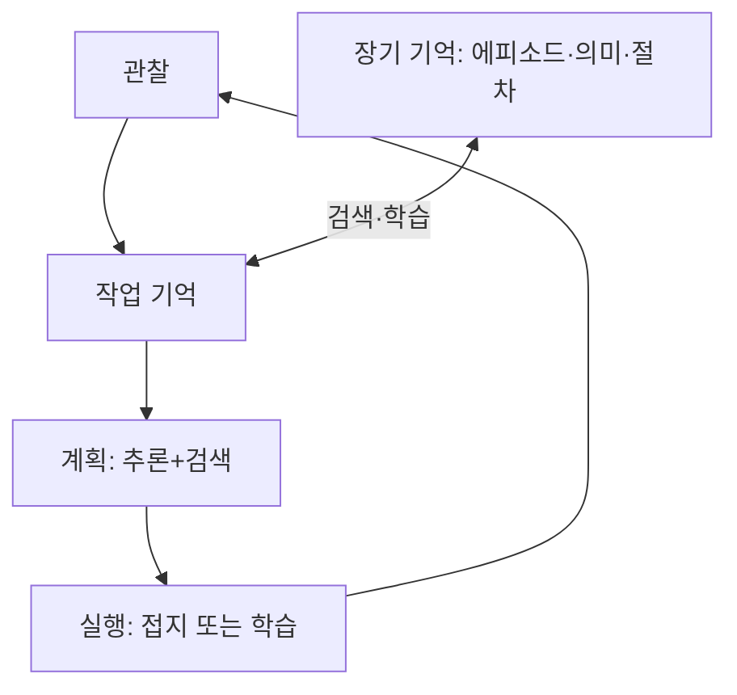
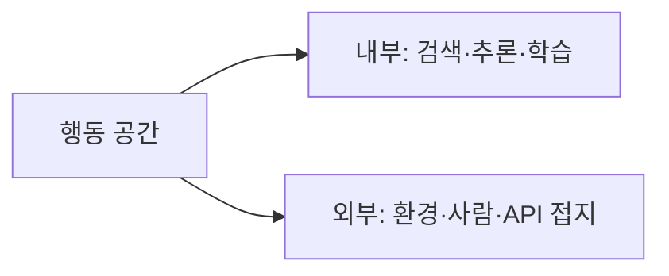

# CoALA

> **CoALA(Cognitive Architectures for Language Agents)** 는 언어 에이전트를 **모듈형 메모리, 내·외부 행동 공간, 의사결정 주기**로 정리하는 개념 틀이다(Sumers 외, arXiv 2309.02427).

## 쉽게 말하면
회사 조직도처럼 "에이전트 안에 무엇이 있고 서로 어떻게 일하는가"를 그린 설계도다. 서로 달라 보이는 에이전트 프로젝트도 이 설계도 위에 올려 놓으면 비교할 수 있다.

## 자세히
(논문 본문 HTML 확인)
- **메모리 모듈**
  - **작업 기억**: 현재 결정 주기에 쓰는 정보(지각 입력, 활성 지식, 목표). LLM 호출 사이에 유지되며 다른 구성요소를 잇는다.
  - **에피소드 기억**: 이전 주기의 경험(과거 상호작용·궤적)을 예시나 맥락으로 꺼내 쓴다.
  - **의미 기억**: 세계와 에이전트 자신에 대한 지식. 외부의 읽기 전용이거나 에이전트가 새로 얻은 지식으로 갱신.
  - **절차 기억**: 노하우. LLM 가중치에 암묵적으로, 코드(추론·검색·접지·학습·결정 절차)에 명시적으로 담긴다.
- **행동 공간**
  - **내부 행동**: 검색(장기→작업 기억 읽기), 추론(LLM으로 작업 기억 읽기·쓰기), 학습(장기 기억 쓰기).
  - **외부 행동**(접지): 물리 환경, 사람·다른 에이전트, API·게임·웹 같은 디지털 환경과 상호작용.
- **의사결정 주기**: **계획**(추론·검색으로 후보 행동 제안·평가·선택, 여러 번 반복 가능) → **실행**(외부 접지 행동 또는 내부 학습 행동) → 관찰 → 반복.

## 그림으로 보기

## 예시
- 코딩 에이전트를 CoALA로 읽기: 작업 기억=현재 컨텍스트, 에피소드=이전 세션 로그, 의미=프로젝트 문서, 절차=시스템 프롬프트와 스킬 파일, 외부 행동=파일 편집·명령 실행.

## 헷갈리는 것과 비교
| 개념 | 차이 |
|---|---|
| CoALA | 에이전트를 기술하는 개념 틀 |
| [메모리 종류](#memory-types) | CoALA의 메모리 구분을 실무에 적용 |
| ReAct 등 프롬프트 패턴 | 틀 안의 구체 구현 |
| [LangGraph 스토어](#langgraph-store) | 장기 기억을 구현하는 도구 |

## 더 읽을거리
- [Cognitive Architectures for Language Agents](https://arxiv.org/abs/2309.02427)
