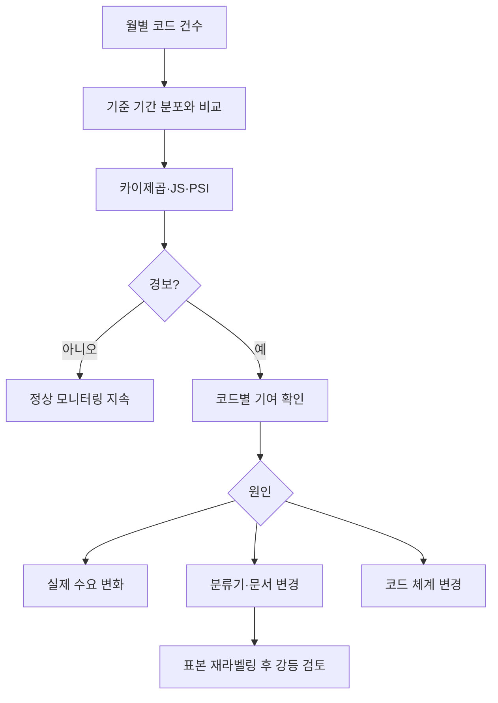

# 코드 분포 감시

> 상담 처리 결과 코드(환불·배송·해지 등)의 **월별·주별 비율 분포가 바뀌었는지** 통계적으로 점검해, AI 분류기의 이상이나 실제 문의 패턴 변화를 일찍 발견하는 감시.

## 쉽게 말하면
평소 "배송 문의 50%, 환불 30%"였는데 이번 달 "배송 43%, 환불 38%"가 되었다면 두 가지 중 하나다. 실제로 환불 문의가 늘었거나, AI가 환불로 분류하는 버릇이 생겼다. 분포를 매달 비교하면 이 변화를 놓치지 않는다.

## 자세히
출처: Evidently 데이터 드리프트 설명 페이지(본문 확인, 2026-11-18). 아래 계산은 가상 데이터로 직접 수행했다.
- **기본 검정(Evidently)**: 기준 데이터 1,000건 이하이면 범주형은 **카이제곱 검정**(이진은 Z 점수 비율 차이 검정), 드리프트 점수는 p값이고 0.05 이하이면 드리프트. 1,000건 초과이면 범주형은 **Jensen–Shannon 발산**, 0.1 이상이면 드리프트.
- **선택 가능한 방법**: PSI, K–L 발산, JS 거리 등. 이 페이지는 PSI의 기본값이나 0.1·0.25 같은 관습 임계값을 제시하지 않았다(그 관습은 다른 문헌에서 오는 것이며 여기서 확인한 것이 아니다).
- **데이터셋 수준 판정**: 컬럼별 검정 결과를 모아 예를 들어 "50% 이상의 특징이 드리프트하면 데이터셋 드리프트"로 선언하는 규칙을 예로 든다. 기본 비율은 명시되지 않았다.
- **직접 계산(가상)**: 코드 4개(배송·환불·계정·기타), 지난달 500·300·150·50건, 이번 달 430·380·140·50건.
  - 카이제곱 검정: χ²≈15.03, 자유도 3, p≈0.0018 → 분포 변화 유의.
  - PSI≈0.030, JS 발산≈0.0038(제곱근인 JS 거리≈0.061).
  → **지표에 따라 결론이 갈린다.** 카이제곱은 변화를 잡았지만 JS 거리는 0.1 미만이고 PSI도 작다. 표본 수와 지표 선택이 결과를 좌우한다는 점을 보여 준다.
- **운영 방법(제안)**: ①기준 기간 고정(예: 직전 3개월) ②월별 + 주별 검정, 지표 두 개 이상 병행 ③코드별 기여도(어느 코드가 많이 변했나) 표시 ④경보 시 원인 분기: 실제 수요 변화(캠페인·장애) vs 분류기 변화(모델·프롬프트·문서 변경) vs 코드 체계 변경 ⑤샘플을 사람이 재라벨링해 확인.
- **한계**: 분포가 같아도 개별 건의 분류가 틀릴 수 있다(오류가 서로 상쇄). 분포 감시는 정확도 검사를 대체하지 못하고 보완한다. 신규 코드가 추가되면 기준이 깨진다([처리 결과 코드 설계](#disposition-code-design)).

## 그림으로 보기


## 예시
```python
from scipy.stats import chi2_contingency
last = [500, 300, 150, 50]
this = [430, 380, 140, 50]
chi, p, dof, _ = chi2_contingency([last, this])   # p ≈ 0.0018
```
교육 활용: 상담 분류 대시보드에 "전월 대비 분포 변화 경보"를 추가해 보는 실습.

## 헷갈리는 것과 비교
| 개념 | 차이 |
|---|---|
| 코드 분포 감시 | 코드별 비율의 시간 변화 점검 |
| 정확도 평가 | 개별 건 정답 여부 점검 |
| [강등 트리거](#intent-demotion-triggers) | 오답률 악화 시 자율 단계를 내림 |
| 데이터 드리프트 | 입력·출력 분포 변화 일반 |

## 더 읽을거리
- [Evidently: 데이터 드리프트 탐지](https://docs.evidentlyai.com/metrics/explainer_drift) — 표본 크기별 기본 검정과 임계값
