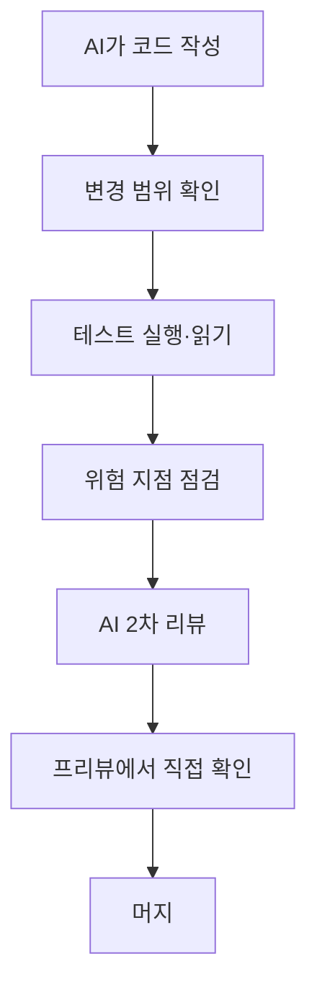

# AI 코드 리뷰 습관

> AI가 쓴 코드는 그럴듯해 보여도 틀릴 수 있으므로, 사람이 "무엇을 어떤 순서로 볼지" 정해 둔 습관으로 검토해야 한다. 핵심은 코드 전체를 읽는 게 아니라 위험한 지점에 시선을 모으는 것이다.

## 쉽게 말하면
신입 직원이 빠르게 써 온 보고서를 검토하는 일과 비슷하다. 문장이 매끄럽다고 숫자가 맞는 건 아니다. 그래서 "숫자·출처·결론" 같은 확인 순서를 정해 두듯, 코드도 "무엇을 바꿨나·테스트는 통과하나·위험한 곳은 어디인가" 순서로 본다.

## 자세히
- **먼저 작게 받기**: PR/변경을 작게 쪼개게 한다. GitHub flow도 커밋 하나에 완결된 변경 하나를 권한다.
- **테스트부터 읽기**: 구현보다 테스트가 요구사항을 말한다. 테스트가 없거나 AI가 테스트를 약하게 고쳤는지 본다. Anthropic은 코딩 에이전트가 테스트 결과로 반복 개선할 수 있다고 하면서도 "사람 검토는 여전히 중요"하다고 한다.
- **위험 지점 체크**: 인증·인가([인증과 인가](#access-control)), 비밀키 하드코딩, 사용자 입력 처리, 결제·삭제 같은 되돌릴 수 없는 동작, 새로 추가된 의존성.
- **요구사항 대조**: 시킨 일만 했는지, 요청 밖의 파일을 건드리지 않았는지 diff 범위를 본다.
- **AI에게 리뷰도 시키기**: 다른 세션·모델로 "버그와 보안 허점만 찾아 줘"라고 시킨 뒤, 지적을 사람이 판정한다. 자기 코드를 자기가 평가하면 관대해지기 쉽다.
- **실행해 보기**: 프리뷰 배포([배포 기초](#deployment-basics))에서 핵심 흐름을 직접 눌러 본다.

## 그림으로 보기

## 예시
리뷰 요청 프롬프트: "이 diff에서 ① 권한 검사 누락 ② 하드코딩된 비밀값 ③ 입력 검증 없는 곳 ④ 요청하지 않은 변경만 목록으로 알려 줘. 없으면 없다고 하고, 추측은 표시해."

## 헷갈리는 것과 비교
| 개념 | 차이 |
| --- | --- |
| 코드 리뷰 | 사람/AI가 변경을 읽고 판단 |
| 테스트 | 기계가 정해진 기준으로 자동 검사 |
| [결정적 피드백](#deterministic-feedback) | 린터·테스트처럼 판정이 흔들리지 않는 신호 |
| 자기 리뷰 vs 교차 리뷰 | 다른 세션이 보면 편향이 줄어듦 |

## 더 읽을거리
- [GitHub flow](https://docs.github.com/en/get-started/using-github/github-flow) — PR·리뷰 절차
- [Anthropic: Building effective agents](https://www.anthropic.com/engineering/building-effective-agents) — 테스트를 근거 신호로 쓰되 사람 검토는 유지
