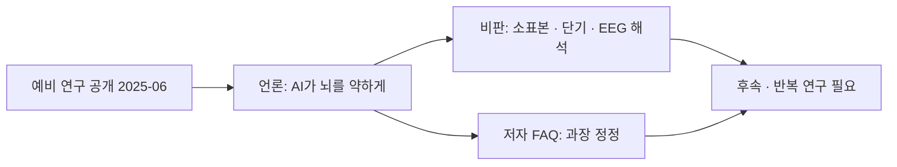

# 인지 부채 논쟁

> 인지 부채 논쟁은 MIT Media Lab의 "Your Brain on ChatGPT"(2025) 예비 연구가 "AI로 쓰면 뇌 활동이 줄어든다"고 보도된 뒤, 연구의 한계와 과장 보도를 둘러싸고 벌어진 논의다.

## 쉽게 말하면
단 한 번 찍은 엑스레이로 "이 사람은 평생 약해진다"고 말하기는 어렵다. 이 연구도 작은 표본의 첫 관찰이어서 큰 결론을 얹기엔 이르다는 반론이 따랐다.

## 자세히
- 설계: 에세이 쓰기에서 ChatGPT·검색엔진·도구 없음 3집단, EEG 측정, 4회 세션. 54명 참가, 4번째(교차) 세션은 18명. 논문은 동료 심사 전 예비 결과로 공개(Kosmyna 주도, 2025-06).
- 주장(저자): AI 집단은 연결성이 낮고 자기 글에 대한 소유감·인용 회상이 낮았다. "인지 부채"는 지금 편한 대가로 나중에 치르는 비용이라는 비유.
- 비판: 표본이 작음, 20분짜리 짧은 과제, 장기 학습·성과는 미측정, EEG 연결성만으로 "부채"와 "도구 제거에 따른 일시적 적응"을 구분하기 어려움.
- 과장 보도: "뇌 썩음" 헤드라인에 저자들이 FAQ로 정정을 요청했고, IQ 측정이 아니었으며 brain rot 근거는 없다고 밝혔다.
- 읽는 법: 방향성 있는 가설로 보고, 인과 증거가 되는 [AI 목발 효과](#ai-as-crutch) 실험(Bastani) 및 상관 연구([인지적 오프로딩](#cognitive-offloading))와 함께 놓고 판단.

## 그림으로 보기

## 예시
교육 자료에서 이 연구를 인용할 때: "예비 결과이며 인과는 불확실하다"를 함께 적고, 헤드라인 대신 한계를 소개.

## 헷갈리는 것과 비교
| 개념 | 차이 |
|---|---|
| 인지 부채 | MIT 연구가 쓴 은유 |
| [AI 목발 효과](#ai-as-crutch) | 시험 성적으로 측정된 무작위 실험 |
| [인지적 오프로딩](#cognitive-offloading) | 상관 설문 연구의 틀 |

## 더 읽을거리
- [The Decoder: MIT study and what it means](https://the-decoder.com/mit-study-shows-cognitive-debt-through-chatgpt-heres-what-it-means-in-real-world-practice/) — 연구 요약과 해석.
- [Axios: AI's great brain-rot experiment](https://www.axios.com/2025/07/02/chatgpt-brain-mit-study-dumber) — 보도와 반응.
- [Your Brain on ChatGPT: Myth or Mechanism? (Substack)](https://mikkelfrimerrasmussen.substack.com/p/your-brain-on-chatgpt-myth-or-mechanism) — 비판적 검토.
