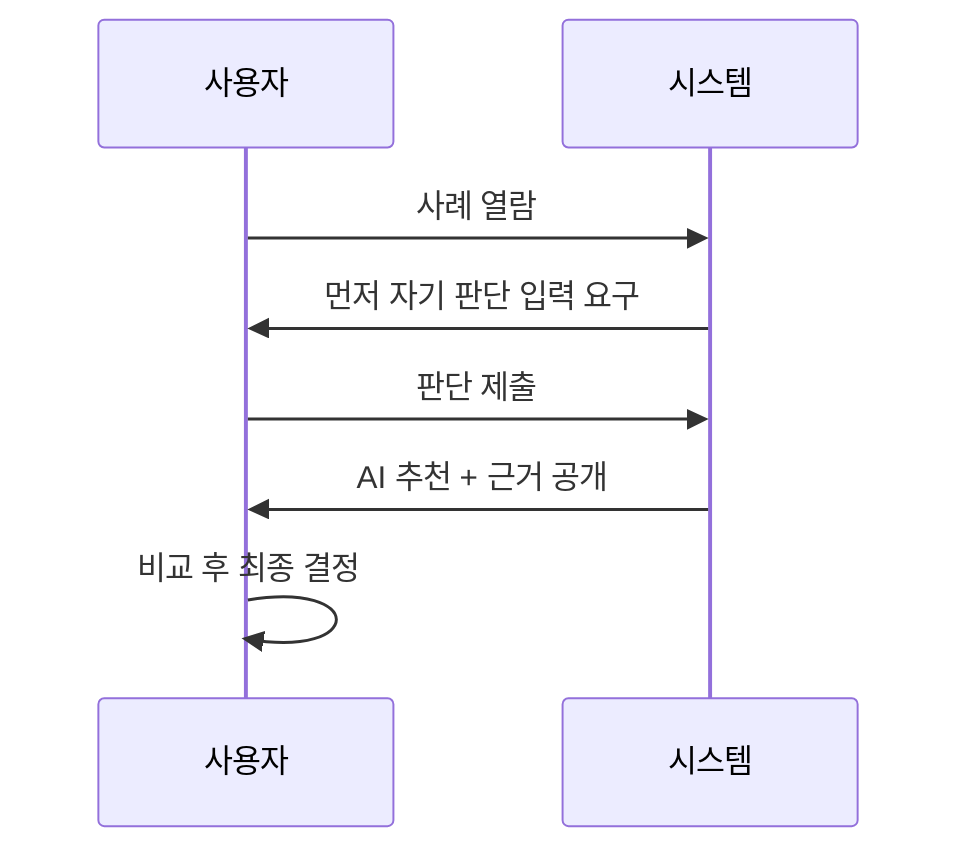

# 인지적 강제 장치

> AI 답을 그냥 받아들이지 못하게, 사용자가 먼저 스스로 생각하거나 잠시 멈추도록 만드는 인터페이스 설계. 과의존을 줄이지만 사용자 만족은 낮아지는 경향이 있다.

## 쉽게 말하면
계산기를 쓰기 전에 "대략 답이 얼마쯤일지 먼저 써 보라"고 시키는 것과 같다. 약간 귀찮지만 숫자가 터무니없는지 알아챌 수 있게 된다.

## 자세히
출처: Buçinca·Malaya·Gajos(CSCW 2021, arXiv 2102.09692) 초록 확인.
- **문제**: AI 보조를 받는 사람은 틀린 추천도 받아들이는 과의존이 흔하고, 설명을 붙여도 해결되지 않거나 더 악화될 수 있다. 이중 처리 이론을 바탕으로, 사람들은 개별 추천·설명을 분석적으로 따지지 않고 "언제 AI를 따를지"에 대한 어림 규칙을 만든다고 설명.
- **개입**: 사용자가 AI 설명에 더 신중하게 관여하도록 하는 세 가지 인지적 강제 장치를 설계.
- **결과(199명 실험)**: 이 설계들이 단순한 설명 방식 두 가지보다 과의존을 유의하게 줄였다.
- **상충**: 과의존을 가장 많이 줄인 설계가 주관적 평가는 가장 낮았다 → 과의존 감소와 선호·신뢰 사이의 긴장.
- **형평성**: 인지 욕구(노력이 드는 사고에 대한 동기)가 높은 참가자가 평균적으로 더 이득을 봤다.
- **설계 패턴 예(일반적 예시, 논문 세 설계의 이름을 확인한 것은 아님)**: AI 추천을 보기 전에 자기 판단 입력, 추천을 일정 시간 뒤에 공개, AI가 추천하기 전에 근거부터 보여 주고 사용자가 결론 선택.
- 관련: [사용자 과의존](#user-overreliance), [설명이 과신을 부르는 문제](#explanations-overreliance).

## 그림으로 보기

## 예시
- 방사선과 판독 도우미: 소견 입력 전에는 AI 결과가 접혀 있고, 사용자가 임상 인상을 기록한 뒤 열린다.
- 대출 심사: 심사역이 승인/거절 초안을 먼저 선택해야 AI 점수가 보인다.

## 헷갈리는 것과 비교
| 개념 | 차이 |
|---|---|
| 인지적 강제 장치 | 숙고를 강제하는 UI |
| 확신도 표시 | 정보 제공 |
| [의도적 마찰](#friction-by-design) | 비슷한 목적의 더 넓은 개념 |

## 더 읽을거리
- [To Trust or to Think](https://arxiv.org/abs/2102.09692) — 인지적 강제 장치 실험(초록 확인)
