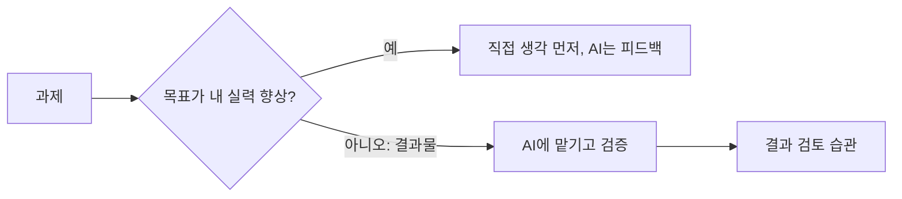

# 인지적 오프로딩

> 인지적 오프로딩은 기억·계산·판단 같은 생각의 일부를 메모, 계산기, 검색, AI 같은 외부 도구에 맡기는 것이다.

## 쉽게 말하면
전화번호를 외우는 대신 연락처 앱에 맡기는 것과 같다. 머리는 편해지지만 번호는 기억에서 사라진다. 일상에선 합리적이어도, 배우려는 능력까지 맡기면 문제다.

## 자세히
- 득: 작업 기억 부담 감소, 더 높은 수준 작업에 집중.
- 실: 맡긴 능력이 약해질 수 있고, 도구 결과를 검증하지 않게 된다.
- Gerlich(Societies, 2025-01): 666명 설문 + 50명 인터뷰에서 AI 도구 사용 빈도와 비판적 사고 점수가 음의 상관, 오프로딩이 매개 요인이었다. 젊은 층이 의존도가 높고 점수가 낮았으며 고학력은 사용과 무관하게 점수가 높았다. 다만 **상관이지 인과가 아니고**(역인과 가능), 측정이 자기보고에 의존한다.
- 판단 기준: 목표가 "결과물"이면 오프로딩 OK, 목표가 "내 실력"이면 제한(→ [AI 목발 효과](#ai-as-crutch)).

## 그림으로 보기

## 예시
- 맡겨도 되는 것: 회의록 정리, 형식 변환.
- 맡기면 곤란한 것: 학습 중인 논증 구성, 내가 책임져야 할 판단의 근거 확인.

## 헷갈리는 것과 비교
| 개념 | 차이 |
|---|---|
| 오프로딩 | 일반적인 외부 위탁 |
| [AI 목발 효과](#ai-as-crutch) | 학습 상황에서 실측된 부작용 |
| [AI 리터러시](#literacy) | 언제 맡기고 언제 검증할지 판단하는 능력 |

## 더 읽을거리
- [PsyPost: AI tools may weaken critical thinking](https://www.psypost.org/ai-tools-may-weaken-critical-thinking-skills-by-encouraging-cognitive-offloading-study-suggests/) — Gerlich 연구 보도.
- [SSRN: AI Tools in Society](https://papers.ssrn.com/abstract=5082524) — 논문 초록.
