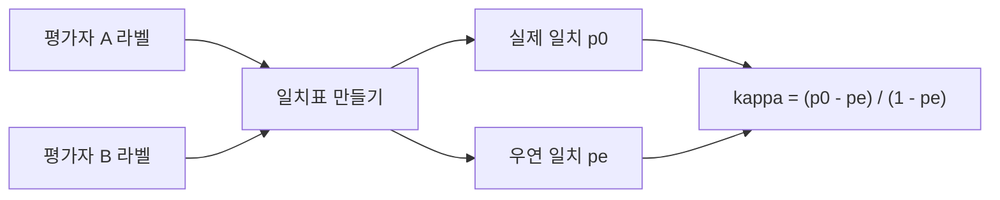

# Cohen's kappa

> 두 평가자(사람 둘, 또는 사람과 LLM 심판)가 같은 항목을 분류했을 때 일치도에서 "우연히 맞을 몫"을 뺀 통계. 1이면 완전 일치, 0이면 우연 수준이다.

## 쉽게 말하면
동전 던지기로 O/X를 정해도 절반은 서로 맞는다. 그래서 "80% 일치"만으로는 대단한지 모른다. kappa는 우연으로도 얻을 일치를 빼고 "그 위에서 얼마나 더 맞았나"만 센다.

## 자세히
- **공식**: κ = (p₀ − pₑ) / (1 − pₑ). p₀는 실제 일치 비율, pₑ는 각 평가자의 라벨 분포에서 우연히 일치할 비율(scikit-learn 문서, Wikipedia 확인).
- **범위**: -1 ~ 1. 1 완전 일치, 0 우연 수준, 음수는 우연보다 못함. 평가자를 바꿔도 값이 같다(대칭).
- **계산 예(위키 예시)**: 50건, 둘 다 Yes 20, A만 Yes 5, B만 Yes 10, 둘 다 No 15 → p₀=0.70, pₑ=0.5×0.6+0.5×0.4=0.50, κ=0.40.
- **scikit-learn**: `cohen_kappa_score(y1, y2)`. 순서 있는 등급(1~5점)이면 `weights="linear"|"quadratic"`로 가까운 불일치를 덜 벌한다. 문서 예시: 5건 중 4건 일치 → κ=0.6875.
- **해석표(Landis-Koch)**: 0~0.20 약함, 0.21~0.40 보통 이하, 0.41~0.60 중간, 0.61~0.80 상당, 0.81~1 거의 완벽. 위키는 이 기준이 저자들의 의견일 뿐 근거가 약하다고 지적한다. 참고용으로만.
- **주의(비판)**: 범주 비율(유병률)에 민감해, 희귀 범주에서는 일치가 높아도 κ가 낮게 나올 수 있다. 같은 60% 일치라도 표에 따라 κ가 0.13 또는 0.26이 된다. 평가자 둘이 다른 비율로 라벨을 붙이면(편향) 값이 달라진다. 그래서 일치율과 κ를 함께 보고한다.
- **평가에서의 쓰임**: LLM 심판이 사람과 얼마나 맞는지 잴 때([LLM 자동 평가](#llm-auto-rater)). 평가자가 셋 이상이면 Fleiss' kappa나 Krippendorff's alpha를 쓴다.

## 그림으로 보기


## 예시
```python
from sklearn.metrics import cohen_kappa_score
human = ["pass","fail","pass","pass","fail"]
judge = ["pass","fail","pass","fail","fail"]
print(cohen_kappa_score(human, judge))  # 0.615...
```
통과/실패 판정이 90% 일치해도 대부분 "통과"인 데이터라면 κ는 낮을 수 있다.

## 헷갈리는 것과 비교
| 개념 | 차이 |
|---|---|
| 일치율 | 우연 포함 |
| Cohen's kappa | 우연 보정, 평가자 2명 |
| Fleiss' kappa | 평가자 3명 이상 |
| [위치 편향](#position-bias-judge) | 심판 신뢰도를 깎는 편향 |

## 더 읽을거리
- [scikit-learn: cohen_kappa_score](https://scikit-learn.org/stable/modules/generated/sklearn.metrics.cohen_kappa_score.html) — 공식·가중치·예시
- [Wikipedia: Cohen's kappa](https://en.wikipedia.org/wiki/Cohen%27s_kappa) — 계산 예, 해석표, 비판
