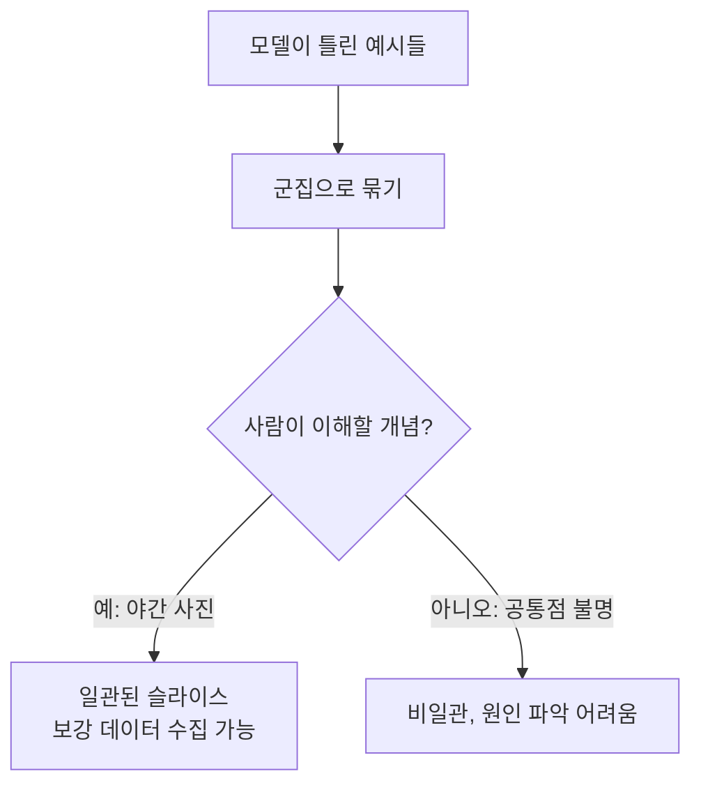
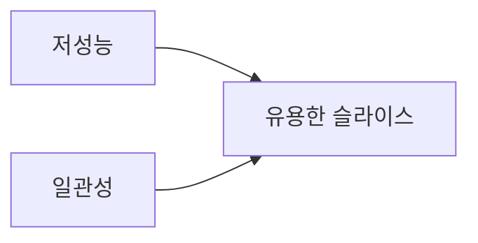

# 일관된 슬라이스

> 일관된(coherent) 슬라이스는 모델이 낮은 성능을 보이는 데이터 부분집합 중에서, 구성 예시들이 **사람이 이해할 수 있는 하나의 개념**("흉관이 보이는 X선", "야간 사진")으로 묶이는 것이다. 단순히 틀린 예시의 군집이 아니라 "설명 가능한" 약점이어야 쓸모가 있다.

## 쉽게 말하면
틀린 문제를 모아 놓고 보니 전부 "분수 나눗셈"이면 일관된 약점이다. 반대로 "3번, 17번, 42번, 59번…"처럼 공통점 없이 모아 놓았다면 숫자는 맞아도 무엇을 공부해야 할지 알 수 없다.

## 자세히
- **정의(Domino 논문, ar5iv 직접 확인)**: 슬라이스는 "속성이나 특성을 공유하는 예시 묶음"이고 서로 겹칠 수 있다. 일관된 슬라이스는 예시가 "사람이 이해하는 개념에 가깝게 정렬된" 슬라이스다. 의미 있는 주석으로 정의한 슬라이스는 구성상 일관되다.
- **왜 중요한가**: 논문은 실용적인 슬라이스 발견법이 도메인 전문가가 이해할 수 있는 일관된 슬라이스를 찾아야 한다고 본다. 정렬이 잘 돼도 사람이 해석하기 어려울 수 있으므로 이상적인 방법은 공유 개념의 **이름**까지 붙여야 한다([Domino 슬라이스 발견](#domino-slice-discovery)).
- **평가 방식**: 1,235개 슬라이스 발견 설정(데이터셋·모델·정답 슬라이스)에서 발견된 슬라이스 함수가 정답 슬라이스를 임계값 β 이상 정밀도로 예측하면 "찾았다"고 본다. 주 지표는 k=10의 precision-at-k.
- **두 조건의 동시 충족**: 저성능(underperforming) + 일관성(coherent). 저성능만 만족하면 노이즈 군집일 수 있고, 일관성만 만족하면 모델이 잘하는 개념일 수 있다.
- **읽는 법(해석)**: 슬라이스를 찾으면 대표 예시 수십 개를 사람이 눈으로 보고 공통 개념을 확인한다. 작은 슬라이스의 점수는 노이즈일 수 있다([슬라이스 표본 크기 주의](#slice-sample-size-caution)).

## 그림으로 보기

## 예시
- 얼굴 인식 모델의 실패가 "측면 얼굴 + 저조도"로 묶인다 → 해당 조건의 데이터를 추가 수집.
- 교육 소재: 같은 오류 예시를 두 가지 묶음으로 나눠 어느 쪽이 설명 가능한지 토론.

## 헷갈리는 것과 비교
| 개념 | 차이 |
|---|---|
| 일관된 슬라이스 | 사람이 이해할 개념으로 설명되는 약점 |
| 오류 군집 | 임베딩상 가깝지만 의미가 불명할 수 있음 |
| [집단별 성능 보고](#subgroup-performance-report) | 미리 정의한 집단 |
| [CheckList 행동 테스트](#checklist-behavioral-testing) | 사람이 설계한 테스트 |

## 더 읽을거리
- [Domino 논문 (ar5iv HTML)](https://ar5iv.labs.arxiv.org/html/2203.14960) — 슬라이스·일관성 정의, 평가 설정(열어 확인, 앞 100,000자).
