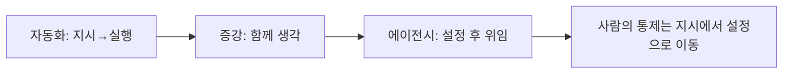
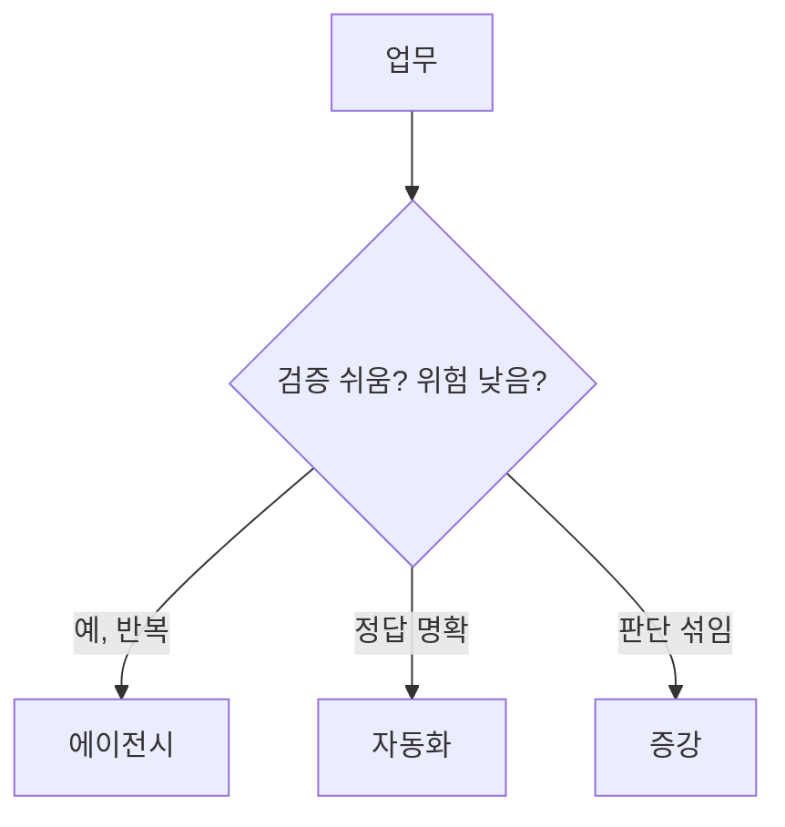

# 협업 모드

> 사람과 AI가 일을 나누는 세 가지 방식: **자동화(Automation), 증강(Augmentation), 에이전시(Agency)**. AI Fluency 프레임워크의 상호작용 모드다. (Anthropic AI Fluency 용어 요약 PDF 열람 2026-11-28)

## 쉽게 말하면
자동화는 "이 일을 이렇게 해 줘"라고 시키는 것, 증강은 함께 머리를 맞대고 주고받는 것, 에이전시는 규칙과 배경을 정해 두고 알아서 하게 맡기는 것이다.

## 자세히
(출처: Dakan·Feller·Anthropic의 AI Fluency 용어 요약, CC BY-NC-SA 4.0.)
- **자동화**: AI가 구체적인 사람의 지시에 따라 구체적 작업을 수행. 사람이 무엇을 할지 정하고 AI가 실행.
- **증강**: 사람과 AI가 **사고 파트너**로 함께 작업. 양쪽이 결과에 기여하는 반복적 주고받기.
- **에이전시**: 사람이 AI를 설정해 **자기 대신 독립적으로 일하게** 함(다른 사람이나 AI와 상호작용 포함). 사람은 정확한 행동이 아니라 AI의 **지식과 행동 패턴**을 정한다.
- 이 모드들은 4D 중 위임(Delegation)의 판단 재료다. 위임은 "무엇을 사람이, 무엇을 AI가 하고 어떻게 나눌지" 결정하는 역량이며 문제 인식·플랫폼 인식·과업 위임으로 나뉜다.
- 선택 기준(내 정리): 정답이 명확하고 검증이 쉬우면 자동화, 창의·판단이 섞이면 증강, 반복 가능하고 위험이 낮으며 점검 장치가 있으면 에이전시. 에이전시일수록 [검증·책임](#task-risk-matrix) 설계가 중요하다.
- 한계: 이 분류는 교육용 프레임워크이며 실제 업무는 한 작업 안에서 모드가 섞인다.

## 그림으로 보기

## 예시
- 자동화: "이 표를 CSV로 변환해 줘." 증강: 기획안을 AI와 번갈아 다듬기. 에이전시: 메일 분류 규칙을 정해 AI 비서가 대신 처리.
- 교육: 수강생이 자기 업무 5개를 세 모드로 분류해 보는 실습.

## 헷갈리는 것과 비교
| 개념 | 차이 |
|---|---|
| 자동화 | 사람이 지시, AI가 실행 |
| 증강 | 함께 생각하는 파트너 |
| 에이전시 | 설정해 두고 독립 수행 |
| [플랫폼 인식](#platform-awareness) | 위임 전 AI의 능력·한계 파악 |

## 더 읽을거리
- [AI Fluency 용어 요약(Anthropic PDF)](https://www-cdn.anthropic.com/4396730ed190e691a3712cf2fd6bfe35509deca2.pdf) — 모드 정의(읽음).
