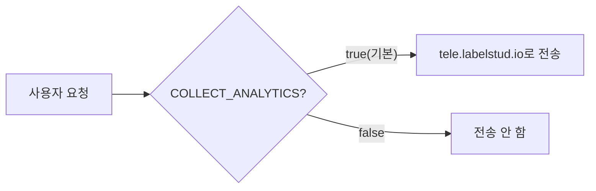
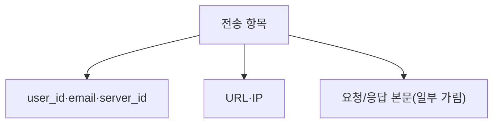

# COLLECT_ANALYTICS 설정

> Label Studio의 사용 통계 전송 스위치다. 기본값이 켜짐(True)이라 사내망에서 쓰려면 환경 변수로 꺼야 한다.

## 쉽게 말하면
앱이 "사용 기록을 제작사에 보내도 되나요?"를 묻지 않고 기본으로 보내도록 되어 있어서, 민감한 데이터를 다루는 팀은 직접 꺼야 한다.

## 자세히
(label-studio 소스 `settings/base.py`와 `core/utils/contextlog.py`를 직접 읽고 확인. 공식 문서의 analytics 페이지는 404라 확인 못 했다. 2026-11-21 기준 develop 브랜치.)
- **기본값**: `COLLECT_ANALYTICS = get_bool_env('COLLECT_ANALYTICS', get_bool_env('collect_analytics', True))` → **기본 True**, 소문자 이름도 허용.
- **끄기**: `COLLECT_ANALYTICS=false`. `contextlog.dont_send()`가 설정이 꺼져 있으면 아무것도 보내지 않는다. 허용되는 false 문자열 목록은 확인하지 못했다.
- **전송 내용(코드 기준)**: `https://tele.labelstud.io`로 POST(백그라운드 스레드, 타임아웃 3초). payload에는 `user_id`, `user_email`, `server_id`(설정 폴더의 UUID), 쿼리 포함 전체 URL, 뷰 이름, 메서드, 세션 ID, 클라이언트 IP, 요청 JSON 본문과 응답(로그인·가입은 가림, 4xx/5xx는 비움), 버전·파이썬 버전·Docker 여부·브라우저/OS가 포함된다.
- **제외**: 테스트 환경에서는 보내지 않고 `DEBUG_CONTEXTLOG`면 대신 로그로 남긴다.
- **함의**: 요청 본문에 업무 데이터가 들어갈 수 있으므로 외부 노출을 막으려면 끄고, 네트워크 격리도 병행한다([라벨링 도구 네트워크 격리](#labeling-tool-network-isolation)).

## 그림으로 보기

## 예시
- docker-compose에서 `environment: - COLLECT_ANALYTICS=false`.
- 교육 활용: "기본값이 켜져 있는 개인정보 설정"을 점검하는 보안 체크리스트 사례.

## 헷갈리는 것과 비교
| 개념 | 차이 |
|---|---|
| COLLECT_ANALYTICS | 제품 사용 통계 전송 스위치 |
| 네트워크 격리 | 외부 연결 자체를 막음 |
| [자체 호스팅 라벨링 개인정보](#self-hosted-labeling-privacy) | 상위 주제 |

## 더 읽을거리
- [label-studio base.py](https://raw.githubusercontent.com/HumanSignal/label-studio/develop/label_studio/core/settings/base.py) — 기본값 정의.
- [label-studio contextlog.py](https://raw.githubusercontent.com/HumanSignal/label-studio/develop/label_studio/core/utils/contextlog.py) — 전송 내용.
