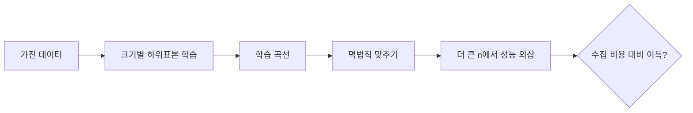
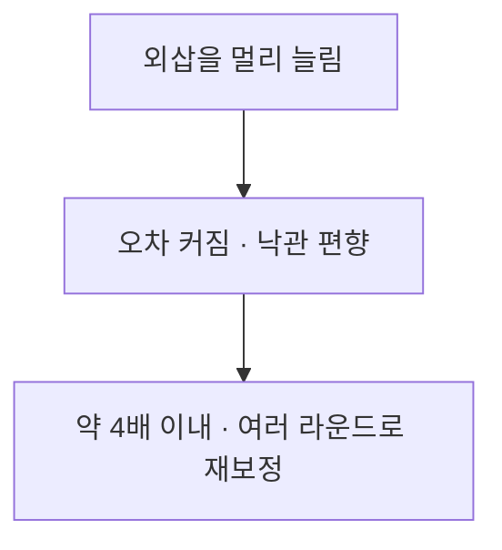

# 추가 수집 효과 외삽

> 데이터를 더 모으면 성능이 얼마나 오를지를, 지금 가진 데이터의 일부(하위표본)로 여러 크기에서 학습해 학습 곡선을 그리고 멱법칙 등으로 연장해 미리 추정하는 방법이다. 모으기 전에 "그만한 값어치가 있는가"를 가늠한다.

## 쉽게 말하면
달리기 기록이 10km→15km 훈련량에 따라 이렇게 줄었으니, 20km를 하면 얼마나 줄지 예상하는 것과 같다. 단, 기록 향상은 점점 둔해지고, 예상선을 너무 멀리 늘리면 틀린다.

## 자세히
(arXiv 2207.01725 초록을 직접 열어 확인, 직접 실험을 실행하고 나머지는 검색 결과 요약.)
- **절차**: ① 가진 데이터를 여러 크기(예: 30·60·120·240)로 하위표본 추출 ② 각 크기에서 학습·평가(시드 여러 번 평균) ③ 오류(n)=a + b·n^(−c) 같은 역멱법칙을 맞춤 ④ 더 큰 n으로 외삽. 검색 결과: Mukherjee 등(2003)의 SUBEX가 대표 방법.
- **논문(Mahmood 등, CVPR 2022)**: 작은 학습 세트로 목표 성능에 필요한 데이터량을 추정하는 문제를 다룬다. 신경 스케일링 법칙의 멱법칙이 검증 성능 곡선은 모델링하지만 필요 데이터량 추정으로 바로 이어지지는 않아, 멱법칙을 일반화한 함수 계열을 연구했고 **보정 계수 조정과 여러 라운드에 걸친 수집이 추정을 크게 개선**한다고 보고(초록).
- **정확도 한계(검색 결과 요약)**: 한 시뮬레이션 연구는 가진 데이터의 약 4배까지는 유용한 정확도로 추정된다고 보고. 클래스당 5샘플 같은 극소 데이터에서는 멱법칙 외삽 오차가 크고, ImageNet 연구에서는 작은 데이터로 외삽하면 함수가 실제 곡선에서 제각각 벗어난다고 한다. 데이터를 더 모아도 성능이 늘지 않는 "나쁜 학습 곡선"도 있다.
- **직접 실험(scikit-learn 1.9.1, 손글씨 숫자 digits, 로지스틱 회귀, 시드 5회 평균)**: 학습 크기 30→0.285, 60→0.183, 120→0.100, 240→0.070, 480→0.048, 720→0.039(시험 오류). 30~240개 점만으로 a+b·n^(−c)를 맞춰 외삽하면 480개에서 0.041(실제 0.048), 720개에서 0.030(실제 0.039). **외삽이 실제보다 낙관적**이었고 1,078개 예측은 0.022(실측 없음). 간단한 한 번의 실험이므로 일반화는 금물.
- **활용 판단(제안)**: 곡선이 평평해지는 구간이면 수집 대신 모델·라벨 품질 개선이 낫다. 약한 슬라이스별로 곡선을 따로 그리면 [목표 데이터 수집](#targeted-data-collection)의 우선순위를 정할 수 있다.
- 연결: [슬라이스 발견](#slice-discovery), [데이터 영향도(Shapley)](#data-influence-shapley), 소표본 평가의 변동 [소규모 데이터 검증 전략](#small-data-validation-strategy).

## 그림으로 보기



## 예시
```python
import numpy as np
from scipy.optimize import curve_fit
f = lambda n, a, b, c: a + b * n ** (-c)
p, _ = curve_fit(f, sizes, errors, p0=[0.02, 2, 0.5], maxfev=20000)
print(f(1000, *p))      # 1,000개일 때 예상 오류
```
- 라벨링 비용이 건당 500원이고 2,000건 추가로 오류가 0.5%p만 줄어든다고 예상되면 투자 대비 효과가 낮다고 판단.

## 헷갈리는 것과 비교
| 개념 | 차이 |
|---|---|
| 추가 수집 효과 외삽 | 하위표본 학습 곡선으로 데이터 증가 효과 예측 |
| 스케일링 법칙 | 대규모 모델·데이터에서의 경험 법칙 |
| [데이터 영향도(Shapley)](#data-influence-shapley) | 기존 샘플 각각의 가치 |
| [슬라이스 발견](#slice-discovery) | 어디를 더 모을지 방향 찾기 |

## 더 읽을거리
- [How Much More Data Do I Need? (arXiv 2207.01725)](https://arxiv.org/abs/2207.01725) — 필요 데이터량 추정·보정 계수(초록 확인).
