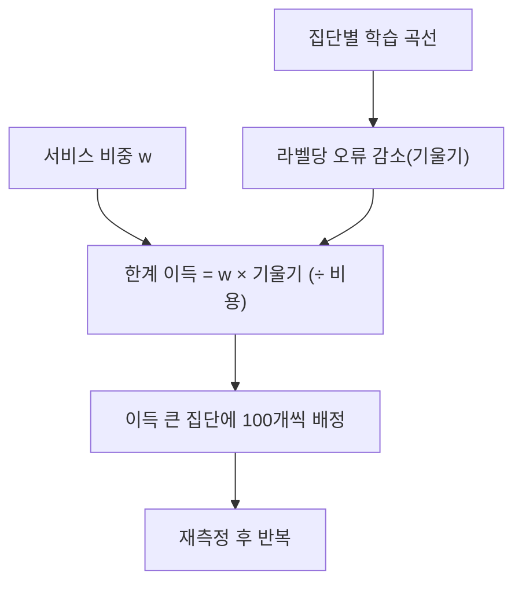

# 집단별 수집 예산 배분

> 라벨링·수집 예산을 집단(슬라이스)에 나눌 때, **각 집단 학습 곡선의 기울기**(라벨 1개당 오류 감소량)와 **서비스에서의 비중**을 곱한 값이 큰 집단부터 채운다. 모든 집단에 똑같이, 또는 트래픽 비율대로 나누는 것보다 효율적일 수 있다.

## 쉽게 말하면
학급에서 보충수업 시간을 정할 때 이미 90점인 반에 시간을 더 주기보다, 한 시간 더 가르칠 때 점수가 가장 많이 오르는 반에 먼저 준다. 학생 수가 많은 반은 가중치를 더 준다.

## 자세히
- **가정과 방법**: 집단 g의 학습 곡선을 ε_g(m) = a·m^(−β) + γ로 두면(집단별 [점근 오류](#asymptotic-error)·지수) 라벨 1개를 더할 때 오류 감소 = −dε/dm = a·β·m^(−β−1). 서비스 비중(트래픽) w_g를 곱해 **기대 전체 오류 감소 = w_g × (감소량)** 이 큰 집단에 라벨을 먼저 배정한다(탐욕적 배분).
- **직접 계산(가상 파라미터, 100개 단위 탐욕 배분)**: 세 집단
  | 집단 | 현재 라벨 수 | 현재 오류 | 라벨 1,000개당 오류 감소(한계) | 트래픽 비중 |
  |---|---|---|---|---|
  | 일반 | 50,000 | 0.0953 | 0.00032 | 80% |
  | 사투리 | 2,000 | 0.3868 | 0.04602 | 10% |
  | 전문용어 | 1,000 | 0.3341 | 0.08772 | 10% |
  (곡선 파라미터: 일반 a=2.0·β=0.35·γ=0.05, 사투리 3.0·0.30·0.08, 전문용어 2.5·0.32·0.06 — 모두 가상.) 라벨 3,000개를 100개 단위로 배분하면:
  | 배분 방식 | 일반 | 사투리 | 전문용어 | 트래픽 가중 평균 오류 |
  |---|---|---|---|---|
  | 현재(배분 전) | - | - | - | 0.1484 |
  | **트래픽 비율대로** | 2,400 | 300 | 300 | 0.1443 |
  | **한계 이득(기울기×비중) 탐욕** | **0** | 1,300 | 1,700 | **0.1366** |
  기울기 기준 배분이 트래픽 비율 배분보다 오류를 **0.1484 → 0.1366**(약 8% 상대 감소)으로 더 줄인다(트래픽 비율 배분은 0.1443, 약 3%). 이미 5만 개가 있는 일반 집단은 라벨을 더해도 거의 안 줄어(한계 0.00032) 배분 0이다.
- **주의 사항**
  1. 공정성·정책 목표: 소수 집단 최소 성능이 요구되면 **하한 제약**(집단별 목표 오류)을 걸고 남는 예산을 한계 이득으로 배분한다([평균 마스킹](#average-masking-weak-groups)).
  2. 곡선 추정이 불확실하면 한 번에 다 쓰지 말고 **단계적으로** 배분하며 매 단계 다시 측정([후속 실측 검증](#follow-up-measurement)).
  3. 작은 집단의 곡선은 점이 적어 불안정하다([슬라이스 검증 표본 크기](#slice-validation-size)).
  4. 수집 비용이 집단마다 다르면 한계 이득을 **비용으로 나눈다**(이득/비용).
- **한계**: 위 수치는 가상 곡선이고 집단 간 전이 학습 효과(한 집단 데이터가 다른 집단을 돕는 효과)를 무시한다.

## 그림으로 보기



## 예시
```python
def eps(a, b, g, m): return a * m**(-b) + g
alloc = {k: 0 for k in slices}
for _ in range(30):                                 # 3,000개를 100개씩
    k = max(slices, key=lambda g: w[g] * (eps(*p[g], cur[g]) - eps(*p[g], cur[g] + 100)))
    alloc[k] += 100; cur[k] += 100
```
- 사투리·전문용어 등 소수 집단에 먼저 라벨을 배정하고 일반 집단은 보류.

## 헷갈리는 것과 비교
| 배분 방식 | 장점 | 단점 |
|---|---|---|
| 균등 | 단순 | 비효율 |
| 트래픽 비례 | 서비스 평균에 맞춤 | 소수 집단 방치 |
| 기울기 기반 | 오류 감소 최대 | 곡선 추정 필요 |
| 하한 제약 + 기울기 | 공정성과 효율 | 설계 복잡 |

## 더 읽을거리
- [Deep Learning Scaling is Predictable, Empirically (arXiv 1712.00409)](https://arxiv.org/abs/1712.00409) — 학습 곡선으로 데이터 수집 계획을 세우는 맥락(PDF 본문 확인). 배분 표는 이 글의 가상 파라미터 직접 계산.
