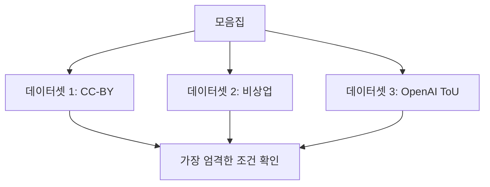
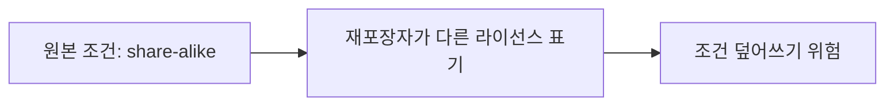

# 데이터 모음집 풀어보기

> 여러 데이터셋을 묶은 모음집(collection)을 하나의 덩어리로 보지 말고, 안에 들어 있는 개별 데이터셋과 원본 출처의 라이선스를 각각 확인하는 절차다.

## 쉽게 말하면
이삿짐 상자 하나에 여러 사람의 물건이 섞여 있을 때, 상자 겉면 이름만 보지 말고 안의 물건마다 주인을 확인하는 일이다.

## 자세히
(Longpre 외 arXiv 2310.16787을 하위 에이전트가 읽은 노트 기준.)
- **문제**: 모음집은 단일 덩어리가 아니라 **출처들의 계보**다. 감사에서 겹치는 모음집은 중복 제거하지 않았다. 재포장자가 원본의 공유 조건(share-alike)을 덮어쓰는 경우가 흔하다.
- **라이선스 요구 비율**: 데이터셋 라이선스의 **85%가 저작자 표시를 요구**하고 **30%가 동일조건변경허락(share-alike)** 을 포함(§3.1). 그림 2 캡션은 73%와 33%로 적어 논문 내부에 불일치가 있다.
- **가장 흔한 라이선스**: CC-BY-SA 4.0 15.7%, OpenAI ToU 12.3%, CC-BY 4.0 11.6%, 맞춤 라이선스 9.6%.
- **합성 데이터**: 비상업·학술 전용 데이터셋의 45.5%가 합성 데이터(상업 허용 12.8%, 미지정 13.6%) — 모델 출력 조건이 얽힌다([합성 데이터와 모델 약관](#synthetic-data-terms)). 약 12%의 데이터셋이 OpenAI로 주석되었다.
- **절차(제안)**: ① 모음집의 구성 데이터셋 목록 확보 ② 데이터셋별 출처·라이선스 표 작성 ③ 가장 엄격한 조건을 모음집 전체 조건으로 취급 ④ 충돌·불명 항목은 사용 제외 또는 확인.

## 그림으로 보기

## 예시
- 인기 지시 데이터 모음집을 쓰기 전 구성 데이터셋 20개의 라이선스 표 작성.
- 교육 활용: 모음집 계보도를 그려 보며 조건 상속 이해.

## 헷갈리는 것과 비교
| 개념 | 차이 |
|---|---|
| 모음집 풀어보기 | 구성 요소별 조건 확인 |
| [출처 단위 제한](#source-level-restrictions) | 출처 층의 조건 |
| 데이터 카드 | 결과를 기록 |

## 더 읽을거리
- [Data Provenance Initiative (arXiv 2310.16787)](https://arxiv.org/abs/2310.16787) — §3.1, 표 3.
