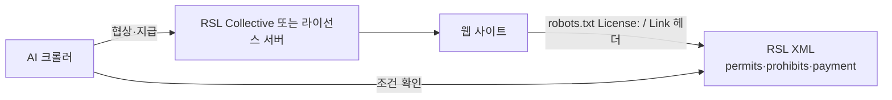
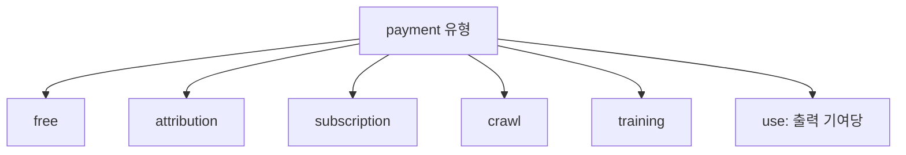

# 집단 라이선스(RSL)

> **RSL(Really Simple Licensing)**은 웹 사이트가 "AI가 내 콘텐츠를 어떤 조건(무료·출처 표기·구독·크롤당·사용당 지급)으로 쓸 수 있는지"를 **기계가 읽는 XML**로 선언하는 개방형 표준이다. 여러 퍼블리셔가 **집단(RSL Collective)**으로 묶어 협상하는 구조와 함께 제안됐다.

## 쉽게 말하면
robots.txt가 "들어오지 마세요/들어와도 됩니다"만 말했다면, RSL은 "들어오려면 이런 값을 내세요"라는 **가격표**를 문 앞에 붙이는 것이다. 작은 가게 수천 곳이 따로 협상하기 어려우니, 음악 저작권 단체처럼 한곳이 모아서 협상하는 모델도 함께 제시된다.

## 자세히
(출처: RSL 공식 사양 페이지 rslstandard.org/rsl를 WebFetch로 확인(앞 10만 자만 읽음) + 검색 결과 요약. 집단의 역할은 사양 본문에 없고 검색 결과의 설명에 기반한다.)
- **현황(사양 페이지)**: **RSL 1.0은 2025-12-10자 Recommendation**(RSL-SPEC-1.0)이다. 검색 결과 요약에 따르면 RSL Collective(비영리, 전 Ask.com CEO Doug Leeds와 RSS 공동 창시자 Eckart Walther 주도)가 2025-09-10에 처음 발표했고, 출시 때 Reddit·Yahoo·Medium·Quora 등이 참여했다(검색 보도, 직접 확인 안 함).
- **구성(사양)**: XML 문서의 루트는 `<rsl>`. 핵심 요소: `<content>`(자원 URL, 선택적 license server), `<license>`(조건), `<permits>`(허용: ai-train·ai-input·search 등 사용 유형, 사용자 계층, 지역), `<prohibits>`(금지: **금지가 허용보다 우선**), `<payment>`(보상).
- **발견 방법(사양)**: robots.txt의 `License:` 지시어, HTTP `Link` 헤더(`rel="license"`, `application/rsl+xml`), HTML `<link>`, RSS `<rsl:content>`, EPUB 같은 파일 메타데이터.
- **지급 유형(사양)**: `purchase`, `subscription`, `training`, `crawl`, `use`(AI 출력에 기여할 때마다), `contribution`, `attribution`, `free`. 선택 확장으로 라이선스 서버(OLP), 크롤러 인증(CAP), 암호화(EMS).
- **집단 역할(검색 보도 요약)**: RSL을 따르는 크롤러는 RSL Collective와 로열티를 협상한다. 한 독일 보도는 **RSL 자체가 크롤러를 기술적으로 막지는 못하며** Cloudflare·Akamai 같은 지지자와 AI 기업의 준수에 의존한다고 지적했다.
- **한계(해석)**: 표준은 "선언"이지 "집행"이 아니다. AI 기업이 따르지 않으면 효력이 계약·소송에 의존한다.

## 그림으로 보기

## 예시
- 블로그 robots.txt에 `License: https://example.com/license.xml`을 두고 XML에서 `ai-train`은 금지, `search`는 허용, `ai-input`은 `use` 지급 조건으로 선언.
- 교육 활동: 우리 회사 콘텐츠 3종에 permits/prohibits를 정해 보고 어떤 지급 유형이 맞는지 토론.

## 헷갈리는 것과 비교
| 개념 | 차이 |
|---|---|
| RSL | 조건·가격을 기계가 읽게 선언 |
| robots.txt | 접근 허용/차단만 말함 |
| [AI 콘텐츠 라이선스 계약](#ai-content-licensing-deals) | 개별 협상 계약 |
| [사용량 기반 라이선스](#usage-based-ai-licensing) | 크롤·추론 단위 과금 방식 자체 |

## 더 읽을거리
- [RSL 1.0 사양 (rslstandard.org)](https://rslstandard.org/rsl) — XML 요소, 발견 방법, 지급 유형, 2025-12-10 Recommendation(앞 10만 자 확인).
