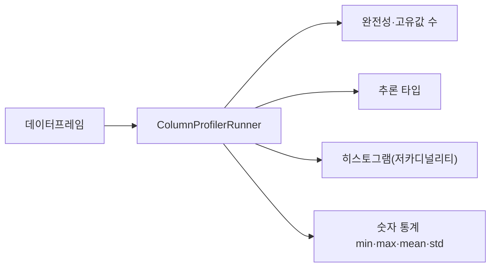
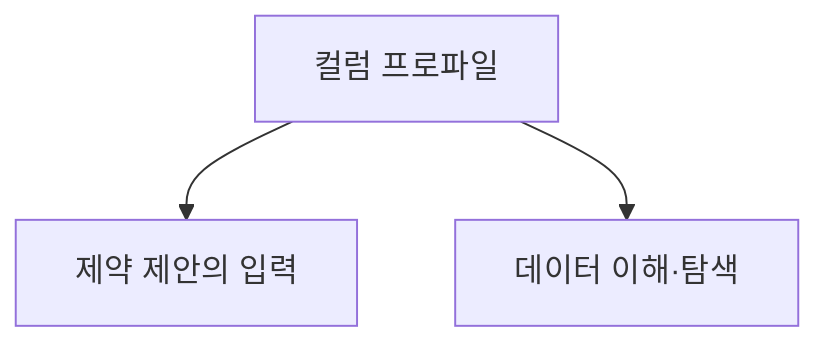

# 컬럼 프로파일

> **컬럼 프로파일(column profile)**은 데이터프레임의 **컬럼마다 완전성·고유값 수·추론한 데이터 타입·분포·(숫자일 때) 최솟값·최댓값·평균·표준편차**를 한 번에 요약한 것이다. Deequ의 제약 자동 제안이 바로 이 프로파일을 바탕으로 규칙 후보를 만든다.

## 쉽게 말하면
처음 받은 엑셀을 열자마자 각 열 위에 "비어 있는 칸 25%, 서로 다른 값 5종, 숫자형, 최소 1~최대 20" 같은 요약 라벨을 붙여 주는 건강검진표다. 규칙을 쓰기 전에 데이터의 모양을 파악하는 출발점이다.

## 자세히
(Deequ 저장소의 데이터 프로파일링 예제 문서(`data_profiling_example.md`)를 WebFetch로 직접 확인. Deequ를 직접 실행하지는 않았다. 아래 수치는 문서의 장난감 데이터 예시다.)
- **실행(문서)**: `ColumnProfilerRunner().onData(df).run()`. 데이터를 **세 번 훑고 셔플을 피해 대용량에도 확장**된다고 설명한다. 결과의 `profiles` 맵에 컬럼별 프로파일이 들어 있다.
- **프로파일 내용(문서)**
  - **완전성**: null이 아닌 값의 비율
  - **근사 고유값 수**
  - **추론한 데이터 타입**: String·Fractional·Boolean 등. 입력이 모두 문자열이어도 **숫자·불리언을 감지**한다(`totalNumber`는 Fractional, `valuable`은 Boolean)
  - **히스토그램**: 고유값이 적은 컬럼은 전체 분포(절대 건수와 비율)
  - **숫자 통계**: 숫자 컬럼은 `NumericColumnProfile`로 변환해 최솟값·최댓값·평균·표준편차를 읽는다(문서는 합계를 언급하지 않는다).
- **예시 값(문서)**
  | 컬럼 | 값 |
  |---|---|
  | `totalNumber` | 완전성 0.75, 고유값 5, Fractional, 최소 1.0, 최대 20.0, 평균 8.25, 표준편차 약 7.28 |
  | `status` 히스토그램 | DELAYED 4건(0.5), IN_TRANSIT 2건(0.25), UNKNOWN 2건(0.25) |
  | `valuable` | 완전성 0.625, Boolean |
- **제안과의 연결(문서)**: 제약 제안 예제에서 `suggestionResult.columnProfiles`로 같은 프로파일을 읽을 수 있다. → [제약 자동 제안](#constraint-suggestion)
- **해석**: 프로파일은 **지금 데이터의 스냅샷**이다. 결측 25%가 정상인지는 업무 지식이 알려 준다. → [자동 제안 사람 검토](#suggestion-human-review)
- **한계**: 문서의 단일 컬럼 프로파일만 확인했다. 컬럼 간 관계(상관·참조 무결성)는 포함하지 않는다(해석).

## 그림으로 보기

## 예시
- 주문 테이블을 프로파일링해 `status`가 3종뿐이고 `amount` 최솟값이 음수임을 발견 → 규칙 설계에 반영.
- 교육 활동: 10행 표에서 컬럼별 완전성·고유값 수·최소·최대를 직접 계산해 프로파일 표 만들기.

## 헷갈리는 것과 비교
| 개념 | 차이 |
|---|---|
| 컬럼 프로파일 | 컬럼별 통계 요약(스냅샷) |
| 제약 제안 | 프로파일에서 만든 규칙 후보 |
| [Facets Overview](#facets-overview) | 비슷한 요약을 시각화로 비교 |
| [품질 지표 저장소](#data-quality-metrics-repository) | 지표를 시간별로 저장·비교 |

## 더 읽을거리
- [Deequ data profiling 예제](https://github.com/awslabs/deequ/blob/master/src/main/scala/com/amazon/deequ/examples/data_profiling_example.md) — 프로파일 항목, 타입 추론, 예시 수치(직접 확인).
