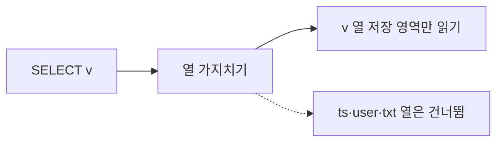
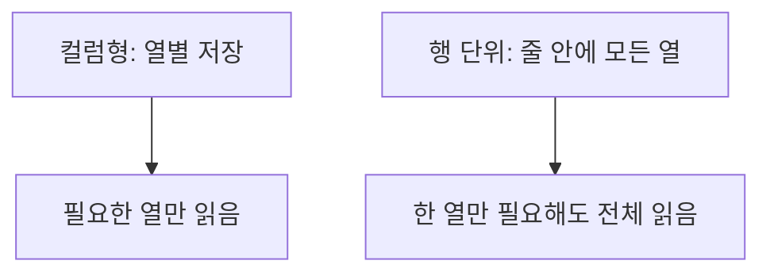

# 열 가지치기

> 질의에 필요한 **열만 읽고 나머지 열은 아예 읽지 않는** 최적화다. 열 단위로 저장하는 Parquet 같은 컬럼형 포맷에서 가능하며, 읽는 바이트와 시간이 열 수에 거의 비례해 줄어든다.

## 쉽게 말하면
엑셀 파일에서 "금액" 열만 필요한데 100개 열을 전부 불러오면 낭비다. 컬럼형 포맷은 열마다 따로 저장돼 있어 필요한 열의 서랍만 열면 된다. 반대로 행 단위 포맷(CSV)은 한 줄 안에 모든 열이 섞여 있어 한 열만 필요해도 전체 줄을 읽어야 한다.

## 자세히
(Athena 최적화 문서에서 컬럼형 포맷의 장점을 직접 읽었고, 읽기 시간은 이 세션에서 **pyarrow 26.0.1**로 직접 측정했다. 합성 데이터·한 환경·3회 중 최솟값이라 일반 결론이 아니다.)
- **원리(Athena 문서)**: 컬럼형 포맷(Parquet·ORC)은 데이터를 행이 아니라 열 기준으로 조직해, 질의에 필요한 열만 로드하고, 전체 로드량이 줄며, 같은 열 값이 모여 있어 압축이 잘 되고, 파일 메타데이터로 불필요한 데이터를 건너뛸 수 있다.
- **직접 측정(200만 행 × 4열: `ts` 정수, `user` 정수, `v` 소수, `txt` 20자 문자열, zstd 압축, 행 그룹 20개, 파일 53.2MB)**

| 읽은 열 | 시간(초) |
|---|---|
| 4개 전부 | 0.0636 |
| `ts`, `v` 2개 | 0.0255 |
| `v` 1개 | 0.0109 |

  한 열만 읽으면 전체 대비 약 **5.8배** 빨랐다. 열 개수와 시간이 정확히 비례하진 않는다(고정 비용·열 크기 차이).
- **열마다 크기가 다르다(직접 측정, 첫 행 그룹의 압축 크기)**: `ts` 약 0.30MB, `user` 약 0.36MB, `v` 약 0.95MB, `txt` 약 1.05MB. 큰 열을 피하면 읽는 양이 더 줄어든다. 그래서 `SELECT *`는 가장 큰 열까지 읽게 만든다.
- **코드(pyarrow)**: `pq.read_table(path, columns=["v"])`처럼 열 목록을 주면 해당 열만 읽는다. SQL 엔진에서는 `SELECT v`처럼 필요한 열만 쓰면 옵티마이저가 알아서 가지친다.
- **주의(일반 원칙)**: `SELECT *`, 불필요한 열 조인, 뷰에서 전체 열을 노출하는 습관은 가지치기 이점을 없앤다. 열이 매우 많은 넓은 테이블일수록 효과가 크다.
- **행 단위 포맷과의 비교**: 앞선 [CSV vs Parquet 실험](#csv-vs-parquet-experiment)에서 CSV는 한 열만 필요해도 전체 행을 파싱해야 해 한 열 읽기가 Parquet보다 약 5배 느렸다(별도 측정).

## 그림으로 보기



## 예시
```python
import pyarrow.parquet as pq
pq.read_table("a.parquet")                        # 0.0636초(4열)
pq.read_table("a.parquet", columns=["v"])          # 0.0109초(1열)
```
- 교육 소재: "SELECT *를 쓰면 안 되는 이유"를 열 크기 표로 설명.

## 헷갈리는 것과 비교
| 개념 | 차이 |
|---|---|
| 열 가지치기 | 필요한 열만 읽음(열 방향) |
| 파티션 가지치기 | 필요한 폴더(파티션)만 읽음(행 묶음 방향) |
| [행 그룹 통계](#row-group-statistics) | min/max로 행 그룹을 건너뜀 |
| [CSV vs Parquet 실험](#csv-vs-parquet-experiment) | 형식 자체의 비교 |

## 더 읽을거리
- [Optimize data (AWS Athena)](https://docs.aws.amazon.com/athena/latest/ug/performance-tuning-data-optimization-techniques.html) — 컬럼형 포맷의 장점(직접 읽음).
