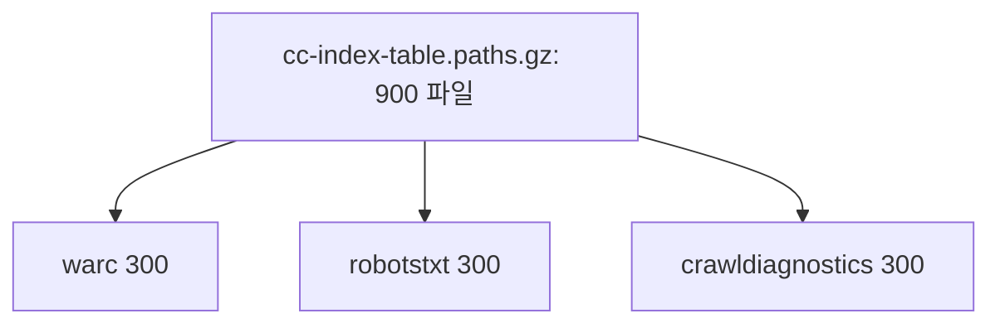

# 열 기반(Parquet) 색인

> Common Crawl은 CDX 텍스트 색인 외에 **Parquet 열 기반 색인 테이블**도 제공한다. 필요한 열(언어·도메인·상태 코드)만 골라 읽어 SQL(Athena·Spark 등)이나 파이썬으로 특정 조건의 페이지를 **WARC 파일 위치까지** 찾을 수 있다.

## 쉽게 말하면
도서관 카드목록을 한 장씩 훑는 대신, "언어 칸"만 따로 모은 표를 열어 한국어 책만 골라내는 것이다. 필요한 칸만 읽으니 빠르고 데이터 양이 적다.

## 자세히
(`data.commoncrawl.org`에서 `CC-MAIN-2024-10` 색인 테이블 목록과 Parquet 파일을 직접 조회·읽음, 2026-11-20)
- **파일 목록**: `crawl-data/CC-MAIN-2024-10/cc-index-table.paths.gz`에 **900줄**(경로)이 있다. 경로는 `cc-index/table/cc-main/warc/crawl=CC-MAIN-2024-10/subset=<종류>/part-NNNNN-….gz.parquet` 형식이고, `subset`은 **warc·robotstxt·crawldiagnostics** 3종이 각각 300개 파일이다([경로 파일](#cc-paths-files)과 같은 방식).
- **파일 하나의 규모**: 첫 `subset=warc` 파일은 약 **1.32GB**, **15,317,210행**, 행 그룹 10개(행 그룹당 약 165만 행).
- **열(일부)**: `url_surtkey`([SURT 키](#surt-key)), `url`, `url_host_name`, `url_host_tld`, `url_host_registered_domain`, `url_host_private_domain`, `url_protocol`, `url_path`, `url_query`, `fetch_time`, `fetch_status`, `content_digest`, `content_mime_type`, `content_mime_detected`, `content_charset`, **`content_languages`**, `content_truncated`, **`warc_filename`, `warc_record_offset`, `warc_record_length`**, `warc_segment`. 마지막 세 열이 있어 조건에 맞는 페이지의 **WARC 파일·바이트 위치**를 곧바로 알 수 있다([범위 요청](#http-range-sampling)으로 해당 레코드만 내려받기).
- **직접 읽기**: HTTP로 Parquet 파일의 필요한 열만 읽는 방식(`pyarrow` + `fsspec`, Parquet 바닥글에서 열 위치를 알아 열 단위로 범위 요청). 첫 행 그룹(1,650,100행)에서 `content_languages`는 `eng` 626,135행, `ell,eng` 553,044행, `ell` 261,996행 등이 상위였고 `kor`을 포함한 행은 **171행**뿐이었다. `fetch_status`는 이 행 그룹 전부 200이었다. 첫 파일의 첫 행 그룹이 SURT 순으로 정렬된 한 구간이라 **전체 크롤의 언어 분포가 아니다**.
- 사용 맥락: Athena(SQL) 쿼리 예: 한국어·`.kr` 도메인 페이지만 선별해 `warc_filename, offset, length`를 뽑고 그 레코드만 받아 코퍼스를 구성(제안, 직접 실행하지 않음). 열 기반이라 `SELECT`한 열만 읽어 비용·시간을 줄인다.
- 주의: 한 파일이 1GB 이상이고 900개 파일이므로 한 번에 읽지 말고 파티션(`crawl`, `subset`)과 열을 제한한다.

## 그림으로 보기



## 예시
```python
import pyarrow.parquet as pq, fsspec
fs = fsspec.filesystem("https")
f = fs.open("https://data.commoncrawl.org/" + path, "rb", block_size=2**20)
t = pq.ParquetFile(f).read_row_group(0, columns=["url", "content_languages"])
```
- 교육: 행 기반 vs 열 기반 저장소의 차이를 설명하는 실제 예.

## 헷갈리는 것과 비교
| 개념 | 차이 |
|---|---|
| CDX 색인 | 텍스트 줄 기반, URL 중심 조회 |
| Parquet 색인 | 열 기반, SQL로 조건 조회 |
| WARC | 실제 원본 응답 데이터 |
| [URL 색인(CDX)](#url-index-cdx) | 상위 개념 노드 |

## 더 읽을거리
- [Common Crawl 데이터 호스트](https://data.commoncrawl.org/) — `cc-index-table.paths.gz`와 Parquet 파일(직접 조회).
