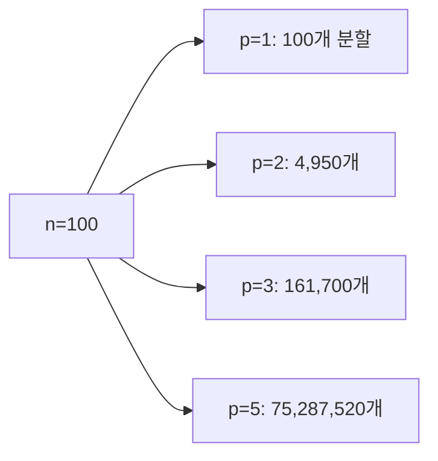
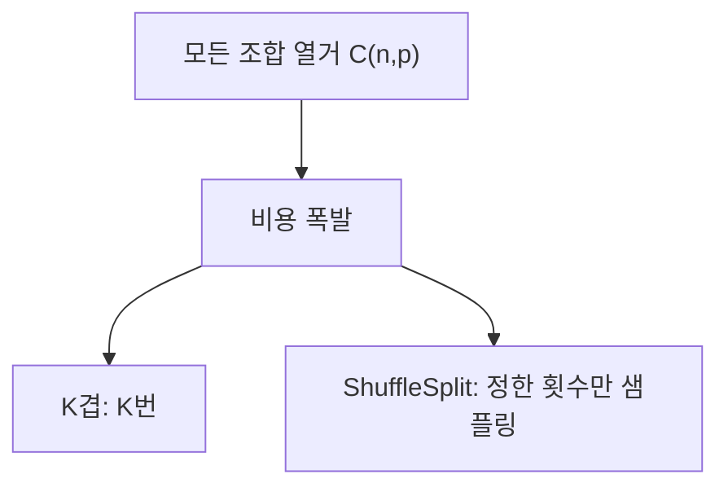

# 교차검증의 조합 폭발

> 모든 가능한 시험 조합을 다 돌리는 교차검증(Leave-P-Out)은 표본 수 n과 뺄 개수 p가 커지면 분할 수 C(n, p)가 폭발적으로 늘어 현실적으로 돌릴 수 없다. 그래서 일부 분할만 무작위로 뽑거나 K겹을 쓴다.

## 쉽게 말하면
학생 100명 중 5명씩 뽑아 시험용으로 삼는 모든 경우를 해 본다면 7천5백만 번이 넘는다. 한 번 학습에 1초가 걸려도 2년이 넘는다. 모든 경우를 해 보는 대신 일부만 무작위로 뽑는 편이 현실적이다.

## 자세히
- **소모적 분할기의 비용(scikit-learn 교차검증 문서, 열람)**: `LeaveOneGroupOut`·`LeavePGroupsOut` 같은 방식은 소모적(exhaustive)이라 비용이 커질 수 있다고 한다. `GroupShuffleSplit`은 모든 분할을 열거하는 것이 너무 비쌀 때 분할을 샘플링하기 위해 쓴다.
- **분할 수 공식(조합 공식)**: n개 중 p개를 시험에 쓰는 경우의 수는 C(n, p) = n! / (p!(n−p)!)이다.
- **직접 계산한 값**: C(20,2)=190, C(100,1)=100, C(100,2)=4,950, C(100,3)=161,700, C(100,5)=75,287,520, C(1000,2)=499,500이다. 표본이 100개일 때 p를 1에서 5로 늘리면 분할 수가 100개에서 7천5백만 개로 늘어난다. 한 번 학습에 1초가 걸린다고 하면 C(100,5)는 약 2.4년(75,287,520초 ÷ 31,536,000초)이다.
- **현실적인 선택(해석)**: ① p=1(Leave-One-Out)은 n번 학습으로 가능하나 n이 크면 느리다 ② K겹은 K번 학습으로 끝나 가장 흔하다 ③ [ShuffleSplit](#shuffle-split)은 지정한 횟수(예: 20~100)만 무작위 분할을 뽑는다 ④ 그룹이 있으면 그룹 단위로 같은 논리를 적용한다.
- **정확성과의 균형(해석)**: 분할을 많이 할수록 평가의 분할 변동이 줄지만 같은 데이터를 재사용하므로 불확실성이 그만큼 줄지는 않는다([층화와 지표 퍼짐](#stratification-metric-spread)).

## 그림으로 보기

## 예시
- 표본 100개에서 Leave-2-Out은 4,950번 학습해야 하므로 학습이 빠른 모델에만 쓰고, 느리면 5겹을 쓴다.
- 교육 활용: 조합 공식으로 분할 수를 계산하는 표를 만들어 보고 학습 시간과 곱해 총 소요 시간을 추정한다.

## 헷갈리는 것과 비교
| 개념 | 차이 |
| --- | --- |
| [Leave-P-out](#leave-p-out) | 상위 주제. 조합 폭발은 그 한계 |
| KFold | K번만 학습. 모든 표본이 정확히 1번 시험 |
| [ShuffleSplit](#shuffle-split) | 조합을 열거하지 않고 샘플링 |

## 더 읽을거리
- [scikit-learn: Cross-validation](https://scikit-learn.org/stable/modules/cross_validation.html) — 소모적 분할기와 샘플링 대안
