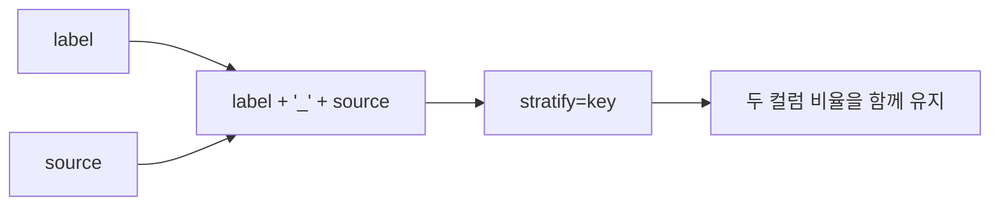
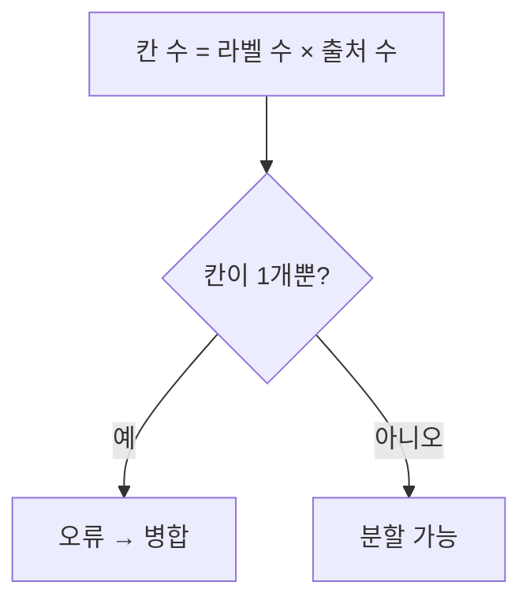

# 조합 키 만들기

> 조합 키는 라벨과 출처 같은 여러 컬럼 값을 이어 붙여(`A_web`) 하나의 문자열 컬럼으로 만들고, 그 컬럼으로 `stratify`해 두 컬럼의 비율을 동시에 맞추는 방법이다.

## 쉽게 말하면
학생을 "학년"과 "반" 두 기준으로 동시에 골고루 뽑고 싶다면 "1학년-A반", "1학년-B반"처럼 이름표를 합쳐 붙이고 그 이름표별로 비율대로 뽑으면 된다.

## 자세히
- **방법(직접 실행, scikit-learn 1.9.1, 가상 400건: 라벨 A/B/C 비율 6:3:1, 출처 web/app/call/store 비율 5:3:1.5:0.5)**: `df["key"] = df.label + "_" + df.source`로 12개 칸(셀)을 만들고 `train_test_split(df, test_size=0.25, stratify=df.key)`를 호출했다. 가장 작은 칸의 샘플 수는 3개였고 분할이 통과했다.
- **효과(출처 비율의 테스트 세트 값)**:

| 분할 기준 | web | app | call | store |
| --- | --- | --- | --- | --- |
| 전체 | 0.500 | 0.315 | 0.135 | 0.050 |
| 라벨만 층화 | 0.510 | 0.330 | 0.110 | 0.050 |
| 조합 키 층화 | 0.500 | 0.310 | 0.140 | 0.050 |

  라벨만 층화하면 출처 비율이 약간 어긋나(call 0.135 → 0.110), 조합 키로 층화하면 전체 비율과 거의 같다. 이 차이는 이 데이터에서 크지 않으며 샘플이 적고 칸이 많을수록 커진다. (한 번의 가상 실험이다.)
- **주의(직접 확인)**: 조합 키의 어떤 칸이 1개뿐이면 `The least populated classes in y have only 1 member`라는 오류가 난다(층화는 칸마다 최소 2개 필요, [test_size와 클래스 수 규칙](#stratify-test-size-rule)). 컬럼이 늘수록 칸 수가 곱으로 늘어 비는 칸이 생긴다.
- **대응(해석)**: ① 값이 많은 컬럼은 묶어서 칸 수를 줄인다([값이 많은 컬럼 묶기](#bin-high-cardinality-columns)) ② 작은 칸은 "기타"로 병합([희귀 클래스 병합](#merge-rare-classes)) ③ 라벨이 여러 개인 데이터는 전용 알고리즘([Iterative stratification](#iterative-stratification)) ④ 조합 키를 만들기 전에 `value_counts()`로 칸별 개수 확인.

## 그림으로 보기



## 예시
```python
df["key"] = df["label"] + "_" + df["source"]
print(df["key"].value_counts().min())   # 최소 칸 크기 확인
train, test = train_test_split(df, test_size=0.25, stratify=df["key"], random_state=0)
```
- 교육 활용: 칸 수를 늘려 가며 분할이 실패하는 지점을 찾는다.

## 헷갈리는 것과 비교
| 개념 | 차이 |
| --- | --- |
| 조합 키 층화 | 두 컬럼 비율을 동시에 유지 |
| 라벨만 층화 | 다른 컬럼 비율은 우연에 맡김 |
| [값이 많은 컬럼 묶기](#bin-high-cardinality-columns) | 칸 수를 줄이는 방법 |
| [Iterative stratification](#iterative-stratification) | 멀티라벨용 |

## 더 읽을거리
- [scikit-learn Cross-validation 가이드](https://scikit-learn.org/stable/modules/cross_validation.html) — 층화 분할기
