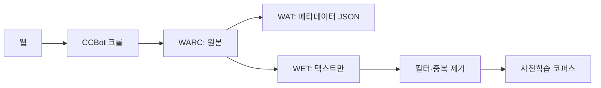
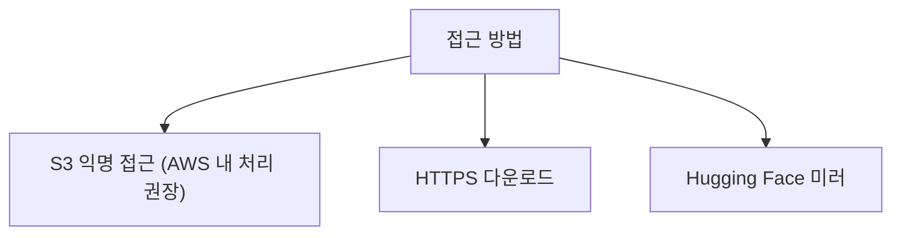

# Common Crawl

> 2008년부터 웹 페이지를 정기적으로 수집해 공개하는 대규모 웹 아카이브다. 많은 공개 언어 모델 학습 데이터(C4, FineWeb 등)의 원천이다.

## 쉽게 말하면
인터넷 전체를 정기적으로 찍은 거대한 사진첩이다. 누구나 무료로 열람할 수 있어서, 언어 모델을 만들려는 사람들이 "읽을 글" 재료로 이 사진첩에서 글을 뽑아 쓴다. 다만 사진첩에는 광고, 중복, 잡글도 그대로 찍혀 있어 걸러야 한다.

## 자세히
(공식 사이트 개요·시작하기 페이지를 직접 열어 확인.)
- **규모와 주기**: 코퍼스는 2008년부터 정기 수집한 페타바이트 규모. 크롤은 `CC-MAIN-2026-43` 같은 회차 이름을 갖고 2026년에만 10회가 색인에 있다(2026-11 확인) — 몇 주마다 새 크롤이 나온다.
- **내용**: 원본 웹 페이지 데이터, 메타데이터 추출물, 텍스트 추출물.
- **파일 형식(시작하기 페이지)**: **WARC** = 원본 크롤(HTTP 응답·요청·메타데이터). **WAT**(Web Archive Transformation) = WARC 레코드의 메타데이터(HTTP 헤더·링크 등)를 JSON으로. **WET**(WARC Encapsulated Text) = 추출한 일반 텍스트만.
- **접근**: S3 `s3://commoncrawl/`(us-east-1)에 익명 접근(`aws --no-sign-request s3 cp`). AWS 안에서 처리하면 빠르고 전송비가 없다. 또는 `https://data.commoncrawl.org/` 경로로 wget·cURL 다운로드(AWS 계정 불필요). 일부 크롤은 Hugging Face 저장소에도 미러링. URL 색인(CDXJ)으로 검색한다.
- **옵트아웃**: 사이트 운영자를 위한 Opt-Out Ledger와 CCBot 안내 페이지가 있다. 이번에 열어 본 페이지에는 robots.txt 정책 세부가 없었다.
- **LLM과의 관계**: 이 개요 페이지는 LLM 학습을 언급하지 않는다. "대부분의 공개 사전학습 코퍼스가 Common Crawl에서 나온다"는 것은 FineWeb 논문과 비교 글 쪽 설명이다([학습 데이터 기초](#training-data-basics)).
- **한계(일반적)**: 원본 그대로는 품질이 고르지 않아 텍스트 추출·언어 판별·품질 필터·[근접 중복 제거](#near-duplicate-removal)를 거쳐야 쓸 만하다. 저작권·개인정보 이슈도 따라온다([데이터 라이선스와 출처](#data-licensing-provenance)).

## 그림으로 보기



## 예시
```bash
# 공식 안내의 접근 방식 (경로는 크롤 회차에 따라 다름)
aws s3 cp --no-sign-request s3://commoncrawl/ . --recursive --exclude "*" --include "<일부 경로>"
```
교육 소재: "내 블로그가 이 사진첩에 있는지"를 URL 색인으로 검색해 보는 실습.

## 헷갈리는 것과 비교
| 개념 | 차이 |
|---|---|
| Common Crawl | 원천 웹 아카이브(비영리 공개 크롤) |
| [FineWeb](#fineweb) | Common Crawl을 걸러 만든 정제 코퍼스 |
| C4 | Common Crawl 기반 정제 코퍼스(휴리스틱 필터) |
| 검색엔진 색인 | 검색용, Common Crawl은 연구·학습용 원본 공개 |

## 더 읽을거리
- [Common Crawl 개요](https://commoncrawl.org/overview) — 규모·내용·접근(직접 열어 확인).
- [Common Crawl 시작하기](https://commoncrawl.org/get-started) — WARC·WAT·WET와 S3·HTTPS 접근(직접 열어 확인).
