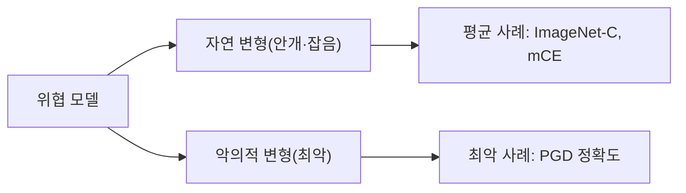
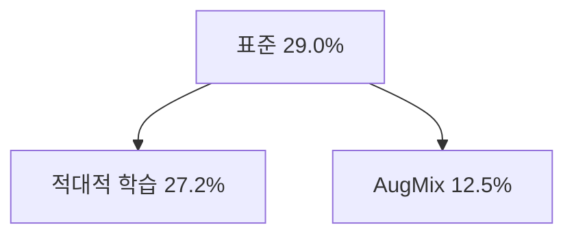

# 흔한 손상 vs 적대적 견고성

> 안개·잡음 같은 자연스러운 변형에 대한 견고성(평균 사례)과 최악의 악의적 변형에 대한 견고성(최악 사례)은 서로 다른 목표이며, 하나를 개선한다고 다른 하나가 같이 좋아지지는 않는다.

## 쉽게 말하면
비 오는 날 운전을 잘하는 것(흔한 손상)과 누군가 일부러 표지판에 스티커를 붙인 상황에서 운전을 잘하는 것(적대적)은 다른 능력이다.

## 자세히
(Hendrycks & Dietterich arXiv 1903.12261과 AugMix arXiv 1912.02781을 하위 에이전트가 원문으로 읽은 노트 기준.)
- **정의**: 손상 견고성 = E_c P(f(c(x)) = y)(손상 분포 평균, **평균 사례**). 적대적 견고성 = min_{‖δ‖<b} P(f(x+δ) = y)(**최악 사례**). 섭동 견고성은 예측의 안정성.
- **교차 효과**: 논문은 우회 가능한 적대적 방어 ALP가 Tiny ImageNet-P에서 mFP를 41%, mT5D를 40% 줄였다고 보고 — 방어가 뚫려도 안정성에는 도움이 있었다.
- **AugMix 표 1**: CIFAR-10-C 평균 오류 — 표준 29.0%, **적대적 학습 27.2%**, AugMix 12.5%. 적대적 학습은 흔한 손상 견고성에 거의 도움이 안 됐고 AugMix가 훨씬 낫다.
- **결론(제안)**: 위협 모델을 먼저 정한다. 센서 잡음·날씨가 문제면 손상 벤치마크(ImageNet-C), 악의적 입력이 문제면 적대적 평가(PGD)를 쓴다. 둘 다 필요하면 각각 측정.

## 그림으로 보기

## 예시
- 공장 카메라 모델은 조명·먼지 변형(손상)으로, 신분증 인식 모델은 위조 공격(적대적)으로 각각 평가.
- 교육 활용: 위협 모델에 따라 평가가 달라지는 사례 정리.

## 헷갈리는 것과 비교
| 개념 | 차이 |
|---|---|
| 손상 견고성 | 평균 사례, 자연 변형 |
| 적대적 견고성 | 최악 사례, 악의적 변형 |
| [AugMix](#augmix) | 손상 견고성 향상법 |

## 더 읽을거리
- [Benchmarking Neural Network Robustness (arXiv 1903.12261)](https://arxiv.org/abs/1903.12261) — 정의와 ALP 결과.
- [AugMix (arXiv 1912.02781)](https://arxiv.org/abs/1912.02781) — 표 1.
