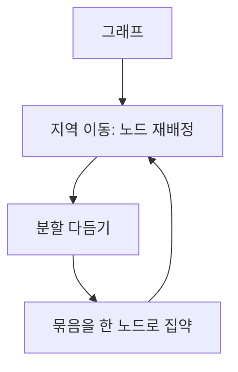
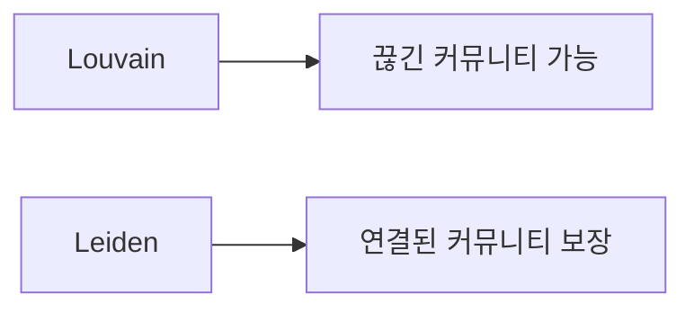

# 커뮤니티 탐지(Leiden)

> 그래프에서 **서로 촘촘히 연결된 노드 묶음(커뮤니티)**을 찾는 알고리즘. Leiden은 Louvain의 약점인 "서로 이어지지 않은 커뮤니티"를 고친 방법이다.

## 쉽게 말하면
학교 친구 관계도에서 "같은 동아리끼리 친한 무리"를 자동으로 나누는 일이다. 잘 나눈 무리는 안에서 서로 이어져 있어야 하는데, 옛 방법은 무리 안에 연결이 끊긴 사람이 섞일 수 있었다.

## 자세히
- 논문: Traag·Waltman·van Eck, *From Louvain to Leiden*(arXiv 1810.08473, 초록 읽음).
- Louvain의 문제: **연결이 부실한 커뮤니티**, 최악에는 **연결이 끊긴 커뮤니티**를 낼 수 있다. 반복 실행하면 더 심해진다. 저자들의 실험에서 **최대 25%의 커뮤니티가 연결이 부실**, **최대 16%가 끊겨** 있었다.
- Leiden의 보장: 커뮤니티가 **항상 연결되어 있음**을 증명했고, 반복 적용하면 각 커뮤니티의 부분집합이 지역적으로 최적 배정된 분할로 수렴한다. 빠른 지역 이동(local move) 방식으로 Louvain보다 빠르고 더 좋은 분할을 찾는다고 보고.
- 지식 그래프에서의 쓰임: GraphRAG 인덱싱 단계가 추출한 개체들에 커뮤니티 탐지를 수행한 뒤, 커뮤니티별 요약·보고서를 여러 수준으로 만든다(문서 열람). 이 문서에 알고리즘 이름은 확인하지 못했으므로 GraphRAG가 Leiden을 쓴다는 설명은 일반 지식이다.
- 한계: 해상도 설정에 따라 묶음 크기가 달라지며, 결과가 항상 사람이 기대하는 "주제"와 일치하지는 않는다(일반 설명).

## 그림으로 보기

## 예시
- 논문 인용 그래프에서 연구 주제 군집 찾기, GraphRAG에서 개체 군집별 요약.
- 교육: 수강생 SNS 관계 데이터를 가상으로 만들어 묶어 보는 실습.

## 헷갈리는 것과 비교
| 개념 | 차이 |
|---|---|
| Leiden | 연결된 커뮤니티 보장 |
| Louvain | 빠르지만 끊긴 커뮤니티 가능 |
| [지식 그래프](#knowledge-graph) | 이 알고리즘이 다루는 데이터 구조 |

## 더 읽을거리
- [From Louvain to Leiden](https://arxiv.org/abs/1810.08473) — 25%·16% 실험(초록 읽음).
- [GraphRAG 인덱싱 개요](https://microsoft.github.io/graphrag/index/overview/) — 커뮤니티 탐지 단계(읽음).
