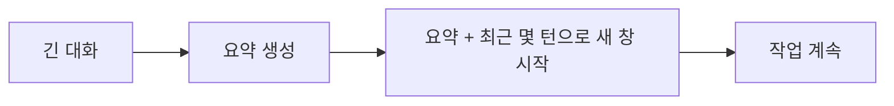
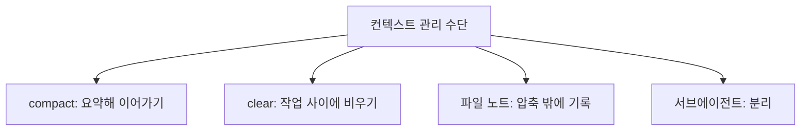

# 압축(compaction)

> 대화가 길어졌을 때 지금까지의 내용을 요약으로 줄여 새 컨텍스트에서 이어 가는 기법. 컨텍스트 창이 차는 것을 막고 불필요한 비용도 줄인다.

## 쉽게 말하면
회의가 세 시간째면 속기록 전체를 다시 읽지 않고 "결정 사항·남은 일" 요약본으로 이어서 회의한다. 요약본에 빠진 내용은 잊히므로 무엇을 남길지가 중요하다.

## 자세히
- **자동 압축**: Claude Code는 대화가 컨텍스트 창을 채우기 전에 자동으로 압축한다. 현재 대부분의 모델이 1M 토큰 창을 쓰고 압축이 그 상단 가까이에서 일어나므로 한도에 막히는 일은 드물다(2026-11 문서).
- **수동 `/compact`와 초점 지정**: `/compact keep the API changes and the test commands`처럼 남길 것을 지정할 수 있다.
- **비용 관점**: 매 요청이 전체 대화를 다시 보내므로 서로 무관한 작업 세 개를 한 세션에 쌓으면 매번 셋 다 다시 읽는다. `/compact` 자체도 전체를 읽어 요약하는 큰 요청이며 캐시가 만료됐다면 더 비싸다. 기록이 필요 없으면 새 세션이 더 싸다.
- **품질 관점**: 길어진 컨텍스트는 정확도가 떨어질 수 있다([컨텍스트 부패](#context-rot)). 압축과 `/clear`로 컨텍스트를 작업 단위로 집중시키면 답이 좋아진다.
- **위험**: 요약이 세부(정확한 명령, 파일 경로, 결정 이유)를 잃을 수 있다. 중요한 결정은 파일(노트·CLAUDE.md)에 따로 기록해 압축에 의존하지 않는다.
- **일반화**: Claude Code뿐 아니라 에이전트 하네스 대부분이 같은 아이디어(오래된 도구 결과 제거, 요약 삽입, 구조화 노트)를 쓴다 — [컨텍스트 엔지니어링](#context-engineering).

## 그림으로 보기

## 예시
- 기능 구현을 끝내고 다른 작업으로 넘어갈 때 `/clear`.
- 긴 디버깅 중간에 `/compact 재현 절차와 가설만 남겨`.
- 중요한 결정은 `NOTES.md`에 적어 두고 새 세션에서 "NOTES.md부터 읽어"라고 시작.

## 헷갈리는 것과 비교
| 개념 | 차이 |
| --- | --- |
| 압축 | 요약해 같은 흐름을 이어감 |
| `/clear` | 기록을 버리고 새로 시작 |
| [프롬프트 캐싱](#prompt-caching) | 같은 접두부 재사용으로 비용 절감 — 압축은 내용을 줄임 |
| [컨텍스트 윈도우](#context-window) | 압축이 지키려는 용량 한도 |

## 더 읽을거리
- [Claude Code: Best practices — 컨텍스트 비용](https://code.claude.com/docs/en/best-practices) — compact·clear·캐시
- [Chroma: Context Rot](https://www.trychroma.com/research/context-rot) — 긴 입력의 성능 저하
