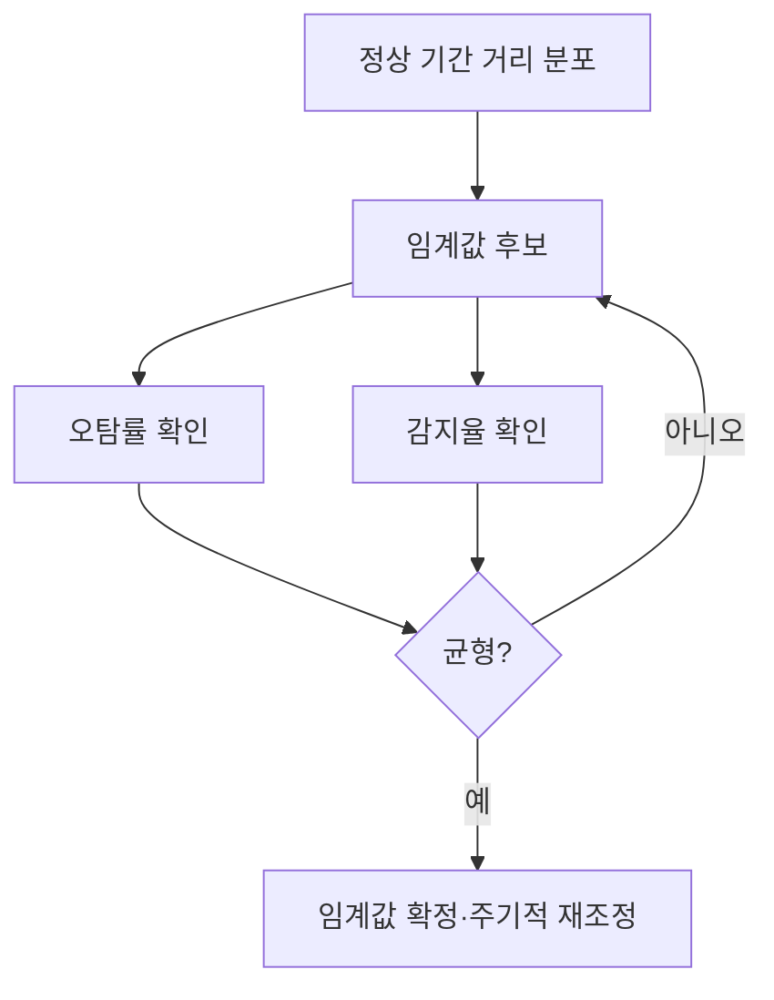

# 비교기 임계값 정하기

> skew·drift 비교기의 임계값을, **아무 일도 없는 정상일에도 거리가 얼마나 흔들리는지** 관찰한 뒤 오탐(헛경보)과 미탐(놓침)의 균형에 맞춰 정하는 일이다. 표본 크기가 작을수록 정상 변동이 커서 같은 임계값이 훨씬 자주 울린다.

## 쉽게 말하면
같은 동전을 100번 던지는 두 사람의 앞면 비율은 서로 조금씩 다르다. "비율 차이가 1%포인트를 넘으면 경보"라고 정하면 동전이 멀쩡해도 경보가 계속 울린다. 경보 기준은 "아무 이상 없을 때 얼마나 흔들리는가"를 먼저 알아야 정할 수 있다.

## 자세히
(TFDV 시작 가이드와 BigQuery 문서에서 L∞·임계값 예를 읽었고, 아래 수치는 이 지도가 **가상 분포를 시뮬레이션**해 직접 계산한 것이다: 시드 5, 조건마다 300회 반복. 현실 데이터의 변동과는 다를 수 있다.)
- **TFDV의 예(문서)**: `infinity_norm.threshold = 0.01`로 `payment_type`의 L∞ 거리가 0.0435984일 때 이상이 보고됐다. 임계값을 어떻게 고르는지에 대한 규칙은 문서에 없다.
- **시뮬레이션 설계**: 범주 4개(`Credit 0.60, Cash 0.30, Prcard 0.01, Other 0.09`)의 **진짜 분포는 항상 같은** 두 날의 표본을 뽑아 L∞를 재고 이를 300회 반복. 하루 표본 수 n=200과 n=2,000 두 경우를 비교했다.
- **정상일의 L∞ 변동(직접 계산)**

  | 하루 표본 수 | 중앙값 | 95번째 백분위 | 최댓값 |
  |---|---|---|---|
  | 200 | 0.0450 | 0.1000 | 0.1450 |
  | 2,000 | 0.0145 | 0.0325 | 0.0415 |

- **임계값별 오탐률(정상일에 경보가 울린 비율)**

  | 임계값 | n=200 | n=2,000 |
  |---|---|---|
  | 0.01 | 98.7% | 71.3% |
  | 0.03 | 75.7% | 6.7% |
  | 0.05 | 40.0% | 0.0% |

  **분포가 전혀 안 변했는데도** 0.01 임계값은 n=200에서 거의 매번, n=2,000에서도 7할 넘게 울렸다. 즉 임계값은 표본 크기에 따라 달라야 한다.
- **미탐 쪽(실제로 Cash가 +0.05 변한 분포로 비교, 직접 계산)**: n=200에서 변화 L∞ 중앙값 0.070, 임계값 0.03이면 **감지율 93%**, 0.05이면 **71%**. n=2,000에서는 중앙값 0.0545, 0.03이면 **100%**, 0.05이면 **71.7%**.
- **해석**: 임계값 0.03은 n=2,000에서 오탐 6.7%·감지 100%로 균형이 좋지만 n=200에서는 오탐 75.7%라 쓸 수 없다. 0.05는 오탐이 적지만 이 크기의 변화(Cash +0.05)는 약 30% 놓친다. **오탐을 줄이면 미탐이 늘어나는 거래**다.
- **정하는 순서(제안, 일반 원칙)**: ① 정상으로 알려진 기간에서 거리의 분포(중앙값·95번째 백분위)를 쌓는다 ② 허용 가능한 오탐률(예: 월 1~2회 경보)과 놓치면 안 되는 최소 변화 크기를 정한다 ③ 그 사이에서 임계값을 고르고 표본 크기가 다른 특징은 따로 정한다 ④ 경보 후 실제 성능 하락과 비교해 주기적으로 재조정한다. 앞선 [허용 편향 기준 정하기](#acceptable-skew-threshold)와 같은 원칙이다.
- **한계**: 위 시뮬레이션은 독립·동일 분포 표본이라는 단순 가정이며 실제 데이터의 요일·계절 패턴이 없다. 숫자는 방법의 시연이지 권장값이 아니다.

## 그림으로 보기



## 예시
```python
import random
def sample(n, probs):
    c = [0]*len(probs)
    for _ in range(n):
        r, acc = random.random(), 0
        for i, p in enumerate(probs):
            acc += p
            if r < acc: c[i] += 1; break
    return [x/n for x in c]
linf = lambda a, b: max(abs(x-y) for x, y in zip(a, b))
# 정상일 거리 분포를 300회 모아 95번째 백분위를 본다
```
- 교육 소재: 동전 던지기로 "정상일의 흔들림"을 체험.

## 헷갈리는 것과 비교
| 개념 | 차이 |
|---|---|
| 임계값 정하기 | 정상 변동·오탐·미탐 균형으로 기준 결정 |
| [허용 편향 기준](#acceptable-skew-threshold) | 같은 문제의 서비스 위험 관점 |
| [L∞ 거리](#l-infinity-norm-categorical) | 이 글에서 쓴 거리 지표 |
| [스팬 기반 검증](#span-based-validation) | 일 단위 비교의 구조 |

## 더 읽을거리
- [Get started with TensorFlow Data Validation](https://www.tensorflow.org/tfx/data_validation/get_started) — L∞ 임계값 예(직접 읽음).
- [ML.TFDV_VALIDATE (BigQuery)](https://docs.cloud.google.com/bigquery/docs/reference/standard-sql/bigqueryml-syntax-tfdv-validate) — 기본 임계값 0.3(직접 읽음).
