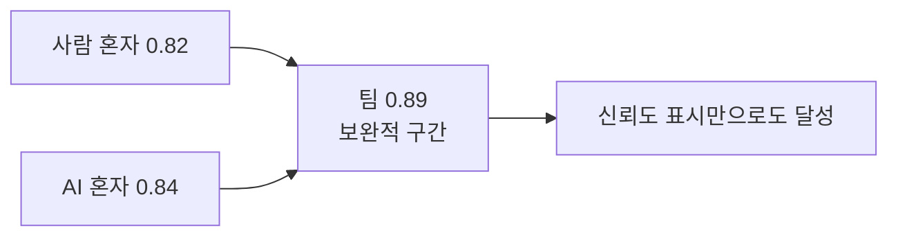
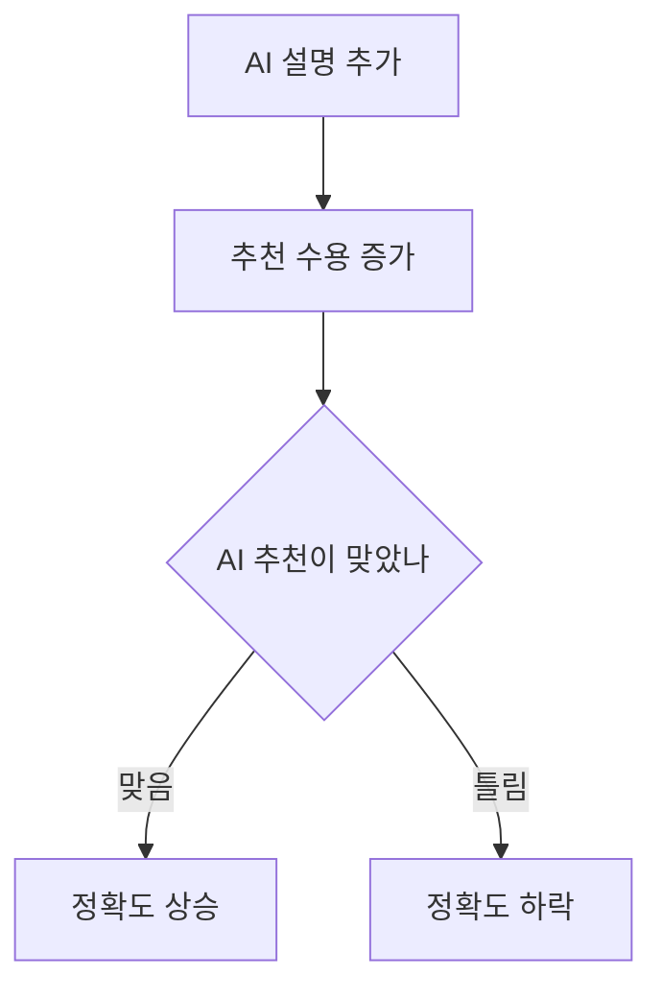

# 보완적 팀 성능

> 사람과 AI가 함께 낸 정확도가 사람 혼자, AI 혼자보다 모두 높은 상태. 직관적으로 당연해 보이지만 많은 연구에서 실제로 관측되지 않았다. Bansal 외(CHI 2021)는 AI와 사람의 정확도를 비슷하게 맞춘 실험에서 이를 관측했지만, 설명을 붙인다고 더 좋아지지는 않았다.

## 쉽게 말하면
수학을 잘하는 사람과 영어를 잘하는 사람이 팀을 이루면 각자 혼자일 때보다 시험을 더 잘 볼 수 있다. 서로의 약점을 채우기 때문이다. 사람과 AI도 그런 상태가 이상적이다. 문제는 AI가 사람보다 훨씬 정확하면 "그냥 AI를 따르는" 것이 가장 낫고, 사람은 방해만 하게 된다는 점이다. 그래서 팀의 이득을 보려면 둘의 실력이 비슷해야 하고 서로 다른 곳에서 틀려야 한다.

## 자세히
출처: Bansal 외 "Does the Whole Exceed its Parts? The Effect of AI Explanations on Complementary Team Performance", CHI 2021, arXiv 2006.14779 본문(직접 읽음). 크라우드 워커 실험이며 전문가 업무에 그대로 일반화할 수 없다.
- **정의**: 팀 정확도 > max(사람 혼자, AI 혼자). 논문은 AI 설명이 이를 가능하게 하는지를 묻는다.
- **선행 연구의 관찰**: 기존 연구는 설명이 팀 성능을 올린다고 보고했지만 이는 대개 사람 혼자일 때만 비교한 것이었고, 팀이 AI 혼자보다 못한 경우도 많았다. 논문의 표 1에 따르면 인용한 연구들에서 보완적 성능이 나타난 사례는 없었다(논문 서술).
- **설계**: AI 정확도를 평균적 사람과 비슷하게 맞춰 보완 여지를 넓혔다. 과제 세 가지 — 맥주 리뷰 감성(Beer, 사람 단독 약 0.82, AI 0.84), 도서 리뷰 감성(Amzbook), LSAT 논리 추론 20문항(특별한 전문지식 불필요). 조건당 참가자 약 100명(93~101), 미국 MTurk 워커, 정답당 보너스를 주고 AI를 맹목적으로 따라서는 보너스 기준(정확도 90% 이상)을 못 넘도록 AI 정확도를 84%로 고정.
- **조건**: 신뢰도만 표시(Team Conf), 최상위 예측 설명(Explain-Top-1), 상위 2개 예측 설명(Explain-Top-2), 신뢰도에 따라 설명을 바꾸는 적응형(Adaptive; 설명 출처는 AI 또는 전문가).
- **결과**
  - 신뢰도만 보여 준 기본 팀 조건이 이미 **세 과제 모두에서 보완적 성능**을 냈다. Beer 팀 정확도 0.89로 AI 0.84, 사람 0.82를 모두 넘었다. Amzbook과 LSAT에서 AI·사람 혼자 대비 상대 이득은 각각 2.2%, 20.1%(논문 문구는 "unassisted workers" 대비).
  - **설명은 추가 이득을 주지 않았다.** Beer에서 Team Conf 0.89 vs Explain-Top-1 0.88(유의하지 않음). 적응형 설명, 전문가가 쓴 설명도 유의한 개선이 없었다.
  - **AI가 맞고 틀림에 따라 갈렸다**: 최상위 설명은 AI가 맞았을 때 정확도를 높였지만 **틀렸을 때는 더 낮췄다**(Beer, LSAT). 설명이 AI 추천의 정답 여부와 무관하게 수용을 늘린다는 해석. 적응형 설명은 AI가 자신 있을 때만 더 따르게 하는 효과가 있었으나 팀 정확도 개선까지는 이어지지 않았다.
- **의미(이 글의 정리)**: 팀 성능 개선은 AI 정확도, 사람 실력, 오류의 독립성, 과제 구조의 조합으로 정해진다. "설명을 붙이면 좋아질 것"이라고 가정하지 말고 보완적 성능 자체를 측정해야 한다.

## 그림으로 보기

## 예시
- 사람 정확도 82%, AI 84%인 감성 분류에서 AI 추천+신뢰도를 보여 주니 팀이 89%에 도달했다(실험 결과).
- 사내 도입 평가: 사람 단독, AI 단독, 사람+AI 세 조건의 정확도를 같은 사례로 비교해야 보완 효과를 알 수 있다(제안).

## 헷갈리는 것과 비교
| 개념 | 차이 |
|---|---|
| 보완적 성능 | 팀 > 사람 단독, 팀 > AI 단독 |
| 단순 향상 | 팀 > 사람 단독이지만 AI 단독보다 낮을 수 있음 |
| [설명이 과신을 부르는 문제](#explanations-overreliance) | 설명이 오류 수용도 늘리는 현상 |
| [인지적 강제 장치](#cognitive-forcing-function) | 설명 대신 사용자의 사고를 유도하는 설계 |

## 더 읽을거리
- [Does the Whole Exceed its Parts? (arXiv 2006.14779)](https://arxiv.org/abs/2006.14779) — 원 논문(본문 직접 읽음)
