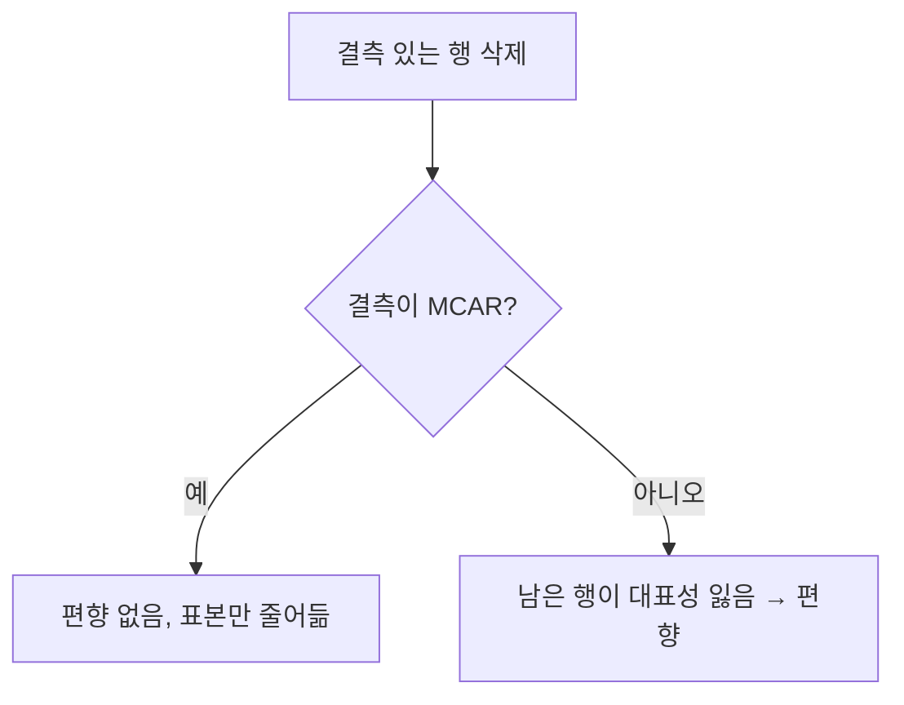
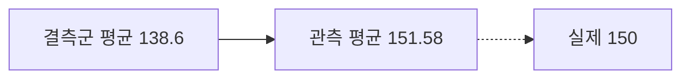

# 완전 사례 분석의 편향

> 결측이 있는 행을 통째로 지우고 남은 완전한 행만 분석하는 방식(listwise deletion)은 결측이 무작위(MCAR)일 때만 편향이 없다. 그렇지 않으면 크게 치우칠 수 있다.

## 쉽게 말하면
설문에서 답을 빠뜨린 사람을 전부 빼면, 빠뜨린 사람들이 특정 부류(예: 고소득자)였을 때 남은 사람들은 전체를 대표하지 못한다.

## 자세히
(van Buuren FIMD 1.3·2.7·3.8절을 하위 에이전트가 원문으로 읽은 노트 기준.)
- **MCAR 아래**: 평균·분산·회귀계수에 편향이 없다. 표준오차는 남은 부분집합 기준으로는 맞지만 전체 기준으로는 커진다(정보 손실).
- **MCAR이 아니면**: 편향이 심할 수 있다. Little & Rubin: 편향은 관측군과 결측군의 평균 차이와 결측 비율이 클수록 커진다.
- **괜찮은 특수한 경우(FIMD 2.7)**: 결측이 Y에만 있을 때, 결측이 Y와 독립일 때, 결측이 Y에만 의존하는 로지스틱 회귀 등.
- **수치 예(FIMD 3.8 선택 모형)**: 관측 평균 151.58 vs 실제 150, 결측군 평균 138.6, 결측 12.2%. (FIMD 1.3.1에는 숫자 편향 예가 없다고 에이전트가 확인.)
- **대안(제안)**: 다중 대체, 가중치(IPW), 결측 메커니즘에 대한 민감도 분석([MNAR 민감도 분석](#sensitivity-analysis-mnar)).

## 그림으로 보기

## 예시
- 소득 문항 무응답자를 삭제한 뒤 소득-만족도 회귀 → 고소득 무응답이 많으면 결과가 치우침.
- 교육 활용: 삭제 전후 평균을 비교하며 대표성을 논의.

## 헷갈리는 것과 비교
| 개념 | 차이 |
|---|---|
| 완전 사례 분석 | 결측 행 제거 |
| [단일 대체](#single-imputation-underestimates) | 값을 채움(다른 문제) |
| 다중 대체 | 여러 번 채워 합침 |

## 더 읽을거리
- [FIMD 2.7절](https://stefvanbuuren.name/fimd/sec-when.html) — 완전 사례가 괜찮은 경우.
- [FIMD 1.3절](https://stefvanbuuren.name/fimd/sec-simplesolutions.html) — 단순 해법의 한계.
