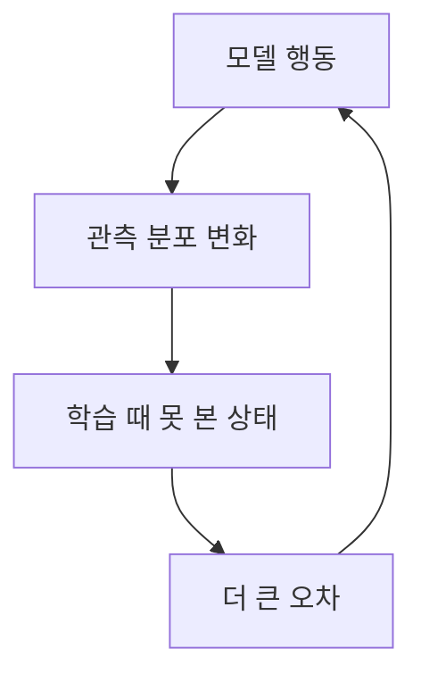

# 예측 오차 누적

> **예측 오차 누적**은 모델의 작은 예측 오차가 롤아웃(연속 예측)이 길어질수록 앞 오차 위에 쌓여 커지는 문제다. 모방 학습과 월드 모델 계획의 대표적 약점이다.

## 쉽게 말하면
눈을 감고 걸을 때 한 걸음의 방향이 1도만 틀려도 백 걸음 뒤에는 크게 벗어난다. 한 번 벗어나면 "연습 때 본 적 없는 자리"에 서게 돼 다음 판단도 더 틀린다.

## 자세히
- **분포 이동**: Ross 외(arXiv 1011.0686)는 순차 예측·모방 학습이 통계학습의 **i.i.d. 가정을 위반**해 이론과 실제 성능을 해친다고 지적한다. 모델 자신의 행동이 다음 관측 분포를 바꾸기 때문이다. 해법으로 정상·결정적 정책을 반복 학습하는 **무후회(no-regret) 온라인 학습** 알고리즘(후에 DAgger로 알려짐)을 제안해 모방 학습 두 과제와 시퀀스 라벨링에서 이전 방법을 앞섰다고 보고한다. 초록에는 "누적 오차"나 이차 후회라는 표현은 없다.
- **월드 모델**: Ha & Schmidhuber(arXiv 1803.10122)는 환경의 생성 모델을 학습하고 에이전트를 모델이 만든 "환각 꿈" 안에서만 훈련해 현실에 옮겼다고 한다. 모델이 틀리면 꿈 속 정책이 현실에서 어긋날 수 있다는 점은 일반 지식이다.
- **완화책**(일반 지식): 짧은 구간만 예측하고 자주 재계획([MPC](#model-predictive-control)), 실제 상태로 자주 보정, 학습 중 모델 자신의 분포에서 데이터 보강(DAgger), 불확실성 추정.

## 그림으로 보기

## 예시
- 자율주행 모방 학습: 전문가는 차선 중앙만 주행해 데이터에 "차선 이탈 복구" 장면이 없고, 조금 벗어나면 복구법을 몰라 계속 벗어난다.
- 월드 모델로 100단계 앞까지 상상하는 계획은 뒤로 갈수록 믿기 어렵다.

## 헷갈리는 것과 비교
| 개념 | 차이 |
|---|---|
| 예측 오차 누적 | 반복 예측에서 오차가 쌓임 |
| 과적합 | 학습 데이터를 외움 |
| 분포 이동 | 입력 분포가 달라짐, 누적의 원인 |
| [MPC](#model-predictive-control) | 자주 재계획해 누적을 억제 |

## 더 읽을거리
- [A Reduction of Imitation Learning and Structured Prediction to No-Regret Online Learning](https://arxiv.org/abs/1011.0686)
- [World Models](https://arxiv.org/abs/1803.10122)
