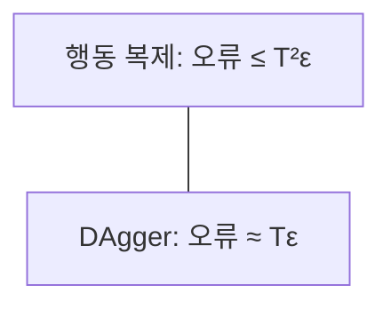

# 오차 누적

> [행동 복제](#behavior-cloning)로 학습한 정책이 **한 번 실수하면 시연에 없던 상태로 들어가 실수가 더 커지는** 현상. 시간 길이 T에 대해 오차가 **T²으로 늘 수 있다**는 것이 Ross 외의 분석이다.

## 쉽게 말하면
내비게이션이 한 번 길을 잘못 들면 처음 보는 동네로 가게 되고, 거기서는 안내가 더 틀려 점점 멀어진다. 연습한 길 위에서는 정확했던 사람이 낯선 길에서는 헤매는 것과 같다.

## 자세히
Ross·Gordon·Bagnell(arXiv 1011.0686, PDF 본문 직접 읽음):
- 문제의 뿌리: 순차 예측에서는 미래의 관찰이 이전 예측에 영향을 받아 통계 학습의 **i.i.d. 가정이 깨진다.** 이를 무시하면 이론과 실제 모두에서 성능이 나쁘다.
- 직관: 학습자가 실수하는 순간 전문가 시연과 완전히 다른 관찰을 만날 수 있고 이것이 **오차의 누적(compounding)**로 이어진다.
- 정리(논문 Theorem 2.1, Ross & Bagnell 2010 인용): 전문가의 상태 분포에서 0-1 손실이 ε인 정책 π는 T 스텝 동안 **J(π) ≤ J(π*) + T²ε**. 이 한계는 **타이트**하다: ε 손실 정책이 T에 대해 이차로 늘어나는 추가 비용을 낼 수 있는 문제가 존재한다. 각주의 예(Kääriäinen 2006): 순서 예측에서 오차율 ε이 기대 오류 수 T/2 − (1−(1−2ε)^{T+1})/(4ε) + 1/2 로 이어지며, 이는 T²ε로 상한되고 작은 ε에서 Θ(T²)로 행동한다.
- 반대로 학습자가 방문하는 분포에서 학습하는 방법(DAgger 계열)은 오류가 **T에 선형**으로 증가한다고 보장한다([DAgger](#dagger-algorithm)).
- 완화(다른 출처): ACT처럼 행동을 묶음으로 예측해 유효 시야를 줄이는 방법([ALOHA와 ACT](#aloha-act), 저자 주장).
- 한계: T²ε는 최악 경우 상한이며 모든 작업에서 실제로 T²로 커지는 것은 아니다. 전문가가 실수에서 복구 가능하면 더 좋은 결과가 나온다고 논문이 언급한다.

## 그림으로 보기

## 예시
- 자율주행 모방 학습에서 차선 중앙에서 조금 벗어난 장면은 시연에 거의 없어 더 크게 벗어남.
- 교육: T=10, 100일 때 ε=0.01로 T²ε와 Tε를 계산해 비교(T=100: 100 vs 1).

## 헷갈리는 것과 비교
| 개념 | 차이 |
|---|---|
| 오차 누적 | 정책 자신의 실수가 분포를 바꿈 |
| [분포 이동](#distribution-shift) | 학습·배포 분포 차이 일반 |
| [행동 묶음 예측](#action-chunking) | 누적을 줄이려는 완화책 |

## 더 읽을거리
- [Ross·Gordon·Bagnell, DAgger 논문](https://arxiv.org/abs/1011.0686) — 정리와 알고리즘(본문 읽음).
