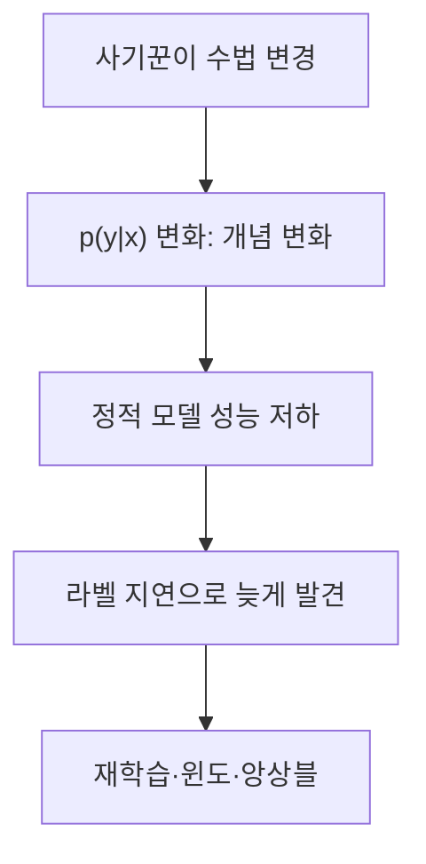
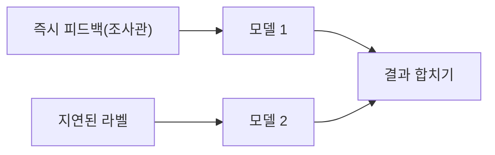

# 개념 변화 사례: 사기 탐지

> 사기 탐지처럼 **상대(사기꾼)가 수법을 계속 바꾸는 분야**에서는, 입력이 비슷해 보여도 "무엇이 사기인가"라는 입력→정답 관계 자체가 변한다(개념 변화). 한 번 학습한 모델의 성능이 시간이 지나며 조용히 무너진다.

## 쉽게 말하면
도둑이 알람이 울리는 창문을 피해 다른 창문으로 들어오기 시작하면, 예전 알람 규칙은 점점 쓸모없어진다. 알람은 그대로인데 도둑의 방식이 바뀌었기 때문이다.

## 자세히
(Dal Pozzolo 등 IJCNN 2015 초록은 검색 결과와 저자 페이지 텍스트로 확인했다. 성능 저하는 직접 시뮬레이션했다.)
- **현실의 어려움(논문 초록)**: 사기 탐지 시스템은 카드 거래 스트림을 감시해 가장 위험한 결제에 경보를 낸다. 초록은 개념 변화의 원인으로 **고객의 습관이 변하는 것**을 들고(사기꾼의 수법 변화는 이 글의 시뮬레이션 설정), 진짜 거래가 사기보다 압도적으로 많은 **클래스 불균형**이 어렵게 만들며, **라벨이 늦게 도착**한다 — 처음에는 조사관이 소수의 경보만 평가하고 대부분의 거래 라벨은 고객이 무단 결제를 신고하는 **수일 뒤**에야 나온다. 논문은 조사관이 바로 주는 **피드백**과 **지연된 지도 샘플**이 성격이 다르다고 보고, 각각으로 분류기를 따로 학습해 결과를 합치는 방식이 슬라이딩 윈도·앙상블 시스템에서 특히 효과적이며 실제 대규모 거래 데이터에서 **경보 정밀도**(조사관의 주 관심사)를 크게 높였다고 보고한다. 구체적 실험 수치는 이번에 확인하지 못했다.
- **직접 시뮬레이션(주 6,000건, 사기 3%, 사기 신호가 처음엔 특징 0·1이 크면 사기이다가 8주에 걸쳐 특징 2·3으로 이동, 로지스틱 회귀, 지표는 평균 정밀도 AP, 무작위 기준선 0.03)**
  | 주차 | 정적 모델(0~1주 데이터로만 학습) | 매주 직전 2주로 재학습 | 4주마다 재학습 |
  |---|---|---|---|
  | 2 | 0.841 | 0.841 | 0.841 |
  | 4 | 0.380 | 0.712 | 0.712 |
  | 6 | 0.102 | 0.745 | 0.321 |
  | 8 | 0.043 | 0.828 | 0.828 |
  | 11 | 0.039 | 0.937 | 0.820 |
  정적 모델은 수법이 바뀐 8주차쯤 **AP가 무작위 수준(0.04)**으로 떨어졌다. 재학습 주기가 짧을수록 회복이 빠르지만 4주마다는 재학습 직전에 크게 떨어졌다. **이 시뮬레이션은 라벨이 즉시 도착한다고 가정**했는데 실제 사기 탐지는 라벨이 늦게 오므로 재학습 효과가 이보다 작다(위 논문의 문제 설정).
- **공변량 변화와의 구분**: 이 사례에서는 입력 분포 p(x)는 거의 그대로이고 **p(y|x)가 변한다**. 그래서 입력 분포만 보는 드리프트 검출([드리프트 탐지기 KS·MMD](#drift-detectors-ks-mmd))은 이 변화를 놓칠 수 있다. 성능 저하는 정답 라벨이 도착해야 확인된다.
- **대응(제안)**: ① 정답이 늦게 오므로 **조사 결과·고객 이의제기** 같은 빠른 신호를 약한 라벨로 활용(성격이 다른 두 신호를 분리해 학습, 논문 아이디어) ② **슬라이딩 윈도** 또는 시간 가중으로 최근 데이터를 강조 ③ 앙상블로 오래된 모델과 새 모델 혼합 ④ 모델 출력 분포(경보율·점수 분포)와 경보 정밀도를 모니터링 ⑤ 새 수법 탐지는 이상 탐지·규칙·전문가 인텔리전스로 보완 ⑥ 재학습 주기와 평가 기간을 서비스 라벨 지연에 맞춰 설계, 시간 순서대로 평가(미래 데이터로 과거 평가 금지).
- **한계**: 합성 데이터의 단순한 수법 이동이다. 실제 사기에는 점진·급변·재발 패턴이 섞인다.

## 그림으로 보기

## 예시
- (가정 예) 카드사의 해외 결제 사기 탐지 모델이 신종 수법 출현 후 경보 정밀도가 60%에서 25%로 떨어짐을 주간 모니터링으로 감지 → 최근 4주 데이터로 재학습, 조사관 피드백을 가중.
- 교육 소재: "AI도 상대가 수법을 바꾸면 낡는다" — 위 표로 재학습 주기 토론(금융·보안 AI 교육).

## 헷갈리는 것과 비교
| 개념 | 차이 |
|---|---|
| 개념 변화(사기 사례) | p(y|x) 자체가 변함 |
| [공변량 변화와 재가중](#covariate-shift-reweighting) | 입력 분포만 변함 |
| [라벨 변화 추정](#label-shift-estimation) | 클래스 비율이 변함 |
| [드리프트 탐지기 KS·MMD](#drift-detectors-ks-mmd) | 입력 분포 변화 검출(개념 변화는 놓칠 수 있음) |

## 더 읽을거리
- [Credit Card Fraud Detection and Concept-Drift Adaptation with Delayed Supervised Information (IJCNN 2015) — 저자 페이지](https://boracchi.faculty.polimi.it/docs/boracchi15IJCNN_Fraud.txt) — 지연 라벨과 피드백을 분리해 학습(초록 수준 확인).
