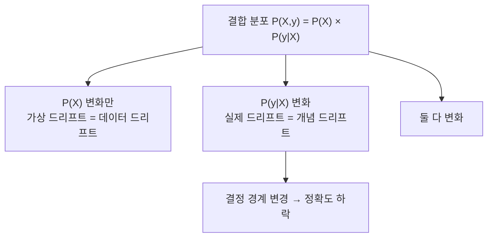

# 개념 드리프트

> 입력(X)과 정답(y)의 관계, 즉 P(y|X)가 시간이 지나며 달라지는 현상. 같은 입력인데 옳은 답이 바뀌므로 모델의 결정 경계가 낡아 정확도가 떨어진다.

## 쉽게 말하면
"스팸 메일"의 기준이 계속 바뀌는 것과 같다. 작년에는 스팸이 아니던 문구가 올해는 스팸이다. 메일의 모양(입력)은 비슷해도 "스팸인가?"라는 정답의 규칙이 바뀐 것이다.

## 자세히
출처: Lu 외 "Learning under Concept Drift: A Review"(arXiv 2004.05785, 원문 PDF를 내려받아 읽음), Evidently AI 가이드(열어서 읽음).
- **정의(Lu 외)**: 어떤 시점 t에서 결합 확률 P_t(X, y)가 P_{t+1}(X, y)와 다른 것. P(X, y) = P(X) × P(y|X)로 나눠 세 원인이 생긴다.
  - **원인 I**: P(X)만 변하고 P(y|X)는 그대로. 결정 경계에는 영향이 없어 **가상 드리프트(virtual drift)**라 불리며, 이는 흔히 말하는 [데이터 드리프트](#data-drift)에 해당한다.
  - **원인 II**: P(y|X)가 변하고 P(X)는 그대로. 결정 경계가 바뀌어 정확도가 떨어지며 **실제 드리프트(actual drift)**라고도 한다.
  - **원인 III**: 둘이 섞임. 현실에서는 I과 II가 함께 일어나 III이 되는 경우가 많다고 논문이 적는다.
- **네 가지 유형(논문 2.2절)**: 갑작스러운(sudden), 점진적(gradual: 새 개념이 한동안 옛 개념을 대체), 증분적(incremental: 옛 개념이 서서히 새 개념으로 변함), 재발(recurring: 이전 개념이 다시 나타남). 앞의 셋은 정확도 하락을 줄이고 빨리 회복하는 데, 재발은 과거 개념을 재활용하는 데 초점을 둔다.
- **다루는 틀**: 논문은 드리프트 **감지**(변화 시점 파악), **이해**(언제·어디서·얼마나), **적응**(모델 갱신) 세 요소를 제안하고, 130편 이상의 문헌을 검토했다. 감지는 데이터 수집 → 모델링 → 검정 통계량 계산 → 가설 검정의 단계 틀로 설명한다.
- **실무 주의(Evidently)**: 정답 라벨이 늦게 오면 입력·예측 드리프트로 먼저 감시하고, 드리프트를 자동 재학습이 아닌 조사의 방아쇠로 본다.
- **의료 예시(해설, 출처 없음)**: 진료 지침이 개정돼 같은 검사 소견의 진단 기준이 바뀌면 개념 드리프트다.

## 그림으로 보기

## 예시
- 사기 탐지: 사기 수법이 바뀌어 과거에 정상이던 패턴이 사기가 됨 → 같은 거래 특성에 대한 정답이 달라짐.
- 대응: 최근 라벨로 재학습, 앙상블에 새 모델 추가, 재발 개념이면 과거 모델 재사용.

## 헷갈리는 것과 비교
| 개념 | 차이 |
|---|---|
| [데이터 드리프트](#data-drift) | 입력 분포 변화, 결정 경계 영향 없을 수 있음 |
| 개념 드리프트 | 입력-정답 관계 변화, 정확도 직접 하락 |
| 예측 드리프트 | 출력 분포 변화 |
| [지연 라벨 모니터링](#delayed-label-monitoring) | 정답이 늦을 때 대리 신호로 감시 |
| [모델 드리프트 모니터링](#model-drift-monitoring) | 상위 감시 활동 |

## 더 읽을거리
- [Learning under Concept Drift: A Review (arXiv 2004.05785)](https://arxiv.org/abs/2004.05785) — 정의·유형·감지·적응(원문 확인)
- [Data drift (Evidently AI)](https://www.evidentlyai.com/ml-in-production/data-drift) — 두 드리프트 구분과 감시 방법(열어서 확인)
