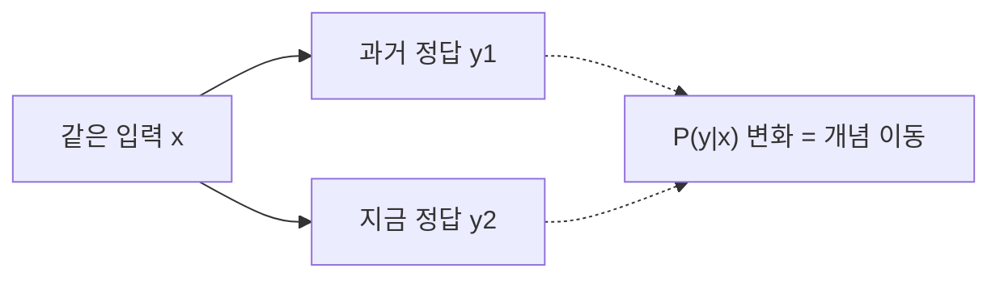
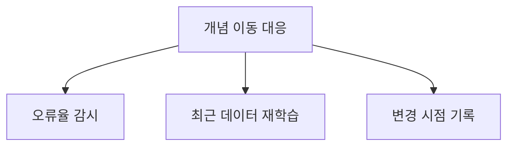

# 개념 이동

> **입력과 정답의 관계 자체가 바뀌는** 분포 이동. 같은 입력인데 정답이 달라지므로 모델이 맞는 답을 내려면 다시 배워야 한다. 정의는 논문마다 어느 조건부 분포가 움직이는지 달라 주의가 필요하다.

## 쉽게 말하면
"스팸"의 기준이 바뀌는 상황이다. 어제까지 정상이던 광고 메일 형식이 오늘은 스팸으로 분류되면, 같은 메일(입력)의 정답(라벨)이 달라진 것이다.

## 자세히
(검색 요약 기준, 1차 논문 미열람.)
- 정의 1: 입력 분포는 같지만 `P_train(y|x) ≠ P_test(y|x)`. 정의 2: 클래스 조건부 `P(X|Y)`가 바뀌는 경우로 정의하는 출처도 있다. 명칭과 관례가 논문마다 달라 **읽는 논문이 어떤 정의를 쓰는지 확인**해야 한다.
- 실전 특성: 이미지 데이터에서는 `P(X)` 변화 없이 개념 이동만 일어나는 일이 드물다는 관찰이 있다. 즉 순수한 개념 이동은 현실에서 분리하기 어렵다.
- 탐지: 온라인 오류율을 감시하는 DDM·EDDM 같은 방법, 마팅게일 기반 탐지기, 개념 이동 온라인 검정(arXiv 2012.14246) 등. 정답 라벨이 있어야 하므로 라벨 지연이 문제다(일반 설명).
- 대응(내 정리): 최근 데이터로 재학습 또는 미세조정, 정책 변경 시점 기록, 윈도 기반 평가.
- 연결: [분포 이동](#distribution-shift)의 한 갈래. AI 업무 사례에서는 규정·정책·사용자 취향이 바뀔 때 일어난다(내 해석).

## 그림으로 보기

## 예시
- 고객 이탈 예측 모델이 요금제 개편 후 같은 행동 패턴의 의미가 달라져 성능이 떨어짐.
- 교육: 규정 개정 전후의 같은 문서에 대한 판정이 달라지는 사례를 토론.

## 헷갈리는 것과 비교
| 개념 | 차이 |
|---|---|
| 개념 이동 | 입력-출력 관계가 바뀜 |
| [라벨 이동](#label-shift) | 클래스 비율만 바뀜 |
| [공변량 이동](#covariate-shift) | 입력 분포만 바뀜 |

## 더 읽을거리
- [Testing for concept shift online](https://arxiv.org/pdf/2012.14246) — 온라인 검정(검색 결과 확인).
