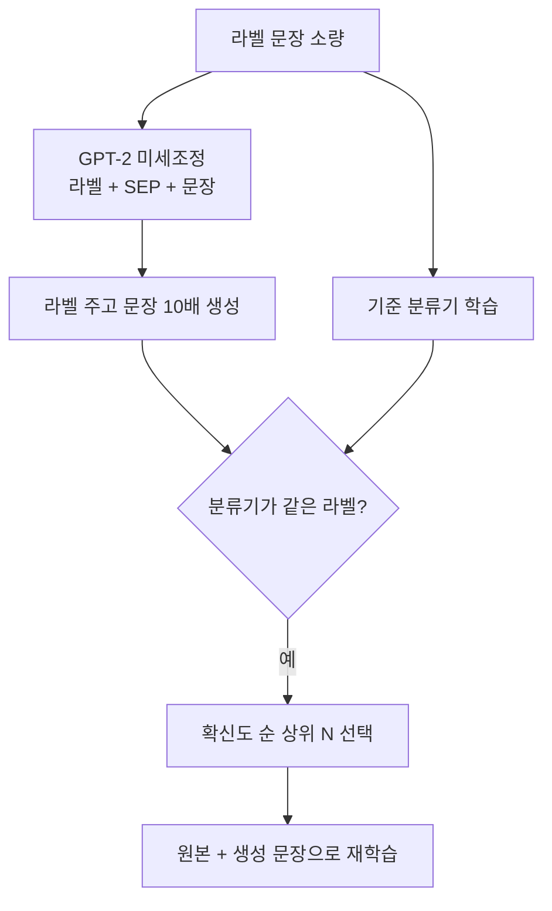

# 라벨 조건부 생성 증강

> 라벨이 붙은 소량의 문장으로 **언어 모델을 미세조정해, "라벨을 먼저 주면 그 라벨의 새 문장을 생성"하게 만들고**, 분류기로 걸러 학습 데이터를 늘리는 방법. LAMBADA가 대표 사례다.

## 쉽게 말하면
"환불 문의" 예문 5개를 본 작가에게 "환불 문의 문장 더 써 줘"라고 시키고, 베테랑 검수자(분류기)가 정말 환불 문의로 보이는 것만 고른다. 예문이 적을수록 이 방식이 도움이 된다.

## 자세히
(Anaby-Tavor 외, "Do Not Have Enough Data? Deep Learning to the Rescue!", AAAI 2020, arXiv 1911.03118을 ar5iv로 직접 읽음)
- **미세조정 입력 형식**: `라벨 + 구분 토큰 + 문장 + 종료 토큰`을 이어 붙여 GPT-2를 사전학습과 같은 다음 토큰 손실로 학습한다. 생성 때는 라벨과 구분 토큰만 주면 그 라벨의 문장이 이어서 나온다.
- **생성과 필터**: 클래스마다 원하는 수의 **10배**를 생성하고, 원 데이터로 학습한 기준 분류기가 **같은 라벨로 예측한 문장만** 남긴다. 남은 문장을 분류기 확신도 순으로 정렬해 클래스별 상위 N개만 쓴다.
- **데이터셋**: ATIS(17개 클래스·4.2k 문장, 항공 예약), TREC(50개·6k, 개방형 질문), WVA(87개·17k, 통신사 고객 지원). 클래스당 5·10·20·50·100개 부분집합으로 실험했다.
- **결과(클래스당 5개, 증강 전→LAMBADA, 정확도 %)**: ATIS는 BERT 53.3→75.7, SVM 35.6→56.5, LSTM 29.0→33.7. TREC는 BERT 60.3→64.3, SVM 42.7→43.9, LSTM 17.7→25.8. WVA는 BERT 67.2→68.6, SVM 60.2→62.9, LSTM 26.0→32.0. 클래스당 50개까지 기준선보다 낫다고 하나 10·20·50개의 정확한 수치는 그림에만 있어 확인하지 못했다.
- **다른 증강과 비교(ATIS, 클래스당 5개)**: BERT 기준 EDA 62.8, CVAE 60.6, CBERT 51.4, **LAMBADA 75.7**. TREC에서 SVM은 EDA 44.8과 LAMBADA 43.9가 대등했다. 저자들은 나머지에서 LAMBADA가 통계적으로 우수하다고 보고한다(McNemar 검정 p<0.01).
- **한계(해석)**: ① 라벨 일관성을 분류기 필터에 의존하므로 기준 분류기가 약하면(예: 5개 예문) 필터도 약하다 ② 생성문이 서로 비슷할 수 있어 다양성 점검이 필요하다([패러프레이즈 다양성 쏠림](#paraphrase-diversity-collapse)) ③ 이 결과는 영어 의도·질문 분류 데이터에서의 보고다.
- **요즘 방식(제안)**: GPT-2 미세조정 대신 지시 따르는 LLM에게 라벨과 예문을 프롬프트로 주고 생성한 뒤 같은 방식으로 필터링한다([증강 프롬프트 설계](#augmentation-prompt-design)).

## 그림으로 보기

## 예시
| 데이터셋(클래스당 5개) | BERT 증강 전→후 |
|---|---|
| ATIS | 53.3 → 75.7 |
| TREC | 60.3 → 64.3 |
| WVA | 67.2 → 68.6 |
- 업무 장면: 고객 문의 유형별 예문이 5개뿐인 새 서비스에서 라벨 조건부 생성으로 클래스당 50문장을 만들고, 분류기 필터 뒤 사람이 20문장씩 눈검사한다.

## 헷갈리는 것과 비교
| 개념 | 차이 |
|---|---|
| 라벨 조건부 생성 | 라벨을 주면 새 문장을 생성 |
| [역번역](#back-translation) | 기존 문장을 번역 왕복으로 변형 |
| [LLM 패러프레이즈 증강](#llm-paraphrase-augmentation) | 기존 문장을 다시 쓰기 |
| [증강 프롬프트 설계](#augmentation-prompt-design) | 지시형 LLM으로 같은 일을 하는 방법 |

## 더 읽을거리
- [Do Not Have Enough Data? Deep Learning to the Rescue! (arXiv 1911.03118)](https://arxiv.org/abs/1911.03118) — LAMBADA 방법과 수치(ar5iv 직접 읽음).
