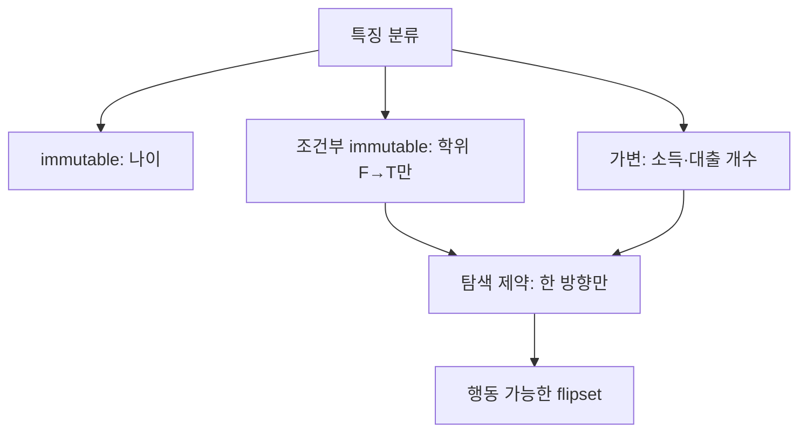

# 조건부 immutable 특징

> 값이 **한 방향으로만 바뀔 수 있는** 특징(박사 학위 보유 FALSE→TRUE, 근속 연수, 나이 상승)이다. 완전히 바꿀 수 없는 특징(나이 ≥ 50)과도, 자유롭게 바뀌는 특징(소득)과도 달라서, 개인이 모델 결정을 바꿀 수 있는 **recourse(대안)**를 계산할 때 방향을 따로 제약해야 한다.

## 쉽게 말하면
"학위를 땄다"는 되돌릴 수 없고 "다시 안 땄던 걸로" 할 수는 없다. 그런데 대출 모델이 학위 있는 사람에게 점수를 깎아 놓았다면, "학위를 없애면 승인된다"는 안내는 아무 쓸모가 없다. 방향 제약을 모르고 만든 설명은 실행할 수 없는 조언이 된다.

## 자세히
(Ustun·Spangher·Liu의 「Actionable Recourse in Linear Classification」(arXiv 1809.06514, FAT* 2019)의 초록과 서론을 PDF로 직접 확인하고, 방향 제약 효과는 작은 모델로 직접 계산했다.)
- **정의(논문)**: **recourse**는 사람이 **행동 가능한(actionable) 입력 변수**를 바꿔 모델의 결정을 바꿀 수 있는 능력이다(예: 소득은 행동 가능, 나이·혼인 상태는 아님). 논문은 선형 분류에서 recourse를 보장·점검하는 **정수 계획법 도구**를 제시하고, 모델 개발에 개입하지 않고 신용 평가 실험으로 보인다.
- **특징 분류(논문 서론)**: 모델이 쓰는 특징은 ① **immutable**(바꿀 수 없음, 예: age ≥ 50), ② **conditionally immutable**(조건부로 바뀜, 예: `has_phd`는 FALSE→TRUE로만 가능), ③ 행동 가능한 것으로 보면 안 되는 것(예: married)이 있다. 또한 `n_credit_cards`를 음수로 만드는 식의 **불가능한 변경**도 제약으로 막는다. 논문은 이런 제약을 이산 제약으로 넣어 **행동 가능한 변경만** 찾는다고 설명한다.
- **flipset(논문)**: 결정을 뒤집는 행동 가능한 변경 목록. 미국의 불리한 처분 통지서에 flipset을 넣으면 사람이 승인되려면 정확히 무엇을 바꿔야 하는지 알 수 있다고 제안한다. 또 방법이 행동 가능한 변경을 못 찾았다고 해서 변경이 **없다는 뜻은 아님**을 주의한다(검증 요건).
- **직접 계산(선형 점수 모델 가정: −1.5+소득/100×1.0−0.5×학위+(−0.8)×대출 개수+0.02×나이, 점수>0 승인, 학위 계수가 허위 상관으로 음수. 거절된 사람 B: 소득 150, 학위 있음, 대출 3건, 나이 52, 점수 −1.86. 비용: 소득 +1만원 0.01, 학위 변경 0.1, 대출 1건 상환 0.3)**
  | 탐색 방식 | 최소 비용 변경 | 비용 |
  |---|---|---|
  | 제약 없는 반사실(학위 박탈 허용) | **학위 제거** + 대출 2건 상환 | 0.70 |
  | **행동 가능한 변경만**(학위는 FALSE→TRUE만) | 대출 3건 모두 상환 | 0.90 |
  제약 없는 반사실은 "학위를 없애라"는 **실행 불가능한 안내**를 주었다. 방향 제약을 걸면 대출을 모두 상환하는 대안이 나오고 비용도 더 든다(0.70 → 0.90). 단순한 장난감 모델이다.
- **설계(제안)**: ① 특징마다 **방향·범위·비용**(변경 가능/불가, 증가만, 감소만, 이산값, 시간 소요)을 명세 ② 모델이 불리하게 쓰는 조건부 immutable 특징(예: 근속 연수가 짧다고 감점)이 recourse를 막는지 점검 ③ 학위·경력처럼 **시간이 오래 걸리는 변경**은 비용을 크게 부여 ④ 통지서에는 **실행 가능한 flipset**만 제시 ⑤ 시간이 지나며 특징이 자동으로 바뀌는 것(나이·근속)은 모델 재평가 때 반영.
- **한계**: 비용 정의는 개인마다 다르다. 위 숫자는 설명용 예시이며 논문 결과가 아니다.

## 그림으로 보기

## 예시
- 채용 점수 모델이 "경력 연수"를 쓸 때 연수는 줄일 수 없고 오직 증가만 가능하다. 거절된 지원자에게 "경력을 줄이면 통과"가 아니라 "자격증 취득 시 점수 상승" 같은 방향이 맞는 대안을 제시.
- 교육 소재: "AI가 알려 준 거절 사유대로 바꿀 수 있나?" — 방향 제약 퀴즈(공정성·설명가능성 교육).

## 헷갈리는 것과 비교
| 개념 | 차이 |
|---|---|
| 조건부 immutable | 한 방향으로만 변하는 특징 |
| immutable | 전혀 바뀌지 않음 |
| [행동 가능한 특징](#actionable-features) | 개인이 바꿀 수 있는 특징 전반 |
| [recourse 가능성과 값의 범위](#recourse-feasibility-bounds) | 값 범위 때문에 대안이 없는 사람 |

## 더 읽을거리
- [Actionable Recourse in Linear Classification (arXiv 1809.06514)](https://arxiv.org/abs/1809.06514) — recourse 정의, 특징 분류, flipset(PDF 앞부분 직접 확인).
