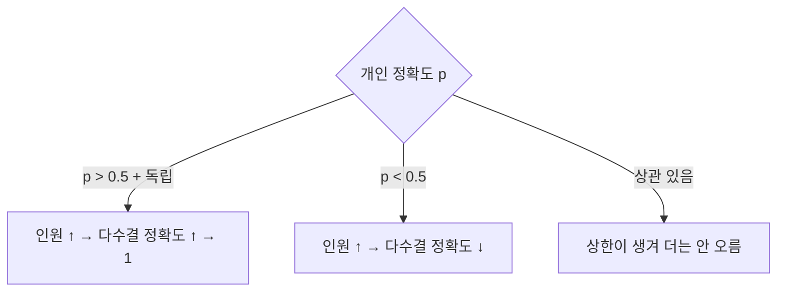
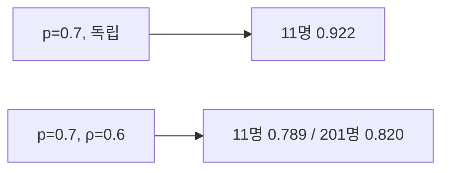

# Condorcet 배심 정리

> Condorcet 배심 정리는 투표자들이 서로 독립적으로 각자 확률 p로 정답을 고를 때, p가 1/2보다 크면 투표자가 늘수록 다수결이 정답일 확률이 1에 가까워지고, p가 1/2보다 작으면 오히려 나빠진다는 정리다.

## 쉽게 말하면
동전보다 조금만 잘 맞히는 사람이라도 독립적으로 많이 모이면 다수의 의견은 거의 틀리지 않는다. 반대로 동전보다 못 맞히는 사람들을 모으면 다수는 더 확실하게 틀린다.

## 자세히
- **정리의 내용(Wikipedia)**: 두 선택지 중 하나가 정답인 다수결에서 각 투표자가 독립적으로 확률 p로 정답을 고른다. 모든 투표자의 능력은 같은 p로 가정하고, 인원은 홀수로 해서 동률을 피한다. p > 1/2이면 투표자가 늘수록 다수가 맞을 확률이 1로 간다. p < 1/2이면 인원이 늘수록 나빠지며 최선의 배심은 한 명이다. 문서는 능력이 사람마다 다르면 정리가 깨질 수 있다고 덧붙이고, 상관된 투표는 다루지 않는다. 머신러닝에서는 약간 더 좋은 분류기들이 독립이면 앙상블이 크게 좋아질 수 있다고 연결한다.
- **직접 계산(이항분포, 독립 가정)**: 다수결이 맞을 확률.

| 개인 정확도 p | 1명 | 3명 | 11명 | 51명 | 201명 |
| --- | --- | --- | --- | --- | --- |
| 0.45 | 0.450 | 0.425 | 0.367 | 0.236 | 0.077 |
| 0.51 | 0.510 | 0.515 | 0.527 | 0.557 | 0.612 |
| 0.55 | 0.550 | 0.575 | 0.633 | 0.764 | 0.923 |
| 0.60 | 0.600 | 0.648 | 0.753 | 0.926 | 0.998 |
| 0.70 | 0.700 | 0.784 | 0.922 | 0.999 | 1.000 |

  p=0.45는 인원이 늘수록 0.077까지 떨어지고, p=0.70은 11명이면 0.922, 51명이면 0.999다.
- **상관이 있을 때(직접 만든 단순 모델)**: "확률 ρ로 모두가 한 대표 투표자를 그대로 따라 하고, 아니면 독립"이라고 하자(p=0.7).

| ρ | 11명 | 51명 | 201명 |
| --- | --- | --- | --- |
| 0 | 0.922 | 0.999 | 1.000 |
| 0.3 | 0.855 | 0.909 | 0.910 |
| 0.6 | 0.789 | 0.819 | 0.820 |

  ρ가 0보다 크면 인원을 늘려도 상한이 생긴다. 이 모델에서 상한은 ρ×0.7 + (1−ρ) = 1 − 0.3ρ이고, ρ=0.3이면 0.91, ρ=0.6이면 0.82로 표의 수치와 맞는다. 이 모델은 개념을 보이는 장난감 설정이다.
- **라벨링에 주는 의미(해석)**: 주석자 독립성과 개인 정확도가 핵심이다. 같은 가이드·같은 도구 제안을 공유하면 독립이 깨진다([주석자 공통 편향](#shared-annotator-bias), [검수자 독립성](#reviewer-independence)). 개인 정확도가 50%에 못 미치는 작업자를 섞으면 다수결을 해친다([작업자 품질 관리](#worker-quality-control)).

## 그림으로 보기

## 예시
- 코드: `sum(comb(n,k)*p**k*(1-p)**(n-k) for k in range(n//2+1,n+1))`로 다수결 정확도를 계산한다.
- 교육 활용: p와 n을 바꿔 가며 표를 채워 "왜 독립성이 중요한가"를 토론한다.

## 헷갈리는 것과 비교
| 개념 | 차이 |
| --- | --- |
| Condorcet 정리 | 독립·p>0.5일 때 다수결이 좋아진다는 정리 |
| [과반 판정 임계값](#majority-vote-threshold) | 몇 명 일치를 확정 기준으로 쓸지 |
| [앙상블의 노이즈 내성](#ensemble-noise-robustness) | 모델 여러 개로 같은 아이디어 적용 |
| [3인 다수결](#majority-vote-three-reviewers) | n=3 특수 경우 |

## 더 읽을거리
- [Condorcet's jury theorem (Wikipedia)](https://en.wikipedia.org/wiki/Condorcet%27s_jury_theorem) — 정리와 가정, p<1/2일 때
