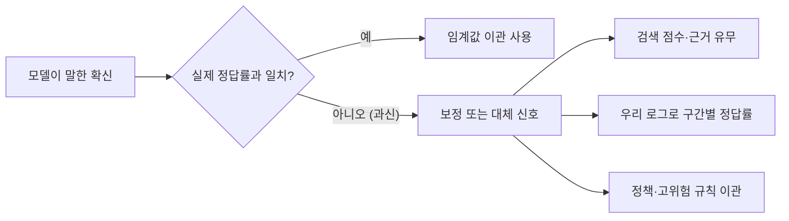
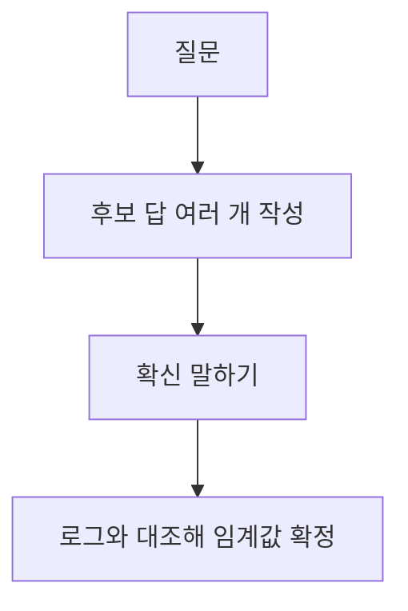

# 신뢰도 보정과 이관

> "AI가 확신 없으면 사람에게 넘긴다"는 규칙은 모델이 말하는 확신이 실제 정확도와 맞아야 작동한다. 안 맞을 때(과신)는 보정하거나 다른 신호로 대체한다.

## 쉽게 말하면
"90% 확신해요"라고 말하는 동료가 실제로는 10번 중 6번만 맞는다면, 그 말만 믿고 일을 맡기면 안 된다. 말투가 아니라 적중 기록으로 그 사람의 확신을 환산해야 한다.

## 자세히
- **보정(calibration)**: 모델이 말한 확신 X%가 실제 정답률 X%와 일치하는 정도. 어긋나면 임계값 이관 규칙이 엉뚱한 곳에서 발동한다.
- **RLHF와 과신**: Leng 등(2024, ICLR 2025)은 RLHF 모델이 말로 표현하는 확신이 과도해지며, PPO에 쓰는 보상 모델이 정답 여부와 무관하게 높은 확신의 답을 선호하는 편향이 원인 중 하나라고 보고했다. 제안한 해결책 PPO-M·PPO-C는 모델 학습 쪽 수정이라 응대 서비스 운영자가 직접 쓸 수는 없다(Llama3-8B, Mistral-7B 실험).
- **말로 한 확신 vs 토큰 확률**: Tian 등(2023)은 ChatGPT·GPT-4·Claude 같은 RLHF 모델에서는 "확신을 말로 말하게 하는 편"이 토큰 확률보다 대체로 보정이 낫고, 일부 데이터셋에서 보정 오차를 상대적으로 약 절반 줄였다고 밝혔다. 다만 후속 연구는 결과가 엇갈린다.
- **운영자가 쓸 수 있는 대안**(일반 원칙, 글 요약 기준)
  - 검색 점수·근거 문서 유무 같은 **외부 신호**
  - 정답 라벨이 있는 우리 로그로 **임계값 직접 보정**(구간별 실제 정답률 확인)
  - 여러 후보 답을 먼저 쓰게 한 뒤 확신을 말하게 하기(보정 개선 보고)
  - 규칙 기반 이관(정책·고위험 주제)은 확신과 무관하게 유지
- 검색 요약에서 본 "검색 점수 기반 이관 사례"는 이번 조사에서 1차 출처로 확인하지 못했다. 임계값 수치(예: 0.65)는 예시일 뿐이다.

## 그림으로 보기

## 예시
- 확신 0.9라 답한 100건 중 실제 정답 60건 → 임계값을 0.9로 두면 틀린 40건이 그대로 나감. 구간별로 재설정.
- 교육 실습: 모델에게 같은 질문 20개의 답과 확신도를 받고 정답표와 대조해 본다.

## 헷갈리는 것과 비교
| 개념 | 차이 |
|---|---|
| 신뢰도 보정 | 확신 수치가 정확도와 맞게 만들기 |
| [감정 기반 이관](#sentiment-trigger) | 고객 감정으로 판단 |
| [이관 트리거 신호](#escalation-triggers) | 신뢰도를 포함한 신호 모음 |
| [문의 위험 등급화](#risk-tiered-intents) | 확신과 무관하게 위험으로 범위를 정함 |

## 더 읽을거리
- [Just Ask for Calibration (Tian 외, 2023)](https://arxiv.org/abs/2305.14975) — 말로 한 확신의 보정 (초록 열람)
- [Taming Overconfidence in LLMs (Leng 외)](https://arxiv.org/abs/2410.09724v1) — RLHF 과신과 PPO-M/C (초록 열람)
