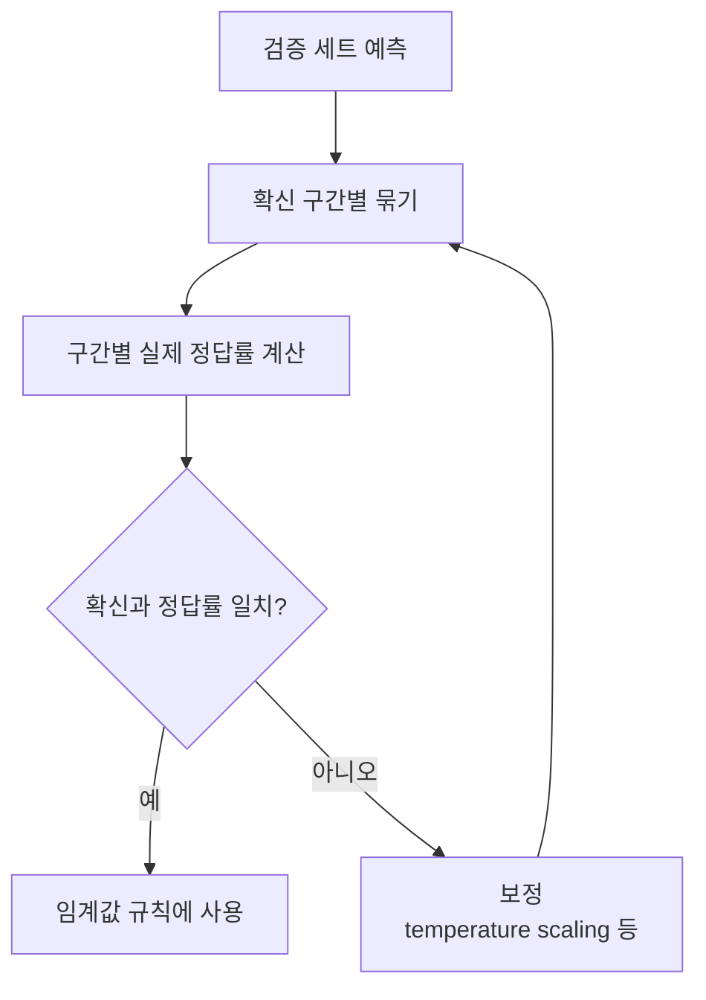

# 신뢰도 보정

> 모델이 "90% 확신"이라고 한 답들의 실제 정답률이 약 90%가 되도록 맞추는 것. 확신도로 자동 처리와 사람 검토를 가를 때 전제 조건이다.

## 쉽게 말하면
저울이 늘 2kg 더 나오면 숫자를 믿고 장사할 수 없다. 영점을 맞춘 저울만 가격 계산에 쓸 수 있듯, 확신도도 보정돼야 "이 점수 이상이면 자동 처리" 같은 규칙을 세울 수 있다.

## 자세히
- **정의**: 확신 구간별 실제 정답률이 확신 값과 같을 때 잘 보정된 것(reliability). 확신 0.9인 답 100개 중 약 90개가 맞아야 한다.
- **현대 신경망은 과신 경향**: Guo 외(ICML 2017, arXiv 1706.04599)는 현대 네트워크가 과거 모델보다 보정이 나쁘고, 깊이·너비·weight decay·배치 정규화가 영향을 준다고 보고했다. 간단한 사후 처리인 **temperature scaling**(Platt scaling의 단일 파라미터 변형)이 대부분 데이터에서 잘 통했다([온도 스케일링](#temperature-scaling)은 생성 온도와 다른 개념과 혼동 주의).
- **측정**: 검증 세트에서 확신 구간별 정답률을 그린 신뢰도 도표(reliability diagram)를 본다. 요약 지표로 ECE가 흔히 쓰인다(위 논문 초록엔 정의 없음, 본문 확인 안 함).
- **LLM**: 말로 한 확신은 보정이 어긋나기 쉽다([말로 표현한 확신](#verbalized-confidence)). 분류형 출력은 토큰 확률, 또는 여러 번 샘플링해 일치율을 쓴다.
- **업무 연결**: 보정된 확신도가 있어야 임계값으로 "자동 / 사람 검토"를 나눈 비용을 계산할 수 있다([사람 개입 라우팅](#human-in-the-loop-routing), [정확도 경제학](#accuracy-economics)).
- 모델·데이터가 바뀌면 보정은 다시 깨질 수 있으니 주기적으로 재측정한다.

## 그림으로 보기

## 예시
- 송장 OCR: 확신 0.95 이상 구간의 실제 정확도가 0.97이면 자동 입력, 그 아래는 사람 확인. 구간 0.8~0.9가 실제로 0.7이면 임계값을 0.93으로 올린다.

## 헷갈리는 것과 비교
| 개념 | 차이 |
|---|---|
| 신뢰도 보정 | 확신 숫자의 정확성 |
| 정확도 | 맞힌 비율 자체 |
| [AI 확신도 표시](#ai-confidence-display) | 사용자에게 보이는 UI |

## 더 읽을거리
- [On Calibration of Modern Neural Networks](https://arxiv.org/abs/1706.04599) — 과신과 temperature scaling 원논문(초록 확인)
