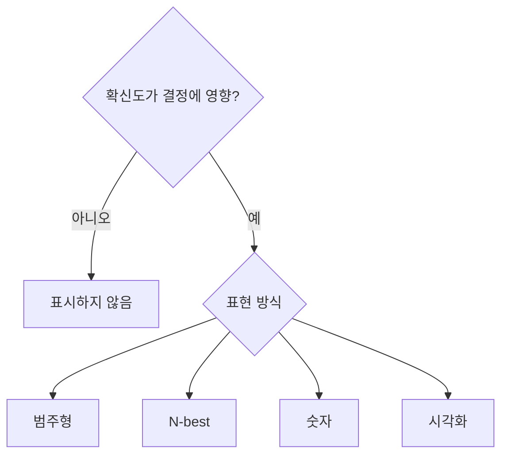

# 확신 표시 유형

> AI의 확신도를 사용자에게 보여 주는 방식은 **범주형·N-best 대안·숫자·시각화** 등이 있고, 각각 장단점이 달라 사용자 테스트로 골라야 한다.

## 쉽게 말하면
날씨 앱이 "비 올 확률 80%"라고 숫자로 보여 줄 수도, "우산 챙기세요"라고 범주로 줄 수도, 비가 올 구간을 그림으로 보여 줄 수도 있다. 같은 불확실성도 표현법에 따라 이해가 달라진다.

## 자세히
(Google PAIR "Explainability + Trust" 챕터를 직접 읽었다.)
| 유형 | 장점 | 단점 |
|---|---|---|
| **범주형**(높음/중간/낮음) | 읽기 쉽고 세부 숫자로 압도하지 않음 | 팀이 **경계값**을 정해야 하고 범주마다 사용자가 할 행동이 분명해야 함 |
| **N-best 대안**("뉴욕·도쿄·LA 중 하나일 수 있어요") | 낮은 확신 상황에 특히 유용, 사용자가 직접 판단하고 선택지 관계를 파악 | 보여 줄 대안 수를 테스트로 정해야 함 |
| **숫자**("독 오크 80%") | 정확하고 익숙 | 사용자가 확률을 이해해야 하고 맥락이 필요. 97% 일치도 불확실하게 받아들일 수 있음 |
| **시각화**(오차 막대·결과 범위 음영) | 불확실성을 그래픽으로 | 도메인 전문가만 이해하는 경우가 많음 |
- **보여 줄지부터 판단(PAIR)**: 결정에 영향이 없으면 생략한다. 85.8% vs 87%처럼 세밀한 값은 혼란을 줄 수 있다. 오해를 부르는 높은 확신은 **맹신**을 낳을 수 있으니 불신을 낳을 위험이 있으면 피한다.
- 사용자 집단마다 확률 친숙도가 다르므로 **초기에 테스트**한다.
- 확신도의 효과 근거: IBM 연구는 확신 점수가 신뢰 보정에 도움이 되지만 정확도 향상은 별개라고 보고([확신 점수 표시](#confidence-score-display)).

## 그림으로 보기

## 예시
- 문서 분류 AI: 높음(자동 처리)/중간(담당자 확인)/낮음(재분류 요청) 3단 범주로 각각 행동을 연결(제안).
- 이미지 인식 앱: 낮은 확신일 때 후보 3개를 나열.

## 헷갈리는 것과 비교
| 개념 | 차이 |
|---|---|
| 확신 표시 | 불확실성의 수준을 보여 줌 |
| [확신 점수 표시](#confidence-score-display) | 숫자형 확신도의 실험 근거 |
| [부분 설명](#partial-explanation) | 설명 범위를 골라 제공 |

## 더 읽을거리
- [Google PAIR — Explainability + Trust](https://pair.withgoogle.com/chapter/explainability-trust/) — 직접 읽음.
