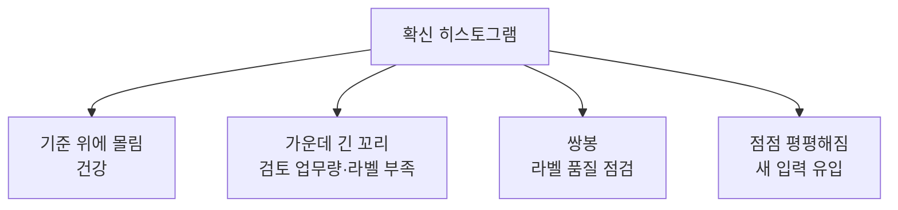

# 확신 분포 모양

> 확신 분포 모양은 모델이 낸 확신 점수들을 히스토그램으로 그렸을 때의 형태(한쪽 쏠림·평평한 꼬리·쌍봉)다. 모양을 보면 임계값을 조정할 문제인지, 검토 인력·라벨 품질·입력 변화 문제인지 가려낼 수 있다.

## 쉽게 말하면
학생 시험 점수 분포를 보면 "대부분 합격선 위인지", "중간에 많은 학생이 몰려 있어 채점 인력이 더 필요한지"를 알 수 있다. 점수 하나하나보다 전체 모양이 운영 판단의 단서다.

## 자세히
- **Nyckel 문서(Tuning Confidence Thresholds, 열람)가 설명하는 네 모양**
  - *기준 위에 몰림*: "건강한 함수는 대부분의 예측이 자동 수락 기준 위에 모여 있다."
  - *가운데가 평평하고 긴 꼬리*: 사람이 처리해야 할 검토 업무량이 실제로 있다는 뜻이거나, 모델이 불확실한 범주에 라벨 샘플이 더 필요하다는 뜻이다.
  - *쌍봉*(아주 높거나 아주 낮은 점수가 많고 가운데가 적음): 쉬운 사례는 잘 배웠다는 뜻이며, 문서는 임계값이 아니라 라벨 품질 문제로 해석한다. 임계값을 옮겨도 해결되지 않는다.
  - *시간에 따라 평평해짐*: "콘솔에서 분포가 평평해지면 모델이 새로운 종류의 입력을 보고 있다." 기준을 조이고 새 사례의 학습 샘플을 더하라고 권한다. 몇 주 피드백이 쌓이면 맞는 예측의 확신이 보통 올라 두 기준을 올릴 수 있다고 한다.
- **시뮬레이션에서의 모양별 차이(arXiv 2601.05974, 열람)**: 점수가 1 근처에 몰린 오른쪽 쏠림은 적은 검토로 높은 성능, 0 근처에 몰린 왼쪽 쏠림은 훨씬 많은 검토가 필요, 균형 잡힌 쌍봉은 중간이었다. 모양이 [검토의 수확 체감](#diminishing-returns-review) 곡선을 좌우한다. 이 결과는 Beta 분포로 만든 합성 데이터이고 검토자를 완벽하다고 가정한 것이다.
- **주의(해석)**: 문서의 쌍봉 해석은 한 도구 문서의 경험칙이며 일반 법칙이 아니다. 모델 확신이 보정(calibration)되어 있지 않으면 분포 모양 자체가 정답률과 무관할 수 있으므로 보정 상태를 먼저 확인한다.
- **운영 습관**: 분포를 주기적으로 기록해 두면 입력 변화(드리프트)의 조기 경보로도 쓴다.

## 그림으로 보기

## 예시
- 문서 분류 서비스: 매주 확신 히스토그램을 저장해 이번 주만 가운데 구간이 두 배로 늘었다면 신규 문서 유형 유입을 의심하고 샘플을 라벨링한다.
- 프롬프트 예: "이 점수 CSV로 0.05 간격 히스토그램을 만들고, 지난주와 비교해 분포 모양이 어떻게 바뀌었는지 요약해 줘."

## 헷갈리는 것과 비교
| 개념 | 차이 |
| --- | --- |
| [이중 임계값 정책](#double-threshold-policy) | 라우팅 규칙. 분포 모양은 그 기준을 조정할 근거 |
| 보정(calibration) | 확신이 정답률과 맞는지. 모양과는 별개로 먼저 확인 |
| 데이터 드리프트 | 입력이 변하는 현상. 분포 평평화가 그 신호가 될 수 있음 |

## 더 읽을거리
- [Nyckel: Tuning Confidence Thresholds](https://www.nyckel.com/docs/best-practices/confidence-scores-and-thresholds/) — 분포 모양별 해석
- [arXiv 2601.05974](https://arxiv.org/html/2601.05974v2) — 점수 분포별 검토 효율 시뮬레이션
