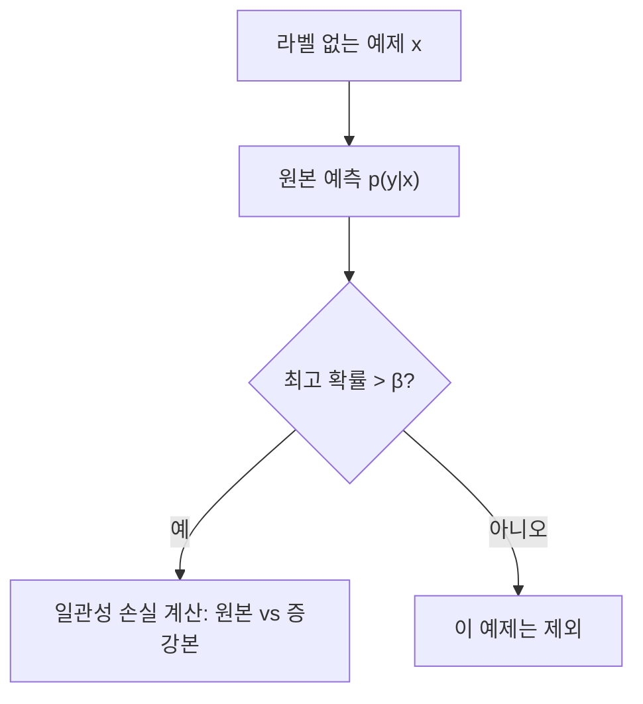
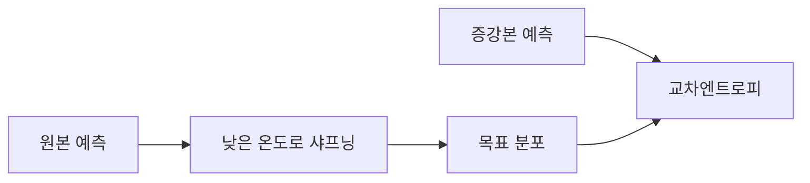

# 신뢰도 마스킹

> UDA(비지도 데이터 증강)에서, 모델이 **확신하지 못하는 라벨 없는 예제는 일관성 손실 계산에서 빼는** 기법이다. 미니배치 안에서 최고 클래스 확률이 임계값 β보다 클 때만 손실에 포함한다.

## 쉽게 말하면
선생님이 채점 답안을 학생에게 가르칠 때, 자기도 헷갈리는 문제는 정답 예시로 쓰지 않는 것과 같다. 확신 있는 문제만 "이 문제는 변형해도 같은 답"이라고 가르쳐야 틀린 확신이 퍼지지 않는다.

## 자세히
- 배경: [UDA](#uda-consistency-training)는 라벨 없는 원본 x와 증강본 x̂에 대한 모델 예측이 같도록 KL/교차엔트로피 손실을 건다. 원본 예측이 엉망이면 그 엉망인 분포를 증강본이 따라가게 되어 해롭다.
- 논문(Xie et al., arXiv 1904.12848) 설명: 각 미니배치에서 원본 예측의 **최고 확률이 임계값 β보다 큰 예제만** 일관성 손실을 계산한다. β는 높게 잡는다 — CIFAR-10·SVHN은 0.8, ImageNet은 0.5.
- 수식 요지: 손실 = (1/|B|) Σ I(max p(y|x) > β) · CE(p_sharp(y|x) ‖ p(y|x̂)). 여기서 I는 조건이 맞으면 1, 아니면 0인 지시 함수이고 목표 분포는 낮은 소프트맥스 온도 τ로 뾰족하게 만든다.
- **샤프닝과의 관계**: 논문은 낮은 온도로 예측을 뾰족하게 하는 것(엔트로피 최소화 효과)과 마스킹을 함께 쓴다. 예를 들어 부록에서 τ=0.4, β=0.8(CIFAR 설정)을 쓴다.
- 직관: 라벨이 매우 적을 때 초기 모델은 대부분 불확실하므로 처음엔 많은 예제가 마스킹되고, 학습이 진행될수록 통과하는 예제가 늘어난다(해석).
- 한계: β가 너무 높으면 학습 신호가 거의 없고, 너무 낮으면 노이즈가 섞인다. 데이터셋마다 다르게 쓴 것(0.8 vs 0.5)이 이를 보여 준다.

## 그림으로 보기

## 예시
- 리뷰 감성 분류에서 "보통이다" 같은 애매한 리뷰(확률 0.4/0.6)는 마스킹되어 일관성 학습에 쓰이지 않는다.
- 교육: 반자동 라벨링에서 "AI가 확신하는 것만 먼저 학습 신호로 쓴다"는 원칙을 설명.

## 헷갈리는 것과 비교
| 개념 | 차이 |
|---|---|
| 신뢰도 마스킹 | 확신 낮은 예제의 일관성 손실 제외 |
| 샤프닝 | 목표 분포를 뾰족하게 만듦(온도 τ) |
| 훈련 신호 어닐링(TSA) | **라벨 있는** 쉬운 예제를 점차 풀어 과적합 방지 |
| [준지도 학습](#semi-supervised-learning) | 이 기법이 속한 큰 틀 |

## 더 읽을거리
- [Unsupervised Data Augmentation for Consistency Training (arXiv 1904.12848)](https://arxiv.org/abs/1904.12848) — 2.4절·부록 PDF 텍스트로 읽음.
