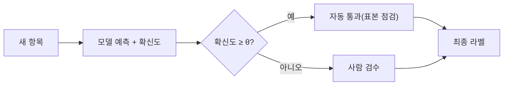
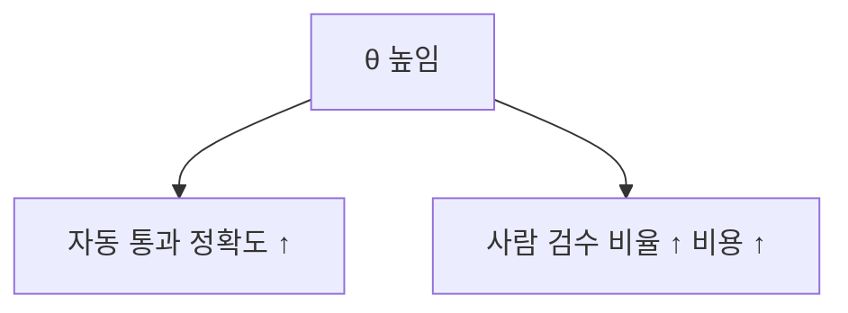

# 확신도 기반 검수 분배

> 모델이 자기 예측에 매긴 확신도(확률)가 낮은 항목만 사람에게 보내 검수하게 하고, 확신도가 높은 항목은 자동으로 통과시키는 분배 방식이다. 사람의 검수 시간을 어려운 사례에 집중시킨다.

## 쉽게 말하면
공항 보안검색에서 평범한 가방은 그냥 통과시키고, 기계가 의심스럽다고 표시한 가방만 직원이 열어 보는 것과 같다. 전부 열어 보면 정확하지만 비싸고, 표시된 것만 열면 싸면서도 대부분의 문제를 잡는다.

## 자세히
(Geifman & El-Yaniv 논문 arXiv 1705.08500 초록을 직접 열어 확인하고, 직접 실험을 실행.)
- **개념적 뿌리**: 분류기에 **기권(reject) 옵션**을 주고 확신이 낮은 입력은 답하지 않게 하면 커버리지(답한 비율)와 정확도를 맞바꿀 수 있다(선택적 분류). Geifman·El-Yaniv는 학습된 심층 신경망에 이를 적용해, 목표 위험 수준을 지정하면 높은 확률로 그 오류율을 유지하도록 입력을 기권시키는 방법을 제안했다. ImageNet에서 **top-5 오류 2%를 99.9% 확률로 보장**하면서도 시험 입력의 약 60%에 답했다(초록).
- **데이터 라벨링에 적용(제안)**: 모델이 붙인 사전 라벨을 확신도 임계값 θ로 나눈다 — θ 이상은 자동 통과(표본만 점검), θ 미만은 사람이 전수 검토([모델 보조 사전 라벨링](#model-assisted-prelabeling)).
- **직접 실험(digits 손글씨 899개 시험, 로지스틱 회귀, 기준 정확도 0.958, 사람 검수 정확도 0.98 가정)**
  | 임계값 | 자동 통과 비율 | 자동 통과분 정확도 | 사람 검수 비율 | 전체 정확도 |
  |---|---|---|---|---|
  | 0.5 | 99.7% | 0.960 | 0.3% | 0.960 |
  | 0.7 | 97.6% | 0.970 | 2.4% | 0.971 |
  | 0.9 | 93.4% | 0.980 | 6.6% | 0.980 |
  | 0.95 | 90.0% | 0.991 | 10.0% | 0.990 |
  | 0.99 | 84.4% | 0.991 | 15.6% | 0.989 |
  사람이 10%만 검수(θ=0.95)해도 전체 정확도가 0.958에서 0.990으로 올랐고, 그 이상 검수 비율을 늘려도(15.6%) 이득이 거의 없었다. 사람 정확도 0.98은 가정이며 확신도 보정이 잘 된 소규모 장난감 모델의 결과다.
- **함정(제안)**: ① 확신도가 **보정되지 않은** 모델(과신)은 틀린 항목을 높은 확신으로 통과시킨다([예측 확률 보정](#pred-probs-calibration)) ② 분포가 바뀌면 확신도 분포도 바뀐다 ③ 자동 통과분도 일부 무작위 표본을 점검해 실제 정확도를 계속 측정한다([제안 비노출 대조 표본](#suggestion-hidden-control-sample)) ④ 확신도가 낮은 항목이 라벨 오류·이상치일 수도 있다.
- **임계값 정하는 법(제안)**: 사람이 라벨한 검증 세트에서 임계값별 자동 통과분 정확도와 검수 비율 곡선을 그리고 목표 오류율에 맞는 지점을 고른다.

## 그림으로 보기



## 예시
```python
p = model.predict_proba(X_new)
conf, pred = p.max(1), p.argmax(1)
auto = conf >= 0.95          # 자동 통과
review = ~auto               # 사람에게 보낼 항목
```
- 상담 문의 분류 1만 건: 확신도 0.95 이상 9,000건은 5%만 점검, 1,000건은 담당자 전수 검수.

## 헷갈리는 것과 비교
| 개념 | 차이 |
|---|---|
| 확신도 기반 분배 | 낮은 확신도만 사람에게 |
| [능동 학습](#active-learning-labeling) | 불확실한 샘플로 모델을 학습시키는 것이 목적 |
| 선택적 분류 | 확신이 낮으면 기권하는 분류기 |
| 전수 검수 | 모든 항목을 사람이 확인 |

## 더 읽을거리
- [Selective Classification for Deep Neural Networks (arXiv 1705.08500)](https://arxiv.org/abs/1705.08500) — 기권 옵션·위험 보장(초록 확인).
