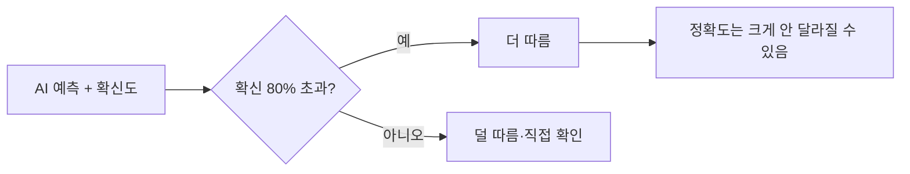

# 확신 점수 표시

> AI가 **예측마다 자신의 확신도(예: 78%)를 함께 보여 주는** 인터페이스다. 사람이 "이 답은 믿어도 되는지"를 사례별로 가늠하게 돕는다.

## 쉽게 말하면
일기예보가 "비 올 확률 90%"라고 말하면 우산을 챙기고 "20%"면 두고 가는 것처럼, AI도 확신도를 알려 주면 사람이 어떤 답은 믿고 어떤 답은 직접 확인할지 정할 수 있다.

## 자세히
(Zhang·Liao·Bellamy, "Effect of Confidence and Explanation on Accuracy and Trust Calibration in AI-Assisted Decision Making"(FAT* 2020, arXiv 2001.02114) PDF를 직접 읽었다. 소득 50K 초과 여부를 예측하는 정형 데이터 과제이며 LLM 대화 UI가 아니다.)
- **설계(실험 1)**: Mechanical Turk **72명**. AI 예측을 보여 줄지·확신도를 보여 줄지·모델이 일부 속성을 못 보는지(완전/부분 모델: 정확도 84% vs 83%)를 조합. 확신도 구간은 50~100%를 10%씩 5구간.
- **정확도**: 참가자 단독 평균 **65%**, 실험 trial에서의 AI는 **75%** — AI가 사람보다 낫지만 큰 차이는 아니었다. 조건 간 차이는 통계적으로 유의하지 않았다.
- **신뢰 보정(논문)**: 확신도를 보여 주면 **AI 확신이 높을 때(80% 초과) AI를 더 따르고**, 낮을 때는 덜 따라 신뢰가 확신도에 맞게 보정됐다(H1 지지). 예측을 보여 주지 않고 위임하는 상황에서도 유지됐다.
- **그러나 정확도는 안 올랐다(논문)**: 확신도 표시가 신뢰를 보정했지만 **AI 보조 정확도**는 유의하게 좋아지지 않았다(H2 기각). 저자 설명: AI가 불확실한 사례는 사람에게도 어려워서, 낮은 확신 사례에서 사람의 예측이 더 나은 대체재가 아니었다. 사람과 모델이 서로 다른 고유 지식을 가진다면 보정이 정확도 향상으로 이어질 수 있다는 단서가 붙는다.
- **한계**: 한 가지 과제, 온라인 참가자, 전문가 아님.

## 그림으로 보기

## 예시
- 사내 문서 분류 AI에 확신도를 표시하고, 60% 미만은 사람이 검토하도록 한다(제안). 단, 확신도가 실제 정확도와 맞게 보정되어 있어야 한다.
- 교육 소재: 확신도가 높으면 무조건 맞는 것은 아니라는 점을 토론.

## 헷갈리는 것과 비교
| 개념 | 차이 |
|---|---|
| 확신 점수 표시 | 사례별 확신도를 UI로 노출 |
| [국소 설명](#local-explanation-limits) | 예측 이유를 속성 기여도로 설명 |
| [사람의 보완 지식](#human-complementary-knowledge) | 정확도 향상에 필요한 조건 |

## 더 읽을거리
- [Zhang, Liao, Bellamy (2020)](https://arxiv.org/abs/2001.02114) — 직접 읽음.
