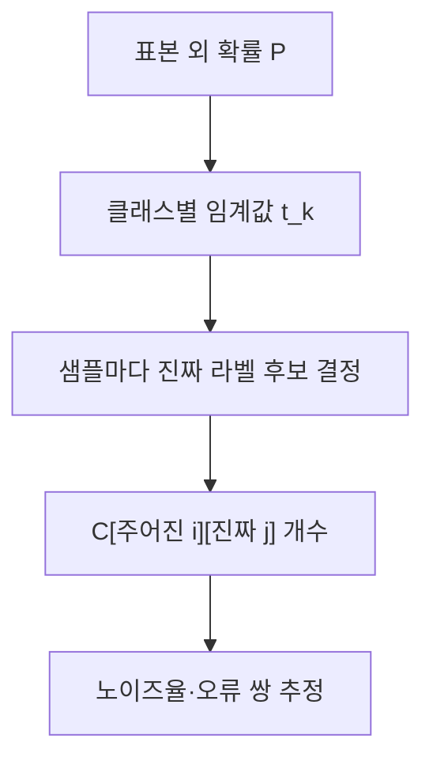
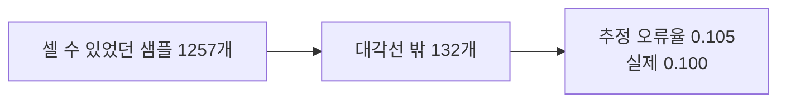

# Confident Joint

> Confident Joint는 "주어진(노이즈 있는) 라벨 i인데 진짜 라벨은 j로 보이는 샘플이 몇 개인가"를 센 K×K 행렬이다. 표본 외 예측 확률을 클래스별 임계값과 비교해 센다. 이 행렬로 라벨 오류율과 어떤 클래스 쌍에서 오류가 많은지 추정한다.

## 쉽게 말하면
답안지마다 학생이 쓴 답(주어진 라벨)과, 안 본 채점 조교가 보기에 확실한 정답(진짜 라벨 후보)을 비교해 "쓴 답 3번인데 조교는 확실히 5번이라고 본 답안지가 몇 장"인지를 표로 센 것이다. 표의 대각선이 아닌 칸이 잘못 쓴 답의 추정 개수다.

## 자세히
- **방법(Confident Learning 논문 초록·직접 구현, 열람)**: 논문은 클래스 조건부 노이즈를 가정하고 주어진 라벨과 진짜 라벨의 결합 분포를 추정하며, 확률 임계값으로 개수를 세는 방식을 쓴다. 이 글의 구현은 다음과 같다. ① [표본 외 확률](#out-of-sample-probabilities) P 구하기 ② 클래스 k의 임계값 t_k = "주어진 라벨이 k인 샘플들의 k에 대한 평균 확률" ③ 샘플마다 확률이 임계값 이상인 클래스 후보 중 확률이 가장 큰 클래스를 "진짜 라벨"로 보고 C[주어진][진짜]를 1 증가. 논문의 표준 구현은 세부(보정·정규화)가 더 있으며 이 글은 단순화한 버전이다.
- **직접 해 본 실험(숫자 손글씨 1,797개, 라벨 약 10%(179개)를 무작위로 변경, 랜덤 포레스트 5겹)**: 임계값을 넘는 클래스가 있어 셀 수 있었던 샘플은 1,257개(약 70%)였다. 그중 대각선 밖 합은 132, 대각선 밖 비율은 132/1,257 ≈ 0.105로 실제 변경 비율 0.100과 가까웠다. 행 "주어진=3"의 추정된 진짜 클래스 개수는 [1, 1, 0, 107, 1, 0, 1, 0, 1, 4], 실제 개수는 [2, 1, 2, 164, 1, 0, 1, 1, 1, 4]로 대각선(107 대 164)은 과소 집계됐다. 센 샘플이 전체의 일부이므로 원 개수는 모자라지만 비율은 맞았다. 그러나 이 근접이 우연일 수 있고(한 번의 실험), 실제 구현은 개수를 행 합에 맞게 보정한다고 알려져 있으나 이 글에서 확인하지 못했다.
- **용도(해석)**: ① 노이즈율 추정 ② 어떤 클래스 쌍에서 라벨 오류가 많은지 파악([혼동 쌍 중심 라벨 가이드](#confusion-pair-guideline)) ③ 라벨 오류 후보 정리 ④ 손실 보정에 쓸 전이 행렬 추정([손실 보정](#loss-correction)).
- **한계**: 클래스 조건부 노이즈 가정이 깨지면(어려운 샘플에 오류 몰림) 추정이 틀린다([특징 의존 노이즈](#feature-dependent-noise)). 모델이 약하면 확률이 부정확해진다.

## 그림으로 보기

## 예시
- 행렬 C의 큰 비대각 칸(예: 주어진 "환불", 진짜 "교환")을 찾아 그 쌍의 샘플을 우선 검수한다.
- 교육 활용: 직접 만든 노이즈 데이터로 C를 구해 실제 오류 개수와 비교한다.

## 헷갈리는 것과 비교
| 개념 | 차이 |
| --- | --- |
| 혼동행렬 | (진짜, 모델 예측) 개수. 진짜 라벨이 있어야 함 |
| Confident Joint | (진짜 추정, 주어진 라벨) 개수. 진짜 라벨 불필요 |
| [표본 외 예측 확률](#out-of-sample-probabilities) | Confident Joint의 입력 |
| [손실 보정](#loss-correction) | 전이 행렬을 학습에 활용 |

## 더 읽을거리
- [Confident Learning (arXiv 1911.00068)](https://arxiv.org/abs/1911.00068) — 결합 분포 추정과 cleanlab
