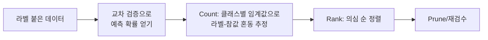
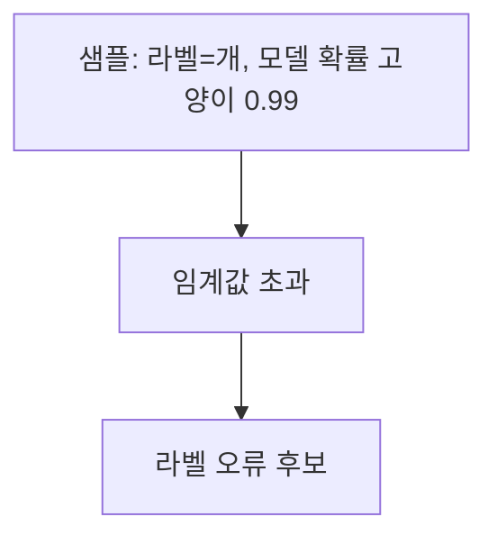

# Confident Learning

> 데이터 라벨의 오류를 찾고 노이즈 정도를 추정하는 프레임워크다. 모델이 각 샘플에 매기는 클래스별 확률을 자신감 임계값과 비교해 "주어진 라벨"과 "아마도 진짜인 라벨"의 관계를 세어(count) 의심 샘플을 골라낸다(prune, rank).

## 쉽게 말하면
채점 조교가 답안지를 훑다가 "이 학생은 평소 고양이 사진을 모두 맞혔는데, 이 사진만 '개'라고 적혀 있고 모델은 99% 고양이라고 한다"를 발견하는 것과 같다. 모델이 매우 자신 있게 다른 답을 말하는 샘플은 라벨이 틀렸을 가능성이 높다.

## 자세히
(arXiv 1911.00068 초록 직접 확인.)
- 제안: Curtis G. Northcutt, Lu Jiang, Isaac L. Chuang. JAIR 2021 게재.
- **세 원칙**: Prune(노이즈 샘플 제거), Count(확률 임계값으로 노이즈량과 라벨 혼동을 추정), Rank(자신도 순으로 정렬해 믿을 만한 샘플을 강조).
- **가정**: 클래스 조건부 라벨 노이즈(노이즈가 샘플이 아니라 클래스 쌍에만 의존). 이를 바탕으로 "주어진 노이즈 라벨 × 알 수 없는 참 라벨"의 결합 분포를 추정하며, 저자들은 이 방법이 증명 가능한 일관성을 가진다고 주장한다.
- **결과(초록)**: CIFAR에서 기존 7개 방법을 앞섰고, MNIST에서 오류 없다고 여겨진 라벨 오류를 찾았으며, Amazon Reviews 감성 분류를 개선했다. ImageNet에서는 클래스 중첩을 추정해 "missile"로 라벨된 약 645장이 사실 "projectile"에 가깝다는 식의 결과를 냈고, 정제로 ResNet 등의 정확도가 소폭 올랐다.
- 특정 데이터 유형·모델에 묶이지 않으며, 구현은 오픈소스 [cleanlab](#cleanlab)로 공개.
- 입력은 **교차 검증으로 얻은 표본 외(out-of-sample) 예측 확률**이어야 한다(안 그러면 모델이 외운 라벨을 믿는다)(제안: 가이드 일반 원칙).

## 그림으로 보기

## 예시
- 상담 문의 분류 라벨 2만 건: 확률 기반으로 의심도 높은 순 200건만 사람이 재검수하면 전수 검수보다 싸다.
- 교육 활용: "AI가 틀린 게 아니라 정답지가 틀렸을 수 있다"는 점을 보여 주는 사례로 좋다.

## 헷갈리는 것과 비교
| 개념 | 차이 |
|---|---|
| Confident Learning | 라벨 오류를 찾고 노이즈 구조를 추정하는 이론·방법 |
| [cleanlab](#cleanlab) | 그 구현 라이브러리 |
| [라벨 오류 탐지](#label-error-detection) | 목적(상위 개념). CL은 그 방법 중 하나 |
| 라벨 스무딩 | 학습 기법. 오류 샘플을 찾지는 않음 |

## 더 읽을거리
- [Confident Learning: Estimating Uncertainty in Dataset Labels (arXiv 1911.00068)](https://arxiv.org/abs/1911.00068) — 원 논문 초록(열어 확인).
