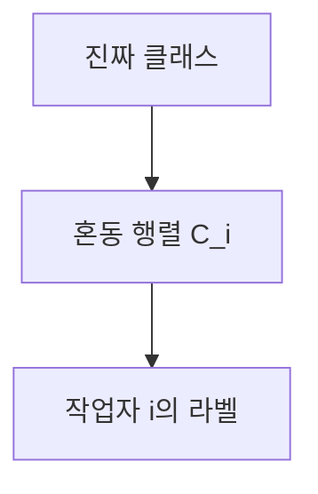
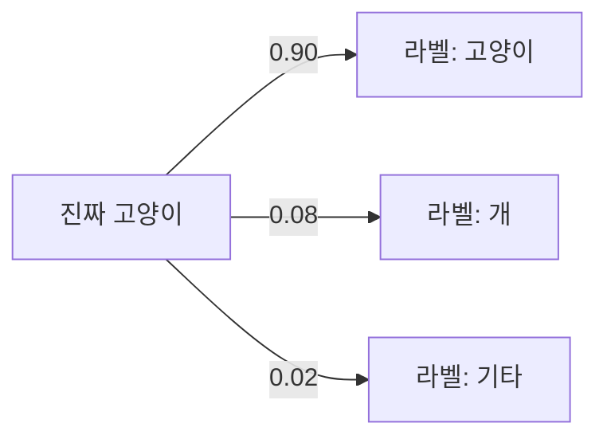

# 라벨러 혼동 행렬

> 라벨러 한 명이 "진짜 클래스 l인 항목을 클래스 c로 라벨할 확률"을 k×k 표로 정리한 것이다. 라벨러의 실수 습관을 숫자로 나타낸다.

## 쉽게 말하면
"이 심사위원은 '보통'을 자주 '나쁨'으로 매긴다" 같은 성격표다. 정확도 하나가 아니라 어떤 오답을 자주 내는지까지 담는다.

## 자세히
(JMLR 17 "Spectral Methods meet EM" 서론과 모델 정의 절을 직접 읽고 확인.)
- **정의**: Dawid & Skene(1979) 가정에 따라 작업자 i가 클래스 l 항목을 클래스 c로 라벨할 확률을 항목과 무관한 상수 μ_ilc로 둔다. 이를 모은 행렬 C_i ∈ R^{k×k}가 혼동 행렬이다. **(l, c)번째 칸 = 진짜 l을 c로 라벨할 확률**.
- **읽는 법**: 대각선은 맞게 라벨할 확률(정확도), 비대각선은 오류 패턴. 각 행의 합은 1.
- **추정**: 진짜 라벨은 모르므로 잠재 변수로 보고 EM으로 진짜 라벨과 혼동 행렬을 함께 추정한다. 이진 문제에서는 민감도·특이도 두 숫자로 줄어든다.
- **쓰임**: 작업자별 신뢰도 점수, 가중 투표, 편향 보정(골드 세트로 추정한 Snow 외 2008의 방식). 이진 단순화 모델도 있다.
- **한계(제안)**: 항목 난이도와 무관하다는 가정이므로 어려운 항목에서만 틀리는 작업자는 잘 모델링되지 않는다. 라벨 수가 적으면 추정이 불안정하다(스무딩 필요).

## 그림으로 보기

## 예시
- 3클래스 감성 라벨에서 작업자 A의 '중립→부정' 칸이 0.35라면 A의 부정 라벨은 중립일 수 있다고 보정.
- 교육 활용: 혼동 행렬 표를 보고 "누가 어떤 실수를 하나" 읽는 연습.

## 헷갈리는 것과 비교
| 개념 | 차이 |
|---|---|
| 라벨러 혼동 행렬 | 라벨러의 오류 습관(진짜→라벨) |
| 모델 혼동 행렬 | 분류기의 예측 오류(진짜→예측) |
| [Dawid-Skene](#dawid-skene) | 이 행렬을 추정하는 모델 |

## 더 읽을거리
- [Spectral Methods Meet EM (JMLR 17, 2016)](https://jmlr2020.csail.mit.edu/papers/volume17/14-511/14-511.pdf) — 정의와 추정.
