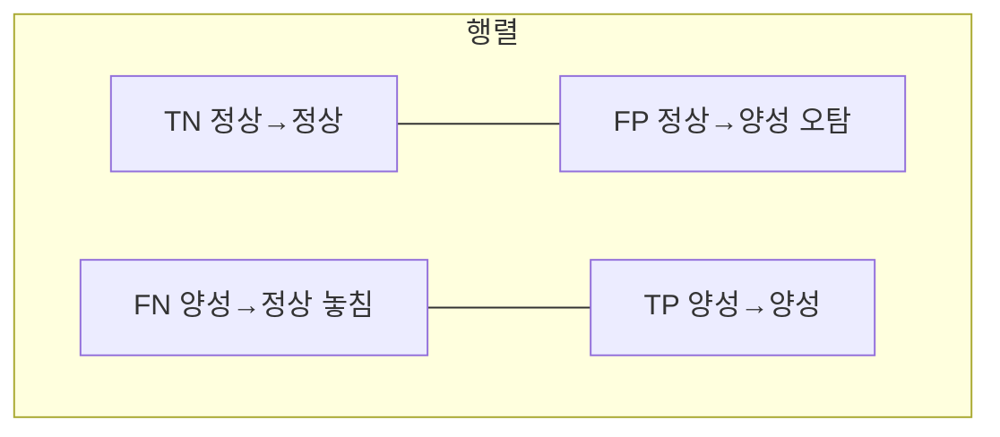
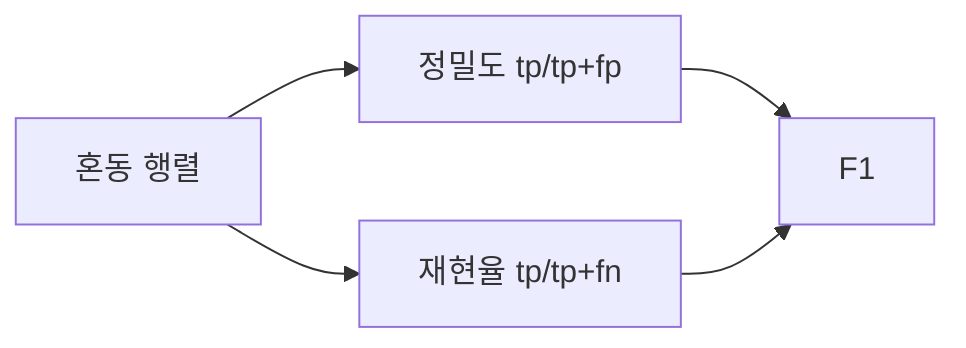

# 혼동 행렬 (Confusion Matrix)

> 혼동 행렬은 분류 결과를 "실제 클래스 × 예측 클래스" 표로 세어, 맞힌 것과 어떻게 틀렸는지(TP·FP·FN·TN)를 한눈에 보여 준다.

## 쉽게 말하면
스팸 필터 성적표다. "스팸을 스팸이라 맞힌 수", "정상 메일을 스팸으로 잘못 막은 수"처럼 틀림의 종류를 칸마다 따로 센다. 정확도 한 숫자로는 안 보이는 실수 유형이 보인다.

## 자세히
scikit-learn 모델 평가 문서 기준:
- `confusion_matrix(y_true, y_pred)`는 **행이 실제, 열이 예측**이다. `[i, j]`는 실제 i를 j로 예측한 개수.
- 이진 분류는 `.ravel()`이 **tn, fp, fn, tp** 순으로 돌려준다.
- **정밀도(precision)** = tp/(tp+fp): 양성이라 예측한 것 중 진짜 양성 비율. **재현율(recall)** = tp/(tp+fn): 진짜 양성 중 찾아낸 비율. 둘을 합친 지표가 [F1](#f1-score).
- 문서 경고: 정확도는 다수 클래스만 찍어도 높게 나온다. 소수 클래스의 recall·F1이나 balanced accuracy를 함께 봐야 한다. `classification_report`는 클래스별 정밀도·재현율·F1·support를 보여 준다.
- 어떤 오류가 더 비싼지가 기준이다. 질병 검사는 FN(놓침), 스팸 차단은 FP(오차단)이 더 치명적일 수 있다(일반적 판단 예).

## 그림으로 보기



## 예시
```python
from sklearn.metrics import confusion_matrix
y_true = [0,0,0,1,1,1,1,1]
y_pred = [0,1,0,1,0,1,0,1]
tn, fp, fn, tp = confusion_matrix(y_true, y_pred).ravel()
print(tn, fp, fn, tp)  # 2 1 2 3
```
고객 문의 자동 분류기의 "환불 요청" 클래스에서 놓침(FN)이 많은지 오탐(FP)이 많은지 본다.

## 헷갈리는 것과 비교
| 개념 | 차이 |
|---|---|
| 정확도 | 전체 중 맞힌 비율, 불균형에 취약 |
| 정밀도 | 예측 양성의 순도 |
| 재현율 | 실제 양성의 회수율 |
| [F1](#f1-score) | 정밀도·재현율의 조화평균 |

## 더 읽을거리
- [sklearn Model evaluation](https://scikit-learn.org/stable/modules/model_evaluation.html) — 혼동 행렬, 정밀도·재현율, 불균형 주의.
