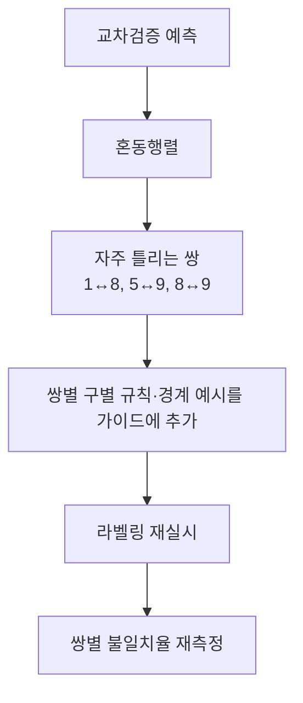
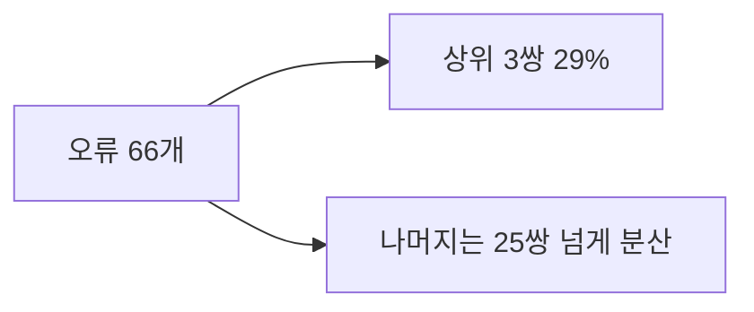

# 혼동 쌍 중심 라벨 가이드

> 혼동 쌍 중심 라벨 가이드는 모델이나 라벨러가 자주 헷갈리는 클래스 쌍을 찾아, 그 쌍을 구별하는 기준과 경계 사례를 라벨링 지침에 구체적으로 적는 방법이다. 오라벨이 몰리는 곳에 지침을 집중해 노이즈를 줄인다.

## 쉽게 말하면
채점 기준표에 모든 항목을 똑같이 길게 적는 대신, 채점자들이 가장 자주 엇갈리는 두세 항목에 "이런 답은 만점, 이런 답은 감점"이라는 예시를 붙이는 것이다. 헷갈리는 곳에 설명을 쏟으면 채점 일관성이 가장 많이 올라간다.

## 자세히
- **혼동 쌍 찾기(직접 해 본 실험)**: 숫자 손글씨 1,797개로 5겹 교차검증 예측을 만들고 혼동행렬에서 틀린 쌍을 센 뒤 (i→j)와 (j→i)를 합쳤다. 전체 오류 66개(정확도 0.963) 중 가장 많이 혼동된 쌍은 1↔8 7건, 5↔9 7건, 8↔9 5건, 3↔9 4건, 1↔2 3건, 1↔4 3건이었다. 상위 3쌍이 전체 오류의 29%였고 오류가 난 쌍은 45쌍 중 28쌍이었다. 이 데이터에서는 오류가 꽤 넓게 퍼져 있어 몇 쌍에 집중해도 효과는 제한적이다. 쌍 집중 전략은 오류가 소수 쌍에 크게 몰릴 때 효과가 더 크다는 점이 한계다.
- **모델 혼동과 라벨러 혼동은 다르다(해석)**: 혼동행렬은 "모델이 틀린 것"이고, 이것이 라벨 오류 때문인지 모델 한계 때문인지는 따로 확인해야 한다. 라벨러 간 불일치가 큰 쌍을 별도로 측정한다(라벨러 두 명이 같은 샘플을 라벨링해 쌍별 불일치를 센다).
- **가이드에 넣을 것(해석)**: ① 두 클래스를 가르는 결정 규칙(예: "A에는 ○○가 있으면 B가 아니다") ② 경계 사례 이미지·문장 3~5개와 정답 ③ 둘 다 아닌 경우의 처리 ④ 헷갈리면 "불확실"로 표시하는 선택지. 가이드를 고친 뒤 같은 쌍의 불일치율이 줄었는지 다시 잰다.
- **노이즈 모델과의 연결**: 혼동이 특정 쌍에 몰린다는 것은 [클래스 조건부 노이즈](#class-conditional-noise)의 패턴이다. 가이드 개선은 그 노이즈를 원천에서 줄이는 방법이다. 어려운 사례 오류는 [특징 의존 노이즈](#feature-dependent-noise)와 겹친다.

## 그림으로 보기

## 예시
- 고객 문의 분류에서 "환불 요청"과 "교환 요청"이 가장 많이 혼동되면 두 범주의 구별 규칙과 예시 문장 5개를 가이드에 넣고, 불일치율이 내려갔는지 재측정한다.
- 교육 활용: 혼동행렬에서 쌍별 오류를 세어 보고 "어디에 설명을 더 쓸까"를 학습자가 정한다.

## 헷갈리는 것과 비교
| 개념 | 차이 |
| --- | --- |
| 혼동 쌍 가이드 | 헷갈리는 쌍에 지침 집중 |
| [클래스 조건부 노이즈](#class-conditional-noise) | 클래스별 오류 패턴이라는 노이즈 모델 |
| [대칭 노이즈](#symmetric-label-noise) | 균등한 오류 가정 |
| [특징 의존 노이즈](#feature-dependent-noise) | 어려운 샘플에 오류 몰림 |

## 더 읽을거리
- [scikit-learn: Confusion matrix](https://scikit-learn.org/stable/modules/model_evaluation.html#confusion-matrix) — 혼동행렬 읽는 법
