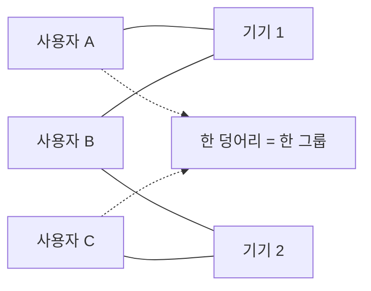
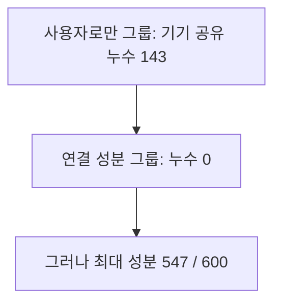

# 연결 성분 그룹핑

> 사용자와 기기처럼 두 가지 기준으로 샘플이 서로 얽혀 있을 때, 한 기준으로만 그룹을 만들면 다른 기준을 통해 학습과 시험이 연결된다. 두 기준 중 하나라도 공유하는 샘플을 그래프로 이어 연결 성분(서로 이어진 덩어리)을 구하고 그 덩어리를 그룹으로 쓰면 누수가 사라진다.

## 쉽게 말하면
친구 관계 지도에서 "친구의 친구의 친구"까지 따라가면 한 무리가 된다. 같은 기기를 쓴 사람들끼리, 같은 사람의 여러 기기끼리 선으로 이으면 서로 이어진 무리가 생긴다. 시험 조를 짤 때 한 무리는 통째로 한쪽에 넣어야 무리 안 정보가 새지 않는다.

## 자세히
- **방법(해석)**: ① 샘플을 노드로 ② 같은 사용자거나 같은 기기인 샘플끼리 간선 연결 ③ 연결 성분(`scipy.sparse.csgraph.connected_components`나 union-find)을 구해 성분 번호를 그룹으로 사용 ④ `GroupKFold`에 이 그룹을 넘긴다.
- **직접 해 본 실험(합성 데이터: 샘플 600개, 사용자 119명, 기기 66개, 기기는 대체로 사용자 2명이 공유하고 약 15%는 무작위 연결)**: 샘플을 사용자로만 묶어 `GroupKFold(5)`를 하면 학습과 시험이 같은 기기를 공유하는 경우가 폴드 합계 143번 나왔다. 사용자와 기기 모두로 연결 성분을 구해 그룹으로 쓰면 이 공유가 0이었다. 누수를 구조적으로 제거한 것이다.
- **함정(같은 실험)**: 연결 성분이 7개뿐이고 가장 큰 성분이 600개 중 547개였다. 소수의 샘플이 여러 덩어리를 이어 붙이면 거대 성분 하나가 데이터 대부분을 차지해 폴드 분할이 사실상 불가능해진다. 이때는 이어 주는 소수 샘플을 제거·격리해야 한다([다리 샘플 처리](#bridge-sample-handling)).
- **확인(해석)**: 분할 후 두 축 모두에서 학습-시험 교집합이 0인지 [분할 단위 테스트](#split-assertion-test)로 점검한다.

## 그림으로 보기



## 예시
```python
from scipy.sparse.csgraph import connected_components
n_comp, comp = connected_components(adj, directed=False)
GroupKFold(5).split(X, y, groups=comp)
```
교육 활용: 사용자·기기 표를 직접 그려 보고 어떤 샘플이 두 무리를 이어 주는지 찾아본다.

## 헷갈리는 것과 비교
| 개념 | 차이 |
| --- | --- |
| 한 축 그룹 | 다른 축으로 샘플이 연결됨 |
| 연결 성분 그룹 | 모든 축의 연결을 따라 묶음 |
| [다리 샘플 처리](#bridge-sample-handling) | 거대 성분을 쪼개는 방법 |
| [엔티티 해소](#entity-resolution) | 같은 개체인지 판별하는 단계 |

## 더 읽을거리
- [SciPy: connected_components](https://docs.scipy.org/doc/scipy/reference/generated/scipy.sparse.csgraph.connected_components.html) — 연결 성분 계산 함수
