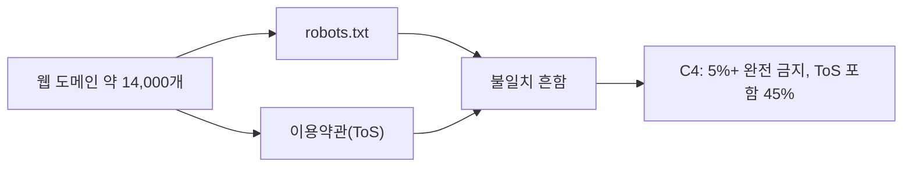
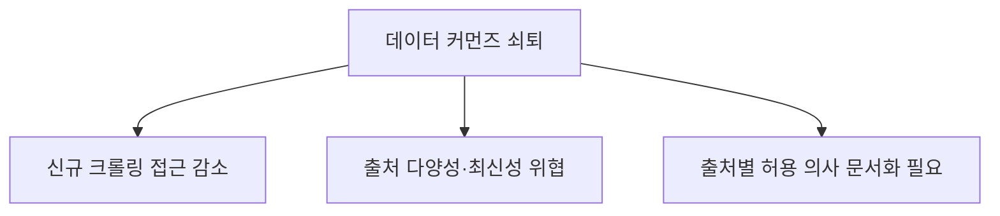

# Consent in Crisis

> 2024년 Longpre 등이 AI 학습 말뭉치를 구성하는 웹 도메인 약 1만 4천 개의 크롤링 허용 의사(robots.txt·이용약관)를 감사해, 웹 사이트들이 AI 학습용 수집에 빠르게 동의를 철회하고 있음을 보인 논문이다. 제목의 "AI 데이터 커먼즈의 급격한 쇠퇴"가 핵심 주장이다.

## 쉽게 말하면
도서관이 책을 빌려 주던 옛날에는 누구나 읽을 수 있었는데, 출판사들이 갑자기 "AI는 읽지 마세요"라는 안내문을 붙이기 시작했다. 이미 모아 둔 장서(C4 같은 말뭉치)에도 그 안내문이 붙은 책이 얼마나 되는지 센 연구다.

## 자세히
(arXiv 2407.14933 초록을 직접 열어 확인. 원문은 열람하지 않았다.)
- **범위**: AI 학습 말뭉치의 바탕이 되는 **약 14,000개 웹 도메인**의 크롤링 허용 의사를 조사했다.
- **C4 결과(초록)**: C4 토큰의 **약 5% 이상**이 완전히 수집 금지 상태가 되었고, 가장 활발하게 유지되는 핵심 C4 출처로 좁히면 **약 28% 이상**이다. 이용약관(ToS)에 명시된 크롤링 제한까지 포함하면 C4의 **약 45%** 가 해당한다.
- **불일치(초록)**: 사이트가 이용약관에서 말하는 내용과 robots.txt에 적은 내용이 서로 다른 경우가 흔하다.
- RefinedWeb·Dolma 같은 말뭉치도 논문에서 다루지만 이번에 확인한 초록에는 비율이 없다.
- **의미(제안)**: ① robots.txt는 신호일 뿐 법적 구속력이 약하고 사이트마다 이용약관과 다르게 표현한다 ② 이미 수집된 데이터는 소급 삭제되지 않지만, 앞으로의 데이터 접근성은 줄어 데이터 출처 다양성과 최신성에 영향 ③ 기업이 학습 데이터 출처를 정리할 때 출처별 허용 의사를 기록해야 한다([데이터 출처·라이선스](#data-licensing-provenance), [CCBot과 옵트아웃](#ccbot-opt-out)).
- **한계(제안)**: 초록 수준의 수치이며 구체 방법·도메인 선정 방식은 원문 확인이 필요하다. 허용 의사 표시와 실제 수집·법적 효력은 별개다.

## 그림으로 보기

## 예시
- 자사가 학습에 쓰려는 웹 문서 목록에서 도메인별로 robots.txt의 AI 관련 규칙과 이용약관의 크롤링 조항을 표로 정리하고, 충돌하는 도메인은 제외하거나 별도 허락을 구한다(제안).
- 교육 활용: AI 데이터 거버넌스 수업의 최신 사례. "공개된 웹 데이터 = 자유롭게 써도 되는 데이터"가 아니라는 점.

## 헷갈리는 것과 비교
| 개념 | 차이 |
|---|---|
| robots.txt | 크롤러에게 접근 허용 여부를 알리는 기술적 신호 |
| 이용약관(ToS) | 이용 조건을 명시한 계약 문서 |
| [CCBot과 옵트아웃](#ccbot-opt-out) | 특정 크롤러를 막는 구체 방법 |
| [ODC-By 라이선스](#odc-by-license) | 데이터베이스 재사용 조건(콘텐츠 권리와 별개) |

## 더 읽을거리
- [Consent in Crisis: The Rapid Decline of the AI Data Commons (arXiv 2407.14933)](https://arxiv.org/abs/2407.14933) — 14,000 도메인 감사 요약(초록 확인).
