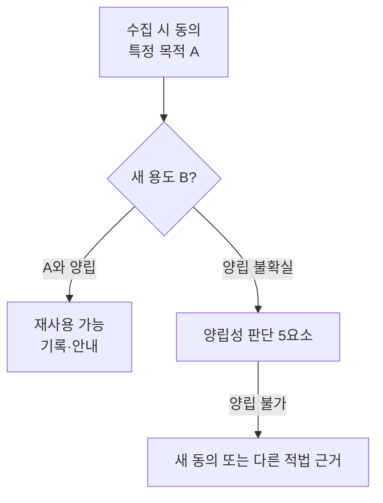
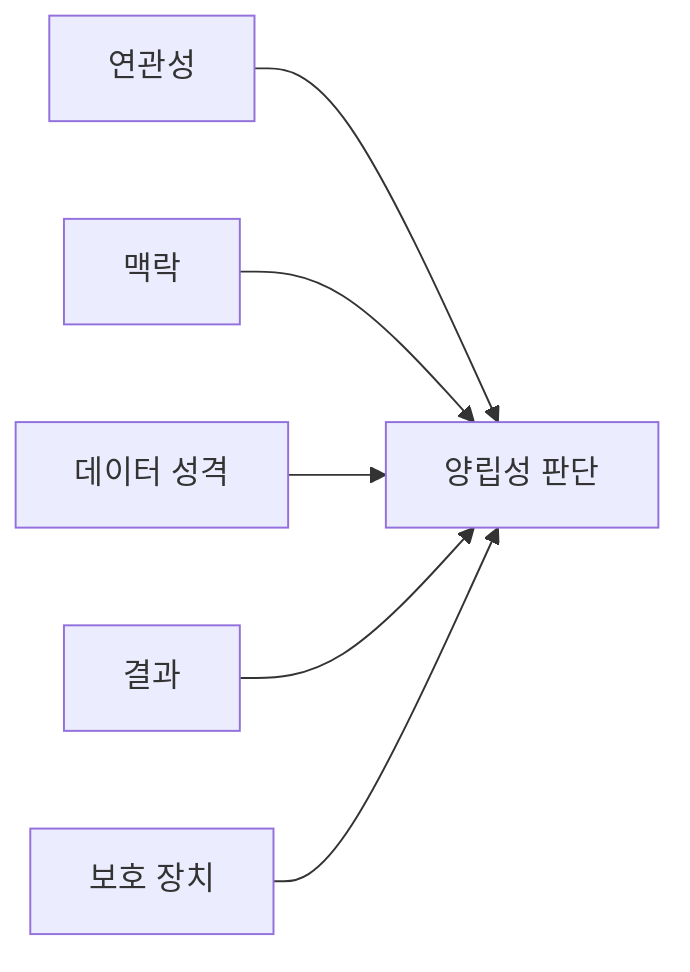

# 동의 범위와 용도 제한

> 개인정보를 수집할 때 받은 **동의는 "특정한 목적"에 대한 것**이어서, 그 범위를 넘는 새 용도로 데이터를 쓰려면 다시 동의를 받거나 다른 적법 근거·양립성 판단이 있어야 한다. 이것이 목적 제한(purpose limitation) 원칙이다.

## 쉽게 말하면
"배송 안내 문자를 보내도 됩니다"에 동의한 고객에게 광고 문자를 보내면 약속 위반이다. 동의서에 적힌 용도 안에서만 데이터를 쓰겠다는 약속이 목적 제한이고, 새 용도가 생기면 "이건 처음 약속과 같은 종류인가?"를 따져야 한다.

## 자세히
(GDPR 제6조 해설문과 영국 ICO의 목적 제한 가이드를 직접 읽었다. ICO는 영국 GDPR 기준이라 EU GDPR과 세부 조문이 다를 수 있고, 어느 것도 법률 자문이 아니다.)
- **동의의 범위(GDPR 6조 1항 a호)**: 처리는 "정보주체가 **하나 이상의 특정한 목적**을 위해 자신의 개인정보 처리에 동의한 경우" 적법하다. 즉 동의는 목적에 묶인다.
- **목적 명시(ICO)**: 수집 시점부터 무엇을 위해 모으고 무엇을 할지 분명히 하고(명시적·정당한 목적), 처리 기록과 개인정보 안내문에 목적을 적는다. 목적이 바뀌면 안내문을 갱신하고 데이터를 다시 쓰기 전에 사람들에게 알린다. 정해진 서식은 없고 문서화·투명성 의무를 지키면 대체로 충족된다. 처리 문서·안내문을 정기적으로 검토해 목적 이탈(function creep)을 잡는다.
- **새 용도가 양립 가능한 경우(ICO)**: 새 목적이 원래 목적과 **양립 가능**해야 재사용할 수 있다. **동의로 수집한 데이터**는 규칙이 더 엄격해, 새 동의를 받거나, 데이터 보호 원칙 준수를 입증하거나, 별첨 2의 목적(공공 안전, 범죄 수사, 생명 보호, 세금, 법적 의무 등)에 해당하고 새 동의를 받기 합리적이지 않은 경우 등에 양립 가능으로 본다. 다른 적법 근거로 수집한 데이터는 연구·통계 등 추가 경로나 **양립성 판단**으로도 가능하다.
- **양립성 판단 요소(GDPR 6조 4항, ICO)**: ① 원래 목적과 새 목적의 **연관성** ② 수집 **맥락**(정보주체와 처리자의 관계, 합리적 기대) ③ 데이터의 **성격**(특수 범주·형사 데이터 여부) ④ 정보주체에 미칠 **결과** ⑤ **보호 장치**(암호화·가명처리 등). 목록은 완결적이 아니다. 새 목적이 원래와 매우 다르거나 예상치 못하거나 부당한 영향을 주면 양립 불가 가능성이 높고, 그때는 구체적 동의가 필요할 가능성이 크다.
- **새 동의가 필요한 때(ICO)**: 동의로 수집했다면 새 동의를 받거나 다른 적법 근거를 찾아야 한다. 특수 범주 데이터 재사용은 제9조 조건, 형사 범죄 데이터는 제10조 조건이 필요하다. ICO의 예: 의사가 환자 명단을 여행사를 운영하는 배우자에게 넘겨 요양 휴가 상품을 홍보하게 하는 것은 원래 목적과 양립 불가로 본다.
- **AI·데이터 활용에서(해석)**: 고객 문의 데이터를 서비스 개선용으로 수집했다가 모델 학습에 쓰려 할 때 이 목적이 원래와 양립하는지를 위 요소로 점검한다. 구체 결론은 사실관계·관할에 따라 달라지므로 이 글은 판단 틀만 제시한다. EDPB의 최신 지침은 검색에서 확인하지 못했다.

## 그림으로 보기

## 예시
- 배송 안내 동의로 받은 전화번호를 마케팅 문자에 쓰려 할 때: 새 동의가 필요할 가능성이 크다(양립성 판단상 연관성·기대 낮음).
- 교육 소재: "이 데이터를 처음 모을 때 어떤 약속을 했나?"를 체크리스트로 만들기.

## 헷갈리는 것과 비교
| 개념 | 차이 |
|---|---|
| 동의 범위 | 동의가 허용한 특정 목적 |
| 목적 제한 | 명시한 목적 밖의 비양립 사용 금지 원칙 |
| 양립성 판단 | 새 용도가 원래와 양립하는지 따지는 절차 |
| [허용 용도 정책](#allowed-use-policy-data) | 조직이 데이터별 허용 용도를 정리한 내부 정책 |

## 더 읽을거리
- [GDPR Article 6 (gdpr-info.eu)](https://gdpr-info.eu/art-6-gdpr/) — 동의·6조 4항 양립성 요소(직접 읽음).
- [Purpose limitation (ICO)](https://ico.org.uk/for-organisations/guide-to-data-protection/guide-to-the-general-data-protection-regulation-gdpr/principles/purpose-limitation/) — 영국 GDPR 목적 제한 가이드(직접 읽음).
