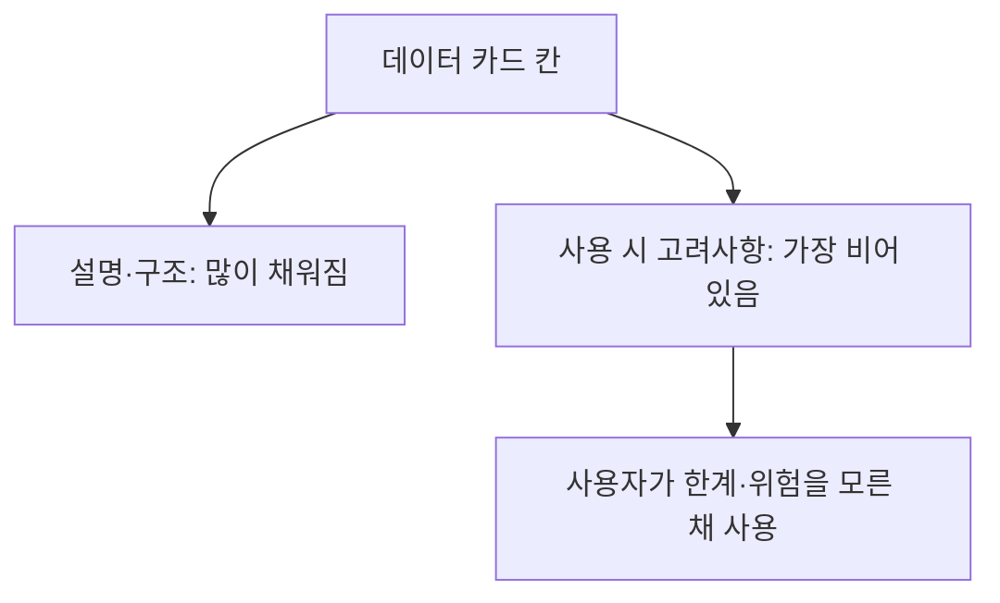
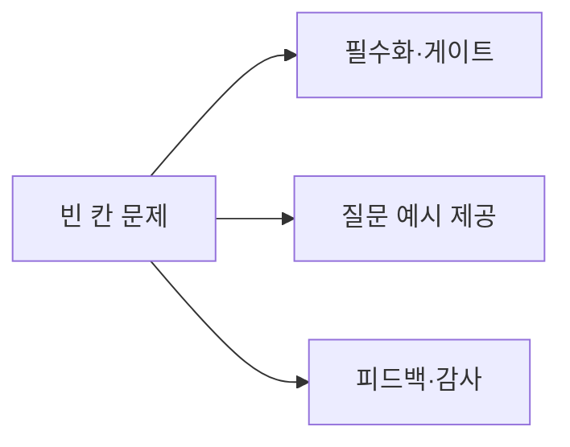

# 사용 시 고려사항 칸이 비는 문제

> 데이터 카드에서 **"이 데이터를 쓸 때 주의할 점(사회적 영향·한계·편향)"을 적는 칸이 가장 적게 채워지는** 현상이다. 정작 사용자가 가장 알아야 할 정보가 가장 비어 있다.

## 쉽게 말하면
식품 포장에서 제품 이름과 용량은 다 적혀 있는데 "알레르기 주의, 어린이 섭취 주의" 칸만 비어 있는 것과 같다. 쓰기 쉬운 칸(설명·구조)은 채우고, 쓰기 어렵고 책임이 따르는 칸(주의·한계)은 건너뛰기 쉽다.

## 자세히
(arXiv 2401.13822의 초록과 Google Data Cards Playbook 페이지를 직접 읽었다. 초록에는 섹션별 완성 비율 수치가 없어 숫자는 적지 않는다.)
- **연구 결과(Yang·Liang·Zou, arXiv 2401.13822 초록)**: Hugging Face의 데이터셋 카드 **7,433건 전수**를 분석했다. 카드 작성의 완성도는 폭넓게 다르며 **데이터셋 인기와 함께 움직인다**. 실무자는 **Dataset Description과 Dataset Structure** 칸을 가장 많이 채우고, **"Considerations for Using the Data" 칸에는 내용이 가장 적다.**
- **그 칸에 쓰이는 내용(초록)**: 하위 항목을 토픽 모델링하니 **기술적·사회적 영향과 한계**가 드러났다. 사용(usage) 섹션은 접근성과 재현성이 더 필요하다고 한다. 사람 평가에서는 **내용이 포괄적일수록** 카드의 전체 품질을 높게 본다. 저자들은 ML 연구가 더 철저한 데이터셋 문서화를 필요로 한다고 주장하며 초록에는 구체 권고가 없다.
- **왜 비나(해석, 연구의 결론이 아님)**: 한계·위험을 쓰려면 데이터를 깊이 알아야 하고, 책임 부담이 커 보이며, 칸이 있어도 누가 확인하지 않으면 건너뛰기 쉽다. 인기와의 상관은 인과를 뜻하지 않는다.
- **Google Data Cards Playbook(직접 읽음)**: 데이터 카드는 ML 데이터셋의 핵심 사실을 구조화한 요약이며 템플릿은 **15개 주제**(작성자·민감성·동기·출처·주석·유지보수 등)를 다룬다. 툴킷은 **Ask**(이해관계자와 템플릿 공동 설계), **Inspect**(실제 데이터셋으로 템플릿 시험), **Answer**(40개 이상의 실제 카드에서 나온 작성 지침), **Audit**(공개 전 완성된 카드를 평가하고 조직 전체 투명성을 추적) 네 모듈이다. 카드에는 소유자·기여자·관리자 역할이 있는 작성자, 유지보수 상태(정기 갱신·적극 유지·제한적 유지·폐기), 버전·갱신 계획, 피드백 절차 칸이 있다. 페이지는 이것이 2022년의 탐색적 사례이며 현재의 관행은 다를 수 있다고 밝힌다.
- **메우는 방법(제안, 위 자료에서 직접 나온 처방은 아님)**: ① 필수 칸으로 지정하고 비면 공개·사용 신청을 막는다 ② 칸 안에 질문 예시(어떤 집단에서 성능이 낮을 수 있나?)를 넣는다 ③ 소비자 피드백으로 보완한다 ④ 정기 감사로 형식적 작성을 점검한다.

## 그림으로 보기

## 예시
- 사내 고객 리뷰 데이터셋 카드의 "고려사항" 칸에 "한국어 리뷰 위주, 특정 연령대 과소 대표, 반어법 판정 어려움" 같은 한계를 적도록 질문형 가이드를 둔다(예시).
- 교육 소재: 빈 칸 찾기 게임 — 카드의 어느 칸이 비어 있으면 어떤 위험이 생길까?

## 헷갈리는 것과 비교
| 개념 | 차이 |
|---|---|
| 고려사항 칸 공백 | 한계·영향을 적는 칸이 비는 문제 |
| [데이터 카드 도입 규칙](#internal-data-card-adoption) | 카드를 사내에 정착시키는 운영 규칙 |
| [Datasheets for Datasets](#datasheets-for-datasets) | 데이터셋 문서화 제안(또 다른 형식) |
| [카드 분기 샘플 감사](#card-quarterly-audit) | 형식적 작성을 정기 점검 |

## 더 읽을거리
- [Dataset cards on Hugging Face study (arXiv 2401.13822)](https://arxiv.org/abs/2401.13822) — 7,433건 분석(초록 직접 읽음).
- [Data Cards Playbook (Google)](https://sites.research.google/datacardsplaybook/) — 15개 주제와 4개 모듈(직접 읽음).
